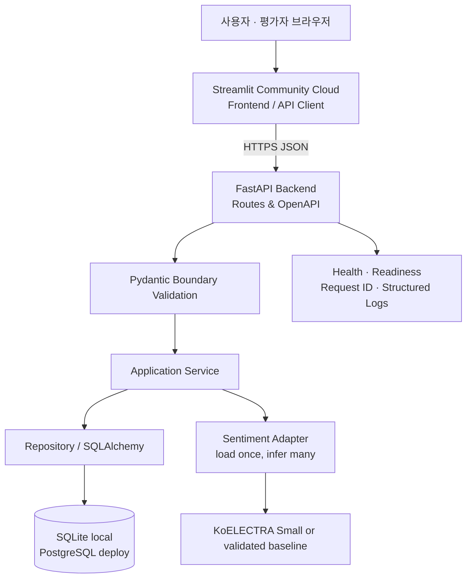
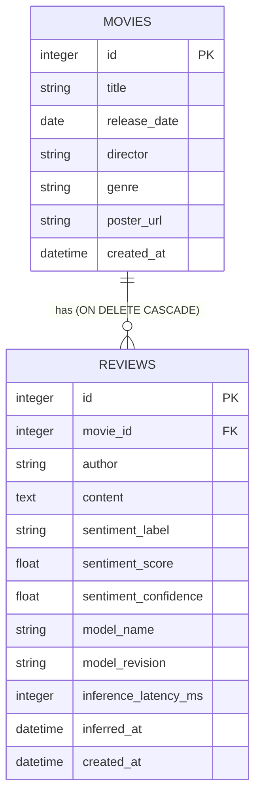
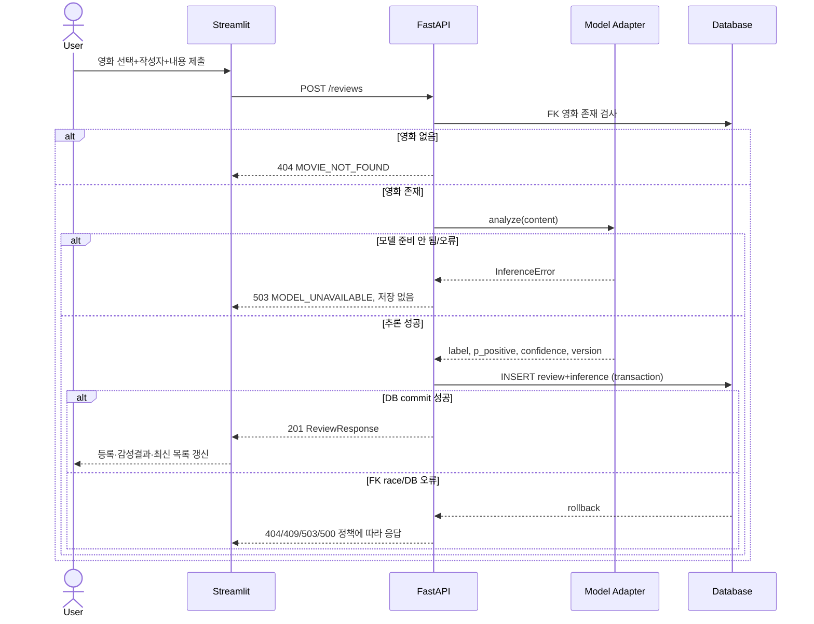
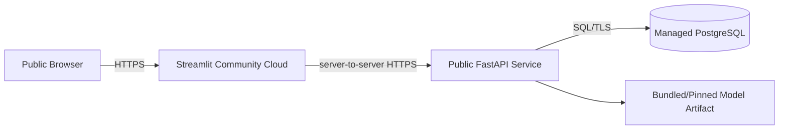
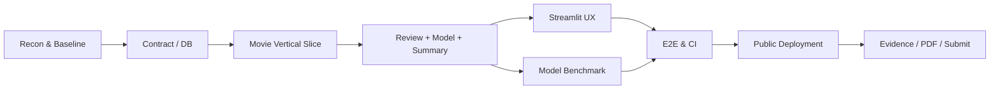

# MISSION 18 — 상세설계 및 구현개발 실행계획서
> **Movie Review Sentiment Intelligence | Design & Delivery Baseline v1.11 — Neon Free Live PostgreSQL Schema Baseline Verified**

| 항목 | 내용 |
|---|---|
| 작성 기준일 | 2026-10-12 (Asia/Seoul) |
| 문서 상태 | **G0–G5 LOCAL PASS; G6 local PASS, remote hosted Actions billing BLOCKED; G7 local predeploy PASS, public HTTPS hosting NOT STARTED**. 2026-10-12 free-first-quality skill reviewed read-only; manual-only workflow_dispatch preserves both hosted jobs, local quality change/release profiles retain contracts, pytest 88 tests, actual G2/G3/G6/G7 full local integration. G4/G5 existing evidence verified, not re-executed; G8 pending |
| 대상 미션 | Codeit AI Engineering Sprint Mission 18 |
| 지정 프로젝트 루트 | `/Volumes/SSD 4T/z_ai_asset/M18_fastapi_review` |
| 제출 경로 | `미션18/{팀명}_{이름}/` (실제 값 미제공: 제출 패키징 시 확정) |
| 공식 프론트엔드 / 백엔드 | Streamlit / FastAPI |
| 목표 | 채점 적합성, 포트폴리오 설득력, 실제 재현성, 장기 재사용 가능한 리뷰/VOC AI 자산 |
| 본 문서의 범위 | **상세설계 및 진행현황 기준본**. G6 승인된 로컬 보안설계(읽기 전용/서버 간 토큰/루프백), FastAPI 오류 및 요청 크기 보호, 공개 Streamlit 쓰기 차단, clean-room 의존성 재설치·회귀검증 기록. GitHub Actions 초기 실행이 GitHub billing으로 시작 전 차단. G7 프론트/DB 재현은 로컬 PASS, 공개 HTTPS 서비스와 G8 PDF 미완료 |
| 기준 우선순위 | ① 사용자 제공 미션 원문 ② 사용자 제공 사전 문서 3종 ③ 명시적으로 검증한 공식 외부 자료 ④ 이 문서에서 새로 제안한 설계 |
| 기술 리스크 | 지정 루트 FULL_HOST 접근 확인. 로컬 Git 및 Python 3.12.14 격리. Movie/Review API와 실제 고정 KoELECTRA 모델의 로컬 E2E 검증 완료. NSMC 공개 test에서 2,000건 실측 완료. 단, 외부 사전학습 모델의 데이터 분리/누출은 독립 검증하지 못했고 교정/OOD 일반화 보장은 없음. 공개 클라우드와 PDF 미완료 |
| GitHub 현황 | M18 private GitHub `exobiz7/mission18-movie-review-intelligence` 생성 후 `origin/main` SHA 7b399445 정상 푸시. Actions run 38114719687은 계정 결제/한도 오류로 runner 시작 전 실패(테스트 0건) |
| 사용자 승인이 필요한 사실 | 제출용 정확한 `{팀명}_{이름}`, 실제 배포 서비스/계정·지출 승인, 기존 로컬 저장소와의 충돌 여부 |

---

## 0. Executive Decision — 평가·포트폴리오·재사용성의 균형

**핵심 결정:** 공식 미션의 Streamlit + FastAPI 구성을 그대로 준수하고, 제출 캡처에 필요한 심화 기능은 모두 구현 범위로 승격한다. 내부는 **Contract First → Service/Repository 분리 → 모델 Adapter → 영속 DB → 실제 HTTP/E2E 검증** 구조로 만든다. 과제에 불필요한 인증 서버·마이크로서비스·Kubernetes는 도입하지 않는다.

### 0.1 우선순위 원칙

1. **P0 — 채점 불합격 위험 제거:** 영화 CRUD, 리뷰 CRUD, 감성분석, 영화별 집계, Streamlit 배포, `frontend`/`backend` 폴더 구분, PDF/스크린샷, 영화 3개×리뷰 10개.
2. **P1 — 높은 평가를 받는 차별점:** OpenAPI 설명과 오류 명세, 데이터 무결성, 모델 비교와 경량화 측정, 실제 E2E 증거, 안정적인 UX, README 복제 실행.
3. **P2 — 실무 자산화:** 모델 버전 이력, 지속적 테스트/CI, Docker/마이그레이션, 배포 운영문서, 템플릿, 장애 및 비용 관리.
4. **이번 범위 밖:** 자체 회원가입, 결제, API Gateway, 작업 큐, MSA, GPU 클러스터, 실시간 스트리밍, 다중 조직 관리. 향후 확장 경로만 기록한다.

### 0.2 '높은 점수'는 약속이 아닌 검증 가능한 산출물로 확보

공식 채점의 상세 배점표는 제공되지 않았다. 따라서 임의의 점수/가산점을 확정 사실로 쓰지 않는다. 본 문서의 품질 목표는 **내부 합격 기준**이다.

| 관점 | 제출 가능한 증거 | 내부 목표 |
|---|---|---|
| 요구사항 적합 | Requirement Traceability Matrix(RTM) | 명시적 제출요건 100% 매핑 |
| 기능 안정성 | API/DB/AI/Streamlit 통합 테스트 | P0 핵심 시나리오 전부 PASS |
| AI 실무성 | 모델 조사표, 성능 실험, 모델 버전 | 최소 3개 후보 비교, 1개 실제 서비스 |
| 배포 | 공개 Frontend/Backend/DB 흐름 | 외부 HTTPS E2E 재현 |
| 전달 완성도 | PDF+ERD+OpenAPI 전체 캡처+시연 캡처 | 표기된 증거의 존재와 내용 상호일치 |
| 정보자산 | README, ADR, RUNBOOK, 테스트/시드 | 다른 텍스트 리뷰 서비스에 재사용 가능 |

### 0.3 근거 구분 규칙

- `[MISSION]`: 이 요청의 미션 원문.
- `[STRATEGY]`: `MISSION18_STRATEGY_AND_HANDOFF_PLAN_20261006.md`.
- `[PREMISSION]`: `MISSION18_PREMISSION_HANDOFF_GUIDE_20261006.md`.
- `[PRACTICAL]`: `MISSION18_PRODUCTION_PRACTICAL_GUIDE_20261006.md`.
- `[EXTERNAL]`: 문서 말미의 공식 문서/모델 카드 등 외부 확인.
- `[DESIGN]`: 본 설계서의 신규 제안. **구현/검증 완료가 아님**.

사전 문서의 예전 경로 `/Users/macbook/Developer/M18_FAST_API`는 **사전 실습 자료의 출처**이며, 본 미션의 신규 지정 경로 `/Volumes/SSD 4T/z_ai_asset/M18_fastapi_review`를 덮어쓰지 않는다.

---

## 1. 현황 및 사전 실습으로부터 계승할 원칙

### 1.1 실측 완료 / 미확인 구분 (2026-10-09)

| 항목 | 현 시점 | 작업 지침 |
|---|---|---|
| 첨부된 3개 MD | **READ** | 요구사항 및 사전 학습 기반 확보 |
| ChatAgent Personal 연결 | **CONNECTED / FULL_HOST VERIFIED** | 실제 읽기·호스트 명령 실행 성공; 필요한 범위만 사용 |
| Mac 지정 M18 폴더 파일 트리 | **VERIFIED / BOOTSTRAPPED** | 최초에는 가이드 3종+이전 실사 메모만 존재; 현재 scaffold, .venv, 로컬 Git, docs/RECONNAISSANCE.md 생성 |
| 사전 실습 원본 노트북·소스 | **NOT PRESENT IN TARGET** | 원본 실습 경로 `/Users/macbook/Developer/M18_FAST_API` 없음; 필요시 별도 검색/이식 전 확인 |
| 연결 GitHub 사용자 | **VERIFIED: `exobiz7`** | 기존 코드 변경 또는 신규 repo 생성 전 정확한 대상 확인 |
| M18 전용 GitHub 저장소 | **NOT FOUND IN CONNECTED SEARCH** | 저장소 존재/원격 URL을 추측하지 않음 |
| FastAPI/Streamlit/모델 실행 결과 | **NOT TESTED** | 계획만 작성 중이므로 PASS라고 표기 금지 |
| 배포 서비스 | **NOT CONFIGURED** | 외부 계정/비용/공개범위 확인 후 진행 |

### 1.2 사전 실습에서 반드시 재사용할 기술 패턴

1. **Path/Query/Body**: `{id}` 자원 식별은 Path, 검색·목록 옵션은 Query, 신규 데이터는 Pydantic Body.
2. **Pydantic 모델 vs dict**: 입력 스키마와 응답 스키마 분리, `model_dump()`, 필요 시 `model_copy()`; 임의 필드 업데이트 차단.
3. **Route 순서**: `/reviews/recent` 같은 정적 라우트를 가변 라우트보다 먼저 선언.
4. **DB 트랜잭션**: INSERT/DELETE 이후 commit, 실패 시 rollback; FK 및 cascade 실제 활성화.
5. **모델 Lifecycle**: 요청마다 파일 다운로드·로드 금지, 1회 로드해 추론 재사용.
6. **TestClient는 충분조건 아님**: Uvicorn 실제 포트와 Streamlit→HTTP→DB 경로로 별도 검증.
7. **프론트는 API Client**: Streamlit은 영속 데이터를 저장하거나 자체 추론하지 않음.
8. **설계 문서도 테스트 가능한 계약**: Method/Path/Input/Output/Status/Side effect와 기대 동작을 고정.
9. **사실 중심 보고**: PASS / FAIL / NOT TESTED를 근거와 함께 남기고 성공을 예단하지 않음.
10. **기존 자산 보존**: 현재 프로젝트, 다른 미션(M16 등), 원격 프로세스 및 다른 repo 무단 변경 금지.

### 1.3 사용자 관점과 실무 확장성

- 사용자는 영화 목록·상세·포스터를 탐색하고 영화를 추가한다.
- 사용자는 저장된 영화에 작성자·리뷰를 입력한다.
- 백엔드는 리뷰 저장 요청 중 감성 모델을 실행하고 예측 레이블·확률·버전을 함께 저장한다.
- Streamlit은 리뷰 생성 응답과 영화별 감성 지표를 표시한다.
- 평가자는 `/docs`, ERD, DB 관계, 3×10개 이상의 저장된 결과를 증거로 확인한다.
- 포트폴리오 평가자는 코드 배치보다 **설계 근거→재현 절차→검증 결과** 연결을 확인한다.

---

## 2. Requirement Traceability Matrix (RTM)

`D`=필수, `E`=원문 심화지만 본 프로젝트 P0로 구현, `S`=제출, `Q`=추가 품질.

| ID | 요구사항/근거 | 우선순위 | 구현 위치 | 증거 및 시험 |
|---|---|---|---|---|
| FR-M01 | 영화 목록/제목/포스터 표시 [MISSION] | D | UI + GET `/movies` | 캡처, E2E |
| FR-M02 | 영화 등록(제목/개봉일/감독/장르/포스터 URL) | D | POST `/movies`, Streamlit form | 유효/무효 요청 |
| FR-M03 | 전체 영화 조회 | D | GET `/movies` | API 200 + DB |
| FR-M04 | 특정 영화 조회 | D | GET `/movies/{movie_id}` | 200/404 |
| FR-M05 | 영화 삭제 | D | DELETE `/movies/{movie_id}` | 204/404, FK cascade |
| FR-R01 | 리뷰 등록/작성자/내용 | E→P0 | POST `/reviews` | 201 + DB |
| FR-R02 | 전체·영화별 리뷰 조회 | E→P0 | GET `/reviews`, GET `/movies/{id}/reviews` | 200 + 필터 |
| FR-R03 | 리뷰 삭제 | E→P0 | DELETE `/reviews/{id}` | 204/404 |
| FR-R04 | 최근 10개 리뷰 | E→P0 | GET `/reviews/recent?limit=10` | 정렬/정확히 10 |
| FR-A01 | 리뷰 등록 후 자동 감성분석 | E→P0 | Inference Adapter | 레이블·확률·버전 |
| FR-A02 | 영화별 감성 분석 점수 평균 | E→P0 | GET `/movies/{id}/sentiment-score` | SQL 집계 검증 |
| FR-A03 | 모델 선정·경량화 검토 | E→P0 | benchmark/docs | 후보·측정·선정 근거 |
| FR-O01 | 데이터는 Backend만 관리 | D | Service/DB | 프론트 DB 접근 0건 |
| FR-O02 | Streamlit Community Cloud 배포 | D | `frontend/` | 공개 URL, smoke |
| SUB-01 | 보고서 PDF | S | `MISSION18_REPORT.pdf` | 파일 열기/페이지 확인 |
| SUB-02 | 프론트/백/모델 구조도 | S | 보고서/ARCHITECTURE | 도식·구현 일치 |
| SUB-03 | DB ERD | S | 보고서/ERD | PK/FK/관계 일치 |
| SUB-04 | FastAPI `/docs` **전체** 캡처+설명 | S | docs/evidence | 화면 분할 전체 범위 |
| SUB-05 | 영화 최소 3개 저장·캡처 | S | seed + UI | DB 조회+화면 |
| SUB-06 | 각 영화 리뷰 최소 10개 저장·캡처 | S | seed + UI | 3개 영화별 개수 증거 |
| SUB-07 | `frontend`/`backend` 폴더 분리 | S | 디렉터리 | 제출 ZIP/트리 |
| QA-01 | 재기동해도 데이터 보존 | Q/P0 | DB | restart test |
| QA-02 | 입력 오류·404·연결 장애 UX | Q/P1 | API + UI | negative E2E |
| QA-03 | OpenAPI 설명·응답 명세 | Q/P1 | FastAPI | `/openapi.json` 정적 검증 |
| QA-04 | CI·seed·smoke·운영문서 | Q/P1 | scripts/docs | 재현 리허설 |

**주의:** 원문에서 평균 평점은 UI에서 선택사항이다. 현재 리뷰 입력에는 별점(1~5)이 없다. 감성 모델의 결과를 임의의 '실제 사용자 별점'으로 허위 표기하지 않는다. 대신 **영화 긍정 지수(평균 긍정 확률)**를 표시한다.

---

## 3. Architecture & ADR (결정 기록)

### 3.1 논리 아키텍처



- 감성 모델은 FastAPI 프로세스 내 Adapter로 제공한다. **별도 ML 서버가 공식 요구조건은 아니며**, 모델 서빙 경계를 코드상으로 분리해 표현한다.
- 모든 Create/Delete/Inference 결과의 **최종 권위는 Backend**이다.
- UI는 자체 영속화, SQLite 접근, `model.predict` 수행을 하지 않는다.

### 3.2 책임 경계

| Layer | 역할 | 하지 않을 일 |
|---|---|---|
| Streamlit | 표시, 폼, 선택 상태, HTTP 요청, 오류 노출 | DB 저장, ML 추론, 최종 권한 판단 |
| Routes | URI, Request/Response, 상태코드, dependency, OpenAPI | SQL·모델 구현 직접 작성 |
| Schemas | 입력 타입, 길이/형식 제한, 출력 계약 | DB 트랜잭션 처리 |
| Services | 영화/리뷰 생성·삭제 규칙, 추론 연계, 집계 의미 | Streamlit 렌더링 |
| Repository | SQLAlchemy 질의, FK 무결성, 트랜잭션 데이터 처리 | API 오류 문자열 구성 |
| Sentiment Adapter | Tokenize, inference, label map, 확률 정규화, 모델 버전 | 사용자 DB 변경 |
| DB | 영화·리뷰의 유일한 영속 데이터 원천 | 파일기반 UI 캐시를 정답 원천으로 사용 |

### 3.3 ADR

| ADR | 결정 | 근거 | 주요 trade-off |
|---|---|---|---|
| ADR-01 | 공식 제출 프론트=Streamlit | 미션 명시 준수 | Next.js 경험은 별도 확장으로만 활용 |
| ADR-02 | FastAPI + Backend 단일 권위 | 사전 실습·재사용성 | 경계 테스트 필요 |
| ADR-03 | SQLAlchemy 2.x + Alembic, local SQLite / deploy PostgreSQL | 관계·트랜잭션, 이식성 | ORM·마이그레이션 초기 학습비 |
| ADR-04 | 영화 1:N 리뷰, FK CASCADE | 요구된 삭제 일관성 | 복구 불가 → UI 경고 및 테스트 |
| ADR-05 | Inference Adapter로 모델 교체 | 모델 성능/비용 비교 용이 | 버전·라벨 정규화 엄격히 관리 |
| ADR-06 | `sentiment_score`는 **긍정 클래스 확률** | 모델 '예측 클래스 확신도' 평균 왜곡 방지 | 원문에 없던 의미를 명시하는 신규 설계 |
| ADR-07 | UI '긍정 지수'와 별점/평점을 구분 | 별점 입력 없으므로 사실성 확보 | UI에서 안내 문구 필요 |
| ADR-08 | model load once, startup/readiness 관리 | latency/cold start | 초기 프로세스 기동 지연 |
| ADR-09 | 채점 로컬 경로와 공개 HTTPS 경로 독립 재현 | 클라우드 장애 영향 축소 | 배포 구성 2가지 관리 |
| ADR-10 | 외부 유료·파괴적 조치는 별도 승인 | 비용·보안·환경 보존 | 자동화 경계 명확 |

### 3.4 비기능 요구사항 — 내부 목표이지 실측치 아님

| NFR | 수용 기준 (설계 목표) | 검증 방법 |
|---|---|---|
| Correctness | 핵심 CRUD/DB/AI/E2E 시나리오 누락 0 | RTM × tests |
| Persistence | API 재기동 이후 영화/리뷰 수 불변 | restart test |
| Integrity | 존재하지 않는 영화 리뷰 거부, 영화 삭제 시 관련 리뷰 일괄 삭제 | FK/cascade test |
| Validation | 빈 내용/잘못된 URL/날짜/초과 길이 422 | negative tests |
| Observability | 오류 시 request_id + HTTP 상태 + 소요 시간 | 로그·응답 헤더 |
| Reproducibility | 초기화된 Python 환경에서 가이드대로 실행 가능 | clean-room rehearsal |
| ML Performance | 모델별 accuracy/F1/p50/p95/RSS/size/cold-start **실측 기록** | 같은 환경 benchmark |
| Local responsiveness | 워밍업 후 리뷰 POST p95 목표 ≤ 2s **(최종 HW 측정 후 조정)** | 최소 100회 요청 |
| Dependency safety | 주요 Python 패키지 버전 고정, 비밀정보 Git 제외 | pip audit/CI |
| Privacy & security | 최소 정보 수집, 로그 원문/비밀정보 미기록 | 설정·로그 점검 |
| Accessibility | 오류/로딩/빈 결과를 텍스트로 설명, 카드 대비·키보드 폼 | UI 점검 |
| Evaluation evidence | 캡처가 DB 실제 상태 및 테스트 결과와 일치 | evidence manifest |

---

## 4. Detailed Data Design / ERD

### 4.1 ERD



### 4.2 필드 계약

| 테이블.필드 | 타입 / 제한 | Null | 생성 주체 | 비고 |
|---|---|---|---|---|
| movies.id | Integer PK, DB auto | N | DB | 임의 `max()+1` 금지 |
| movies.title | VARCHAR(200), trim, 1~200자 | N | Client | 빈/공백-only 422 |
| movies.release_date | DATE | N | Client | ISO `YYYY-MM-DD`; 미래 개봉 허용 |
| movies.director | VARCHAR(120), 1~120자 | N | Client | 복수 감독은 문자열로 우선 처리 |
| movies.genre | VARCHAR(80), 1~80자 | N | Client | MVP 자유 텍스트, normalize 선택 |
| movies.poster_url | VARCHAR(2048), HTTP(S) URL | N | Client | URL 스킴 검증, 서버측 임의 다운로드 금지 |
| movies.created_at | UTC datetime | N | Server | 응답 ISO 8601 `Z` |
| reviews.id | Integer PK | N | DB | 인덱스 키 |
| reviews.movie_id | Integer FK → movies.id | N | Client | `ON DELETE CASCADE`, FK 활성화 |
| reviews.author | VARCHAR(80), 1~80자 | N | Client | 실명 요구하지 않음 |
| reviews.content | TEXT, 1~2000자 | N | Client | whitespace-only 거부 |
| reviews.sentiment_label | `positive`/`negative` | N | Model | 소문자 정규화 |
| reviews.sentiment_score | FLOAT, 0≤x≤1 | N | Model | **P(positive)** |
| reviews.sentiment_confidence | FLOAT, 0.5≤x≤1 | N | Model | `max(P(positive), P(negative))` |
| reviews.model_name | VARCHAR(255) | N | Model | 원격 모델 repo ID/베이스라인 명 |
| reviews.model_revision | VARCHAR(80) | N | Model | HF pinned revision 혹은 자산 해시 |
| reviews.inference_latency_ms | Integer≥0 | N | Model | 순수 추론/전처리 측정 정의 |
| reviews.inferred_at | UTC datetime | N | Server | 모델 추론 시각 |
| reviews.created_at | UTC datetime | N | Server | 생성 시각 |

**제약:** `CHECK` (`sentiment_score BETWEEN 0 AND 1`), (`sentiment_confidence BETWEEN 0 AND 1`), `NOT NULL`, FK, 트랜잭션. 인덱스 `reviews(movie_id, created_at DESC, id DESC)`, `reviews(created_at DESC, id DESC)`. `movies(title)` 검색은 초기 규모에서는 단순 조회, 규모 확인 후 전문 검색 판단.

**SQLite 특이점:** 실제 모든 연결에 `PRAGMA foreign_keys=ON`을 적용해야 FK가 강제된다. ORM cascade와 DB `ON DELETE CASCADE`의 동작을 함께 점검한다. `SQLAlchemy` 공식 문서 참조: https://docs.sqlalchemy.org/en/20/dialects/sqlite.html 및 https://docs.sqlalchemy.org/en/20/orm/cascades.html.

### 4.3 Review Create 의 원자성



- 추론은 DB 락을 잡기 **전** 처리해 트랜잭션 점유시간을 줄인다.
- 존재 검사 후 영화가 삭제되는 race가 가능하므로 FK 위반 처리까지 테스트한다.
- 리뷰 등록과 감성결과는 **하나의 레코드로 원자적으로** commit. 모델 실패 시 가짜 감성값을 쓰거나 201을 반환하지 않는다.
- 리뷰 삭제 후 `review_count`, 평균 지수는 **DB에서 다시 계산**하므로 별도 캐시 불일치가 없다.
- 0건 리뷰: `review_count=0`, `average_sentiment_score=null`, positive/negative counts=0. `0.0`은 '부정적 평균'처럼 오해되어 사용하지 않는다.


## 5. API Contract — 구현 기준 명세

### 5.1 공통 규약

- Base URL(local): `http://127.0.0.1:8000`; 공개환경: `https://<backend-domain>`.
- REST 자원은 기존 전략 문서의 **`/movies`, `/reviews` 경로를 유지**한다. 새 버전 경로 `/api/v1`는 요구사항에 없어 이번에는 도입하지 않는다.
- `Content-Type: application/json; charset=utf-8`; `Date`는 `YYYY-MM-DD`, `DateTime`은 ISO 8601 UTC `...Z`.
- 목록 기본 정렬: `created_at DESC, id DESC`(최신 우선, 동률 시 안정적 순서).
- 목록은 `200 []`, 단건 없음은 `404`, 올바른 생성은 `201`, 본문 없는 삭제 성공은 `204`.
- Query `limit` 기본 50, 최소 1, 최대 100; `offset` 기본 0, 최소 0. `/reviews/recent`는 **limit 기본/최대 10**으로 고정해 요구사항을 드러낸다.
- 임의의 server-generated `id`, 분석 결과, 모델 버전은 클라이언트 create body에서 입력할 수 없고, 추가 입력 필드는 `extra=forbid`를 기본값으로 한다.
- 실패 예외에 raw SQL, stack trace, secrets, 원문 개인 정보 포함 금지.
- API 응답시간 측정에는 HTTP 왕복, 추론 시간, DB 소요시간을 **별도로** 기록한다.

### 5.2 Endpoint Matrix

| ID | Method | Path | 주요 입력 | 성공 응답 | 오류 응답 | Side effect |
|---|---|---|---|---|---|---|
| SYS-1 | GET | `/health` | 없음 | 200 `{"status":"ok"}` | 500 | 없음 |
| SYS-2 | GET | `/readiness` | 없음 | 200 `{"status":"ready","database":...,"model":...}` | 503 | 없음 |
| MOV-1 | POST | `/movies` | `MovieCreate` | 201 `MovieResponse` | 422, 503 | movie INSERT |
| MOV-2 | GET | `/movies` | `query?, genre?, limit?, offset?` | 200 `MovieResponse[]` | 422, 503 | 없음 |
| MOV-3 | GET | `/movies/{movie_id}` | Path positive integer | 200 `MovieResponse` | 404, 422 | 없음 |
| MOV-4 | DELETE | `/movies/{movie_id}` | Path positive integer | 204 empty | 404, 422 | movie+review CASCADE |
| REV-1 | POST | `/reviews` | `ReviewCreate` | 201 `ReviewResponse` | 404, 422, 503 | infer + review INSERT |
| REV-2 | GET | `/reviews` | `limit?, offset?` | 200 `ReviewResponse[]` | 422, 503 | 없음 |
| REV-3 | GET | `/reviews/recent` | `limit` default/max 10 | 200 `ReviewResponse[]` | 422, 503 | 없음 |
| REV-4 | GET | `/movies/{movie_id}/reviews` | `limit?, offset?` | 200 `ReviewResponse[]` | 404, 422 | 없음 |
| REV-5 | GET | `/reviews/{review_id}` | Path positive integer | 200 `ReviewResponse` | 404, 422 | 없음 |
| REV-6 | DELETE | `/reviews/{review_id}` | Path positive integer | 204 empty | 404, 422 | review DELETE |
| ANA-1 | GET | `/movies/{movie_id}/sentiment-score` | Path positive integer | 200 `MovieSentimentSummary` | 404, 422 | 없음 |

**Notes:** `/docs` 및 `/openapi.json`은 FastAPI 자동 제공. Pydantic 검증 전 Route에서 모델 코드를 실행하지 않는다. 백엔드 DB 미준비는 정책상 503로 응답하며, 예기치 못한 버그는 500으로 남긴다. 수정(PATCH)은 이번 미션 필수가 아니므로 제거한다.

### 5.3 입력 및 출력 스키마 — 고정 기준

**MovieCreate**
```json
{
  "title": "시네마 아틀리에",
  "release_date": "2024-06-14",
  "director": "김서준",
  "genre": "드라마",
  "poster_url": "https://assets.example.org/demo/posters/cinema-atelier.png"
}
```
예시 도메인 `example.org`는 설명 전용으로, 실제 포스터가 존재한다고 주장하지 않는다. 제출 seed에서는 검증된 이미지 URL 또는 적법한 자체 제공 이미지 URL로 교체한다.

**MovieResponse**
```json
{
  "id": 1,
  "title": "시네마 아틀리에",
  "release_date": "2024-06-14",
  "director": "김서준",
  "genre": "드라마",
  "poster_url": "https://assets.example.org/demo/posters/cinema-atelier.png",
  "created_at": "2026-10-09T12:00:00Z",
  "review_count": 12,
  "average_sentiment_score": 0.742
}
```
위 수치는 **스키마 예시값**이지 실행된 DB 결과가 아니다. `review_count`와 평균은 영화 목록에서도 표시하며, SQL aggregate/join로 조회해 N+1 쿼리를 피한다.

**ReviewCreate**
```json
{
  "movie_id": 1,
  "author": "demo_reviewer_01",
  "content": "배우들의 연기가 좋고 몰입감이 높은 영화였어요."
}
```

**ReviewResponse** (server-generated 포함)
```json
{
  "id": 1001,
  "movie_id": 1,
  "author": "demo_reviewer_01",
  "content": "배우들의 연기가 좋고 몰입감이 높은 영화였어요.",
  "sentiment_label": "positive",
  "sentiment_score": 0.9321,
  "sentiment_confidence": 0.9321,
  "model_name": "daekeun-ml/koelectra-small-v3-nsmc",
  "model_revision": "<PINNED_COMMIT_SHA>",
  "inference_latency_ms": 34,
  "inferred_at": "2026-10-09T12:01:00Z",
  "created_at": "2026-10-09T12:01:00Z"
}
```
**주의:** 위 `0.9321`, `34ms` 및 날짜는 **JSON 계약 설명용 가상 수치**이며 측정/실행 결과가 아니다.

**MovieSentimentSummary**
```json
{
  "movie_id": 1,
  "review_count": 12,
  "positive_count": 9,
  "negative_count": 3,
  "average_sentiment_score": 0.742
}
```

### 5.4 리뷰 감성 지표의 수학적 정의 (매우 중요)

Binary classification의 모델 출력에 softmax를 적용한 값을 다음과 같이 정한다.

- `p_pos = P(positive | review_text, model)`, `p_neg = 1 - p_pos`.
- `sentiment_label = "positive"` iff `p_pos >= 0.5` (동점에서 양성 선택은 명시적 일관성 규칙).
- `sentiment_score = p_pos` (**반드시 양성 클래스 확률**).
- `sentiment_confidence = max(p_pos, p_neg)` (**예측 클래스 확신도**).
- 영화별 `average_sentiment_score = SUM(review.sentiment_score)/COUNT(review)`; 0건이면 `null`.
- 화면 긍정 지수 = `100 × average_sentiment_score`, 예: `74.2/100`. 이는 **실제 관람객 평점 또는 교정(calibrated) 확률이 아니다**.

왜 구분하는가: `"negative", "score": 0.99`는 라이브러리에서 흔히 '부정으로 확신 99%'다. 이를 긍정 지수 평균에 그대로 포함하면 부정 리뷰가 오히려 높은 평가로 계산된다. 이 오류를 예방하기 위해 결과 계약을 별도 필드로 분리한다.

**모델 `id2label` 검증:** 모델 카드의 예제 `Neg/Pos`나 기본 `LABEL_0/LABEL_1`을 실측 확인 없이 임의 변환하지 않는다. 배포 시 `config.id2label`, 테스트 문장, raw softmax 인덱스를 매핑 검증하고, 불명확하면 모델 준비 실패(503)로 처리한다.

### 5.5 Error Contract (안정된 공개 인터페이스)

```json
{
  "error": {
    "code": "MOVIE_NOT_FOUND",
    "message": "해당 영화를 찾을 수 없습니다.",
    "request_id": "76bfca91-57d6-4f30-b8f5-6be0c6b2c8a8"
  }
}
```

| HTTP | code 예시 | 규칙 |
|---|---|---|
| 400 | `INVALID_OPERATION` | 타입이 아닌 도메인 규칙 위반 |
| 404 | `MOVIE_NOT_FOUND`/`REVIEW_NOT_FOUND` | 특정 ID 자원 없음 |
| 409 | `CONCURRENT_MODIFICATION` | 생성 중 FK race/동시 변경이 분명한 경우 |
| 422 | `VALIDATION_ERROR` | 필드/길이/URL/날짜 검증 실패 |
| 429 | `RATE_LIMITED` | 공개 데모에 제한 활성화 시 |
| 500 | `INTERNAL_ERROR` | 예기치 못한 서버 오류 |
| 503 | `MODEL_UNAVAILABLE`/`DATABASE_UNAVAILABLE` | 일시적 의존성 불가 |

- P0 개발 시 FastAPI `RequestValidationError` handler를 추가해 422도 위 Error Envelope와 일관되게 응답하도록 구현한다. `details`가 필요하면 **필드 경로와 일반화된 이유만**, raw 입력 내용은 감춘다.
- 모든 응답에 `X-Request-ID`를 반환하고 에러 로그와 대응시킨다.
- 정의된 오류를 HTTP 200으로 감싸지 않는다.
- OpenAPI `responses={404:..., 422:..., 503:...}`로 오류 스키마와 example을 기술한다.

### 5.6 OpenAPI Documentation Quality Gate

모든 endpoint에 `summary`, 한국어 `description`, 적절한 `tags`, `response_model`, 성공 `status_code`, 오류 스키마를 지정하고 각 Pydantic Field에 의미·제약·examples를 명시한다. `POST /reviews`의 description에는 **추론 실패 시 저장 없음**을 기재한다. `GET /movies/{id}/sentiment-score`에는 **긍정 확률 평균이며 실측 평점이 아님**을 기재한다.

검증 시 `/openapi.json`에서 endpoint/HTTP method 집합을 자동 검사하고, 사람이 `/docs` 전체 캡처에 schema, request body, response body, 오류 상태가 나타나는지 점검한다.

---

## 6. AI/ML 설계 — 선정·경량화·실측 벤치마크

### 6.1 조사한 모델 후보 (2026-10-09 기준 공개 카드/문서 확인)

| 후보 | 식별자 | 특징/공개 정보 | 리스크/역할 |
|---|---|---|---|
| A. **경량 언어모델(1순위)** | `daekeun-ml/koelectra-small-v3-nsmc` | 한국어 NSMC fine-tuned KoELECTRA-Small; 공개 모델 카드 MIT; 약 **14.1M 파라미터**; safetensors 파일 약 **56.5 MB** | 포트폴리오 대표 모델로 우선 평가. 실제 F1·RAM·속도는 아직 미측정 |
| B. 경량 비교 체크포인트 | `yaongua/koelectra-small-v3-nsmc` | NSMC fine-tuned KoELECTRA Small, 공개 카드 MIT 표기 | A 대비 구현/버전/성능 비교 후보. 독립 모델 개발 성과로 단정 금지 |
| C. 대형 BERT 비교 | `sangrimlee/bert-base-multilingual-cased-nsmc` | NSMC fine-tuned multilingual BERT; 모델 카드의 감성 분류 예시 확인, 파일 약 **712 MB** | 용량/메모리 대비 품질 비교, 모델/데이터 재배포 라이선스 추가 확인 |
| D. 단순 강력 Baseline | `TF-IDF (Korean char 2~5 n-gram) + LogisticRegression` | NSMC train split으로 재현 가능한 CPU baseline 학습 | 학습·패키징·측정 필요, 사전 학습된 완제품 아님 |
| E. 대형 한국어 Transformer (예비) | `nlp04/korean_sentiment_analysis_kcelectra` | 공개 카드 MIT, 한국어 감성 분류 모델, 약 511 MB급 가중치 | A보다 자원 부담, 정밀도 향상 여부는 실제 비교 필요 |

**권장 적용 경로:** A를 1차 모델로 프로토타이핑하고 D를 신뢰성 있는 lightweight baseline으로 구축한다. C/E는 문헌·용량 비교를 먼저 실시하고 개발 자원·시간이 허락하면 3번째 모델 실측을 수행한다. '크면 무조건 정확하다'는 전제는 금지한다.

출처: https://huggingface.co/daekeun-ml/koelectra-small-v3-nsmc , https://huggingface.co/daekeun-ml/koelectra-small-v3-nsmc/tree/main , https://huggingface.co/yaongua/koelectra-small-v3-nsmc , https://huggingface.co/sangrimlee/bert-base-multilingual-cased-nsmc , https://huggingface.co/nlp04/korean_sentiment_analysis_kcelectra .

**학습 데이터:** NSMC 원본 설명은 영화 리뷰 총 200,000개(학습 150,000 / 테스트 50,000), 긍정/부정 균형 데이터로 안내한다. https://github.com/e9t/nsmc . Hugging Face 데이터 카드에는 `cc-by-2.0`가 표기되지만 원본 GitHub README 라이선스 섹션만으로 재배포·상업적 이용 조건을 완전히 단정하기 어렵다. 코드/모델/원문 데이터별 권리·출처·고지 조건은 **상용 재사용 전 개별 확인**하고, 원시 학습 데이터를 무조건 Git에 포함하지 않는다.

### 6.2 모델 선정 기준과 점수 산정

이전 전략 문서에 정의된 가중치를 그대로 계승한다.

| 측정 항목 | 가중치 | 방법 |
|---|---:|---|
| 정확도/분류 품질 | 30 | NSMC held-out macro-F1/accuracy, 음절 오탈자·부정어 수동 error analysis |
| CPU latency | 20 | 단일 스레드·정해진 샘플/길이, warm p50/p95 |
| 모델 파일 크기 | 15 | 실제 model artifact + tokenizer bytes |
| RAM | 10 | subprocess peak RSS / base RSS 구분 |
| Cold-start | 10 | 새 프로세스 로드→readiness, network download와 로컬 load 구분 |
| 배포 난이도 | 10 | 패키지·OS·cold-start·OOM·운영 안정성 |
| 라이선스·재사용성 | 5 | 카드/원본/파생 자산 권리 명확성 |
| **합계** | **100** | 가중 합산 전 동일 조건·측정값 증빙 |

원시 수치는 일단 유지하고 비교를 위해 항목별 0~5점에 근거를 부여한다. 5점만 적어놓는 주관 평가 금지. `MODEL_BENCHMARK.md`에 **환경, 표본, 모델 커밋, 명령, 측정 원자료, 재실행 방법**을 보존한다.

### 6.3 벤치마크 프로토콜

1. **환경 고정**: CPU 모델/아키텍처, OS, Python, torch/transformers/onnxruntime, thread 수, batch size, max_length, tokenization 전략, 모델 리비전, 랜덤시드 기록.
2. **데이터 분리**: NSMC `ratings_train.txt`만 baseline 학습에 사용; 평가에는 `ratings_test.txt`의 고정 추출표본 1,000개(각 클래스 500개) 및 품질 점검용 자체 작성 40~100개 challenging 케이스(반어, 부정, 혼합, 오타, 매우 짧음, 길이 초과) 사용. seed 시연용 영화 리뷰와 모델 평가지표는 구분.
3. **완전성**: null·중복·길이·라벨 분포·split 출처 확인, 파일/추출 인덱스/seed checksum 기록.
4. **실행 분리**: 각 후보는 신규 subprocess에서 로드해 peak RSS 측정. 모델 로딩 시간과 워밍업 후 추론 시간을 따로 기록.
5. **Latency**: 동일 샘플 20회 warm-up 후 최소 200회 single-item inference; `time.perf_counter()`를 사용해 p50/p95/p99 및 requests end-to-end 기록.
6. **Quality**: accuracy, macro precision/recall/F1, 혼동행렬, FP/FN 예시. 같은 평가 데이터와 전처리 기준.
7. **Artifact size**: 원본 모델+tokenizer 합계, ONNX fp32/int8 가중치 및 최종 배포 이미지 총크기 구분.
8. **신뢰도**: Softmax 점수가 calibration되어 있다고 가정하지 않음; 가능하면 confidence histogram/ECE를 추가.
9. **결정**: 품질과 자원 조건의 Pareto 비교를 작성하고, 실제 채택 모델을 ADR로 기록.
10. **Failure condition**: 지정된 머신에서 OOM/버전 불일치/라이선스 불명은 FAIL 또는 NOT TESTED로 기록해 '완료'로 꾸미지 않는다.

### 6.4 경량화 실험 계획

| 실험 | 목적 | 구현/비교 |
|---|---|---|
| E0 — Baseline | 최소 CPU 모델 기준 | TF-IDF + LogisticRegression |
| E1 — FP32 | 품질 우선 Transformer 기준 | KoELECTRA Small PyTorch/safetensors |
| E2 — ONNX | 런타임/그래프 최적화 | E1을 Optimum ONNX 또는 검증된 변환 도구로 export |
| E3 — ONNX INT8 Dynamic | CPU 배포 최적화 | E2에 ONNX Runtime `quantize_dynamic()` |
| E4 — 선택 | 변환 불가/성능 악화 시 대안 | 정적 양자화, batch, thread tuning (선택) |

- **성공 판정**: 변환 모델의 출력 레이블 매핑, 검증셋 macro-F1 저하폭(내부 가이드: **절대 1.0 percentage point 이내**), 파일 크기, CPU p95, RSS, cold-start를 동시에 비교.
- 정량 목표는 **사전 가설**일 뿐. 실제 실험 전 '56MB→15MB', '2배 빨라짐' 같은 수치 보고 금지.
- INT8가 CPU 아키텍처/연산자에 따라 오히려 느릴 수 있으므로 수치 악화 시 최적화 적용을 강제하지 않는다.
- 참고: https://onnxruntime.ai/docs/performance/model-optimizations/quantization.html , https://huggingface.co/docs/optimum-onnx/onnx/package_reference/export .
- `MODEL_BACKEND=torch|onnx|sklearn`, `MODEL_ID`, `MODEL_REVISION`, `MODEL_PATH`, `MAX_TOKENS` 등 설정은 환경변수로 주입.
- 최종 배포 모델은 build 단계에 아티팩트/토크나이저를 준비하거나 불변 revision으로 내려받아 검증한다. 매 HTTP 요청 때 Hub 다운로드하지 않는다.
- 외부 모델 아티팩트는 지정 revision과 검증 SHA-256을 기록하고 **임의 third-party pickle의 역직렬화는 회피**한다. `safetensors`/ONNX 우선.

### 6.5 Inference Adapter Contract

```python
from dataclasses import dataclass

@dataclass(frozen=True)
class SentimentPrediction:
    label: str                 # positive | negative
    positive_probability: float  # P(positive), 0..1
    confidence: float          # P(predicted label), 0.5..1
    model_name: str
    model_revision: str
    inference_latency_ms: int

class SentimentAnalyzer:
    def load(self) -> None: ...
    def analyze(self, text: str) -> SentimentPrediction: ...
    def is_ready(self) -> bool: ...
```

모델 인터페이스 단일화가 핵심 자산이다. 테스트에서는 deterministic fake adapter를 **DI로만 주입**할 수 있지만, 운영 경로에서 fake 결과를 실제 모델로 표시해서는 안 된다. 모델 교체 시 과거 리뷰의 저장 점수를 자동 재계산하지 않으며, `model_revision`의 혼합 집계임을 보고서에서 명시한다. 모델 간 점수가 직접 비교 가능한지 calibration 검증 전에는 추세 해석을 제한한다.

---

## 7. Streamlit UX/UI 상세 설계

### 7.1 정보 구조 (단일 페이지 + tabs)

```text
┌─────────────────────────────────────────────────────────────────────┐
│ 🎬 Movie Review Sentiment Intelligence          [API 연결 상태 ●]  │
│ 영화 리뷰와 한국어 감성분석을 한 곳에서                          │
├─────────────────────────────────────────────────────────────────────┤
│ [영화 갤러리]   [영화 추가]   [리뷰 작성]   [최근 리뷰]             │
├─────────────────────────────────────────────────────────────────────┤
│ 검색 [제목______]  장르 [전체 ▼]    정렬 [최신 ▼]                  │
│                                                                     │
│ [Poster]  영화A        [Poster] 영화B       [Poster] 영화C        │
│           2024                2023                2022            │
│           12 Reviews          12 Reviews          12 Reviews     │
│           긍정지수 74         긍정지수 52         긍정지수 24     │
│        [상세/리뷰]           [상세/리뷰]         [상세/리뷰]      │
├─────────────────────────────────────────────────────────────────────┤
│ 선택 영화 상세                                                      │
│ 감독 / 장르 / 개봉일 / 리뷰 개수 / 긍정·부정 개수 / 감성 지수      │
│ [리뷰 목록: 해당 영화 10개 이상 확인 가능]                         │
│                                                                     │
│ [리뷰 등록 → 감성 분석 진행 → 결과와 목록 refresh]                 │
└─────────────────────────────────────────────────────────────────────┘
```

위 ASCII/표의 숫자는 **와이어프레임 자리표시자**이며 실제 결과가 아니다.

### 7.2 화면별 컴포넌트 및 상태

| 화면 | 필드/표시 | 주된 사용자 행동 | 예외/빈 상태 |
|---|---|---|---|
| Overview | 서비스명, Backend 상태, 전체 영화수 | 페이지 진입 | API 미연결: 안내 + 재시도 |
| Movie Gallery | 포스터, 제목, 감독, 장르, 개봉일, review_count, 긍정 지수 | 필터, 영화 선택 | 결과 없으면 빈 상태 안내 |
| Add Movie | 제목, 개봉일, 감독, 장르, Poster URL | 폼 제출 | 필드 유효성, 성공/오류 |
| Movie Detail | 메타데이터, 통계, **해당 영화 리뷰 최소 10건 표시 가능** | 리뷰 읽기, (관리자) 삭제 | 0건 평균 지수 '집계 없음' |
| Write Review | 영화 선택, 닉네임, 리뷰(1~2000) | 폼 제출 후 결과 표시 | spinner, timeout, 404, model 503 |
| Recent Reviews | 전 영화 최근 10개: 영화ID, 시각, 내용, 레이블, 지수 | 새로고침 | 리뷰 0건 안내 |
| Technical Notes | 모델명/버전, 지표 정의/주의 | 평가자 정보 확인 | 실제 정보만 표시 |

### 7.3 Interaction Contract

1. App 초기화 → backend `/health` (필요 시 `/readiness`) → `/movies` 목록.
2. 검색/장르 변경 → API query만 변경. Streamlit 영속 데이터베이스 금지.
3. 영화 신규 등록: `st.form` 제출 → `api_client.create_movie` → `st.success` → 조회 갱신.
4. 리뷰 등록: 영화 ID 명시 → `POST /reviews` **1회** → 201 Response의 감성 결과 표시 → 영화별 통계/목록 갱신.
5. 네트워크 실패: DB 저장 성공 여부 불확실한 타임아웃은 무조건 POST 재시도하지 않는다. 조회로 상태 확인 후 재입력 안내(선택적 idempotency 후속).
6. 외부 포스터 URL 실패 시 번들된 기본 placeholder 표시. `poster_url`은 외부 데이터로 간주하며 HTML/script 렌더링 금지.
7. 영화 삭제는 **관련 리뷰도 삭제됨**을 확인시킨 뒤 수행. 공개 데모의 삭제 API 접근통제 정책은 9절 참조.
8. 숫자는 `긍정 지수(모델 추정, 실제 별점 아님)`로 표기. `confidence`는 리뷰 개별 모델 판정 확신도로만 별도 표기.

### 7.4 스타일/사용성 가이드

- 포스터 gallery 3열(넓은 화면) → 1열(모바일) 반응형, 고정 image ratio와 카드 높이 맞춤.
- 섹션 간격/컬러/폰트/버튼 계층을 `frontend/theme.py` 또는 소규모 CSS tokens에 집중.
- Streamlit 테마/기본 컴포넌트를 우선해 CSS hack 최소화.
- 모든 HTTP 요청은 `frontend/api_client.py` 한 곳에 모으고 명시적 timeout/typed error wrapper 사용.
- Streamlit의 세션 상태는 **UI 선택 및 한 번성 메시지에만** 사용. `st.session_state`에 영화/리뷰 원천 레코드를 '영속 저장소'처럼 유지하지 않는다.
- 필요한 경우 조회 결과를 매우 짧게 캐시할 수 있으나 Mutation 후 반드시 무효화한다. 채점 경로 기본값은 캐시 없이 정확성 우선.
- Streamlit Python `requests` → FastAPI는 **서버 간 HTTP**로, 브라우저 JS 직접 호출이 아니라면 전통적인 브라우저 CORS 에러가 발생하지 않는다. CORS를 과제라는 이유로 무조건 `*` 열지 않는다.

---

## 8. 저장소, 파일 배치 및 의존성 설계

### 8.1 Canonical Development Tree

```text
/Volumes/SSD 4T/z_ai_asset/M18_fastapi_review/
├── README.md
├── .gitignore
├── .env.example
├── pyproject.toml                 # tool config (ruff, pytest, mypy 등)
├── .github/workflows/ci.yml
├── frontend/
│   ├── app.py                     # Streamlit Cloud entrypoint
│   ├── api_client.py              # HTTP only, no persistence
│   ├── components.py
│   ├── theme.py
│   ├── requirements.txt           # Streamlit Cloud가 자동 탐지할 의존성
│   └── assets/poster_fallback.png
├── backend/
│   ├── __init__.py
│   ├── requirements.txt
│   ├── requirements-dev.txt
│   ├── app/
│   │   ├── __init__.py
│   │   ├── main.py                # FastAPI app, lifespan, middleware
│   │   ├── config.py
│   │   ├── db.py
│   │   ├── models.py
│   │   ├── schemas.py
│   │   ├── errors.py
│   │   ├── dependencies.py
│   │   ├── routers/
│   │   │   ├── movies.py
│   │   │   ├── reviews.py
│   │   │   └── system.py
│   │   ├── repositories/
│   │   │   ├── movie_repository.py
│   │   │   └── review_repository.py
│   │   └── services/
│   │       ├── movie_service.py
│   │       ├── review_service.py
│   │       └── sentiment_adapter.py
│   ├── alembic.ini
│   ├── migrations/
│   └── tests/
│       ├── conftest.py
│       ├── unit/
│       ├── integration/
│       └── runtime/
├── scripts/
│   ├── __init__.py
│   ├── seed_demo_data.py
│   ├── reset_demo_data.py
│   ├── verify_demo_data.py
│   ├── benchmark_models.py
│   ├── smoke_test.py
│   ├── capture_evidence.py       # 환경 지원 시만 구현
│   └── package_submission.py
├── docs/
│   ├── MISSION18_DETAILED_DESIGN_IMPLEMENTATION_PLAN_20261009.md
│   ├── API_CONTRACT.md
│   ├── ARCHITECTURE.md
│   ├── ERD.md
│   ├── MODEL_BENCHMARK.md
│   ├── MODEL_CARD_AND_LICENSES.md
│   ├── DEPLOYMENT.md
│   ├── TEST_PLAN.md
│   ├── RUNBOOK.md
│   ├── ACCEPTANCE_REPORT.md
│   ├── ADR/
│   └── evidence/
│       ├── screenshots/
│       ├── tests/
│       └── manifest.json
├── docker/
│   └── backend.Dockerfile        # 선택적, backend 배포 재현성
├── .local/                        # ignored SQLite/cache/artifact, 생성 후
└── 미션18/                          # 제출 패키징 시 생성; 개발 원본과 혼동 금지
    └── {팀명}_{이름}/
        ├── frontend/
        ├── backend/
        ├── README.md
        └── MISSION18_REPORT.pdf
```

**원칙:** 위 트리는 **구현 예정**이며 현재 Mac에 존재한다고 주장하지 않는다. 새 파일·폴더 생성 전 동일 이름이 존재하면 검사하고 병합 정책을 수립한다. 특정 OS에 없는 기능 또는 기존 동작을 침범하지 않는다.

### 8.2 Python / Dependency Baseline

- 목표 Python: **3.12**를 우선 검토 (실제 Mac 및 배포 런타임에서 지원 확인 후 확정).
- 백엔드: FastAPI, Uvicorn, Pydantic v2, SQLAlchemy 2.x, Alembic, Psycopg 3(Cloud), Transformers/PyTorch 또는 ONNX Runtime(선정 모델별), python-dotenv/설정 관리.
- 프론트: Streamlit, requests, Pillow(포스터 이미지 처리 필요 시).
- 개발: pytest, pytest-cov, httpx/TestClient, Ruff, 타입검사 도구, Bandit/pip-audit(가용성 기준).
- **숫자 없는 '최신' 패키지 선언 금지:** 구현 환경에서 호환성을 확인한 `==`/lockfile을 생성한다. 실제 검증 전 의존성 버전을 이 문서에서 임의로 pin하지 않는다.
- 배포는 프론트/백엔드 dependency file을 구분해 Streamlit이 무거운 Transformer 패키지를 설치하지 않도록 한다.
- 배포/재설치 가능한 모델 아티팩트 버전, Python runtime, requirements hash를 evidence에 기록한다.


## 9. Deployment Architecture / Security / Operability

### 9.1 배포 설계 원칙



- Streamlit Community Cloud는 GitHub repo/branch/entrypoint를 지정하여 배포한다. `frontend/app.py`와 인접한 `frontend/requirements.txt`를 사용한다.
- Streamlit Secrets 또는 환경설정에 `API_BASE_URL`을 보관한다. DB 비밀번호는 **프론트에 주입하지 않고 Backend만** 소유한다.
- Cloud 배포 전 빌드의 Python 버전·dependencies를 일치시키고, 공개 API 주소는 HTTPS를 적용한다.
- Streamlit의 프론트만 공개하고 Backend가 localhost에 있으면 실제 사용자에게 서비스할 수 없다. 반드시 별도 공개 Backend endpoint가 필요하다.
- Backend 호스트 후보: **Render Web Service (우선 비교)**, Railway, Cloud Run, Fly.io. 실제 무료/유료 조건·region·sleep 정책·RAM·build 기한 확인 후 최종 선택.
- PostgreSQL은 Render 관리형 또는 독립 관리형 PostgreSQL. 무료 계층 자원/기간/백업 제한은 **배포일 다시 확인**.

### 9.2 Render 무료 실행 시 반드시 주의할 사실

Render 공식 문서는 무료 웹서비스가 **15분간 inbound traffic이 없으면 spin-down**, 다음 요청 시 재시작(약 1분 소요 가능)되며 **restart/redeploy/spin-down 때 로컬 SQLite를 포함한 파일 변경이 사라지는 ephemeral filesystem**이라고 안내한다. 무료 Render Postgres 역시 30일 만료 조건이 문서화되어 있다. 따라서 **Render Free + 로컬 SQLite를 공개 데모의 유일한 DB로 사용하는 구성을 금지**한다.

출처: https://render.com/docs/free , https://render.com/docs/faq (2026-10-09 확인).

| 환경 | 저장소 | 목적 | 강제 조건 |
|---|---|---|---|
| Local/Grader | SQLite (`.local/movie.db`) | 오프라인 재현 및 안정 채점 | 재시작 영속성 + FK |
| Public Demo (권장) | 외부 영속 PostgreSQL | 평가자 공개 시연 | HTTPS, migration, 백업/복원 |
| Disposable Staging | 일회성 테스트 DB | migration/seed/smoke | 운영 데이터와 물리·논리 분리 |

**배포 장애 Fallback:** 공개 서비스 장애 시에도 채점자에게 `README` 로컬 설치/시드/재현 명령과 실제 촬영된 증거가 남는다. 단, 공개 Streamlit Cloud 배포 요구 자체가 면제되는 것은 아니므로 최종 배포 시 다시 검증한다.

### 9.3 환경변수와 보안 경계

`.env.example` 예시 (실제 비밀정보 기입 금지):

```dotenv
APP_ENV=local
DATABASE_URL=sqlite:///./.local/movie.db
MODEL_BACKEND=torch
MODEL_ID=daekeun-ml/koelectra-small-v3-nsmc
MODEL_REVISION=<VERIFIED_IMMUTABLE_REVISION>
MODEL_PATH=
MAX_TOKENS=128
LOG_LEVEL=INFO
PUBLIC_DEMO_WRITE_ENABLED=false
ADMIN_API_TOKEN=
REQUEST_TIMEOUT_SECONDS=30
```

Frontend의 `API_BASE_URL`은 `Streamlit Cloud Secrets`에 설정하거나 운영환경 변수로 주입한다. **공개 GitHub repo에 `.env`, `.streamlit/secrets.toml`, API 키, DB URL, 학습 데이터 원문, 대용량 캐시를 넣지 않는다.**

### 9.4 공개 데모 권한 문제 — '쓰기 기능'과 '안전'의 충돌

미션은 자체 회원가입을 요구하지 않는다. 그러나 인터넷 공개 Backend에 익명 POST/DELETE를 무제한 열면 스팸/리뷰 삭제/데이터 오염 위험이 생긴다.

- **Local/Grading**: 테스트 편의상 localhost에서 모든 CRUD 제공.
- **Public default**: 영화/리뷰 조회 자유. 쓰기·삭제는 **Backend에서 검증한** 관리 토큰 또는 별도 운영 제한으로 보호한다.
- 평가 시 체험이 꼭 필요하면 **별도 평가용 샌드박스 데이터베이스**, 기간제/회수 가능한 평가 액세스, 요청량 제한, 유효 입력 제약을 도입한다.
- `Streamlit secrets` 속에 관리 토큰을 넣고 모든 익명 사용자의 쓰기 요청에 자동 첨부하면 **UI를 통해 누구나 권한을 행사**할 수 있으므로 이를 인증이라고 주장하지 않는다.
- 리뷰 작성/영화 추가를 공개로 허용하는 경우 운영 기간·쿼터·모니터링·초기화 절차를 먼저 승인하고, 원래 제출 증거는 별도로 보존한다.
- admin token은 서버에서 검증, 입력 토큰은 session 메모리에만 임시 유지, 로그에서 마스킹. 공개 UI에 하드코딩 금지.
- 삭제/리셋은 제출용 데이터에 미치는 영향을 확인하는 확인 단계가 필수.

### 9.5 Security Threat Register

| 위험 | 대응 | 필수성 |
|---|---|---|
| SQL Injection | SQLAlchemy 바인딩, raw f-string SQL 금지 | P0 |
| Validation bypass | Pydantic strict field schema + DB constraints | P0 |
| SSRF by poster URL | Backend가 사용자가 지정한 포스터 URL을 임의 fetch하지 않음, HTTP(S) 검증, 서버 요청이 필요해지면 사설 IP 차단/allowlist | P0/P1 |
| 악성 리뷰 HTML/Markdown | 임의 HTML 실행 금지, 안전한 Streamlit 텍스트 렌더링 | P0 |
| 대용량/악의적 입력 | 길이 제한, body 크기 제한, timeout/rate limit | P1 |
| API 공개 쓰기 악용 | Backend 측 관리 제한, 샌드박스, 배포 모드 토글 | P1 |
| Model Supply Chain | revision pin, safetensors, artifact sha256, `trust_remote_code=False` 기본 | P1 |
| Secrets 유출 | env/secrets 분리, gitignore, CI scanning | P0 |
| 포스터 저작권/브랜드 | 권리 확인된 이미지 또는 자체 제작 샘플, 저작권 고지 | P1 |
| 개인정보 | 데모 리뷰는 합성 데이터, 실명 수집 불필요, raw review 로그 회피 | P1 |
| UI/API 지연 | Timeout 설정, health check, 분리 로깅, cold-start 안내 | P1 |

### 9.6 Health/Readiness / 로그 설계

| 체크 | 성공 | 실패 동작 |
|---|---|---|
| GET `/health` | 앱 프로세스 생존 200 | 5xx |
| GET `/readiness` | `SELECT 1`, 필수 모델 로드 상태 확인 시 200 | DB/모델 준비 안 됨 503 |
| `X-Request-ID` | 모든 응답에 correlation UUID | raw secret 로그 금지 |
| Latency | method/path/status/end_to_end_ms/inference_ms | P95 통계 기록 |
| App version | Git SHA/패키지 버전(민감정보 제외) | 재현 실패 추적 |

**Model Load Strategy:** 실제 서비스에서 사용할 모델은 backend lifespan에서 1회 로드하고 readiness를 사용한다. 모델 artifact와 토크나이저가 없다면 준비 상태를 명확히 실패시킨다. Cold-start가 과도한 호스트에서는 배포 이미지 사전 적재/모델 축소를 먼저 검토한다.

---

## 10. Test Architecture — 코드 작성 전에 테스트 명세를 확정

### 10.1 테스트 레벨

```text
Unit: schema helpers · model mapping · aggregate service · repository predicates
     ↓
Integration: FastAPI TestClient + isolated temp DB + fake model via DI
     ↓
Actual Runtime: Uvicorn subprocess + real HTTP + DB restart
     ↓
Frontend E2E: Streamlit process → FastAPI → DB + actual model → UI
     ↓
Deployment Smoke: Public Streamlit/Backend/DB + evidence
```

**비용 관리:** 매 커밋 unit/integration에서는 다운로드 없는 deterministic fake adapter 사용. 실제 모델과 ONNX 검증은 별도 marking/CI job 또는 명시적 실행으로 수행. fake adapter 결과를 실제 벤치마크라고 제시하지 않는다.

### 10.2 필수 테스트 매트릭스

| Test ID | 분류 | 사전조건/행동 | 합격 기준 |
|---|---|---|---|
| T-M01 | Movie | 유효 영화 POST | 201, 서버 ID/created_at, DB 1개 |
| T-M02 | Movie | GET `/movies` | 200, 방금 만든 영화 존재 |
| T-M03 | Movie | GET `/movies/{id}` | 200, 정확한 메타데이터 |
| T-M04 | Movie | 영화 DELETE | 204, 이후 GET 404 |
| T-M05 | Movie | 빈 title/invalid date/poster_url | 422 + 오류 필드 |
| T-M06 | Movie | GET/DELETE unknown id | 404 |
| T-M07 | Movie | 검색/장르/limit/offset | 필터·순서·제약 일치 |
| T-R01 | Review | 유효 영화의 리뷰 생성 | 201, DB 레코드 1개 |
| T-R02 | Review | nonexistent movie ID로 리뷰 | 404, DB 변경 없음 |
| T-R03 | Review | blank author/review/초과길이 | 422, DB 변경 없음 |
| T-R04 | Review | 전체·영화별 목록 | 대상 리뷰/정렬 정확 |
| T-R05 | Review | 전 영화 최근 `limit=10` | 최대 10개, 최신 순 |
| T-R06 | Review | 리뷰 DELETE | 204, 조회 시 404, count 감소 |
| T-R07 | Review | 영화 삭제 뒤 FK cascade | 해당 리뷰 모두 삭제 |
| T-R08 | Review | 삭제된 영화로 race 발생 | 일관된 404/409, orphan 없음 |
| T-A01 | AI | 긍정·부정 고정 샘플 | `label`, score semantics 일치 |
| T-A02 | AI | `negative`, confidence=0.98 사례 | positive_probability≈0.02 저장 |
| T-A03 | AI | positive class index 교체 모의 | `id2label` 기준 정확히 정규화 |
| T-A04 | AI | inference exception | 503, 리뷰 INSERT 없음 |
| T-A05 | AI | 0 review summary | count 0, average null |
| T-A06 | AI | 2 review p_pos=0.2/0.8 | average 0.5 |
| T-A07 | AI | 모델 재사용 10건 | load() 호출 횟수 1 |
| T-A08 | AI | 모델 버전과 시간 저장 | 응답=DB 메타데이터 |
| T-D01 | DB | 재기동 | 영화·리뷰 개수/내용 보존 |
| T-D02 | DB | FK OFF/ON 검증 | SQLite 연결마다 FK ON |
| T-D03 | DB | 인위적 INSERT 오류 | rollback, 부분 저장 없음 |
| T-D04 | DB | migration fresh database | HEAD schema 생성·조회 |
| T-D05 | DB | seed 2회 | 수량 불변, 중복 없음 |
| T-H01 | HTTP | 실제 Uvicorn `/health` | HTTP 200 |
| T-H02 | HTTP | 실제 `/docs`,`/openapi.json` | HTTP 200, 모두 포함 |
| T-H03 | HTTP | 모델/DB 장애 | `/readiness` 503 |
| T-H04 | HTTP | error response | HTTP status·request_id·sanitized body |
| T-UI01 | UI | 영화 3개 + 포스터 | 3건 표시, fallback 동작 |
| T-UI02 | UI | 영화 등록 → 재조회 | 제출 정보 유지 |
| T-UI03 | UI | 영화 선택→리뷰 등록 | 결과/영화 리뷰/통계 갱신 |
| T-UI04 | UI | API timeout | 예외 화면 대신 의미 있는 오류 |
| T-UI05 | UI | 영화별 12 리뷰 보기 | 3개 영화 모두 10건 이상 확인 가능 |
| T-PUB01 | Cloud | 공개 Streamlit app에서 조회 | Backend HTTPS 접근 정상 |
| T-PUB02 | Cloud | Backend 재배포/재시작 | Postgres 데이터 보존 |
| T-PUB03 | Cloud | 최초 cold start | 로딩 안내, 이후 성공 |
| T-SUB01 | 제출 | 3×≥10 + docs 모든 경로 캡처 | 캡처와 DB 수량 일치 |
| T-SUB02 | 제출 | PDF 및 폴더 규칙 | 파일·열람·내용 완결 |

**채점 핵심 불변식:** `COUNT(movies)>=3`이고 **`MIN(count(reviews grouped by each of 3 seeded movies))>=10`**이어야 한다. 단순 총 리뷰 30개만으로 영화별 분포를 증명하지 않는다.

### 10.3 자동 테스트 도구·실행 프로토콜

- `pytest -q`, 필요 시 `pytest -m "not live_model"`; `ruff check .`, `ruff format --check .`.
- 커버리지 목표: Service/Repository 핵심 코드 **line 85% 이상** (내부 목표, 실측 후 조정).
- API contract regression: 테스트에서 openapi paths/methods/schema fields/status 정의를 스냅샷 또는 assertions로 검증.
- Runtime smoke: 오염되지 않은 별도 DB 사용, startup/health/OpenAPI/movie/review/aggregate/delete/restart 순서 검사.
- UI E2E는 사람 확인 + 테스트 도구로 증거 확보. headless 캡처가 불안정하면 수동 캡처를 허용하되 PASS 증거를 남긴다.
- 각 검증을 `PASS | FAIL | NOT TESTED | BLOCKED`로 기록, 환경·시간·명령·기대/실제·로그 경로 포함.
- **실패를 성공으로 바꾸기 위한 테스트 무력화 금지.** 실패원인 해결이나 명시적 범위변경만 허용한다.

### 10.4 적대적 입력·장애 시나리오

- 중복 등록 버튼 클릭, 인코딩(이모지/한글/줄바꿈), SQL-like 텍스트, URL scheme `javascript:`, 비어있는 URL, 이미지 404, 영화를 삭제한 직후 리뷰 POST.
- API 단절, read timeout, DB lock, DB credentials 오류, 모델 다운로드 차단, 모델 load OOM, malformed model logits, 0 reviews, 입력 2,001자, 모델에 없는 out-of-domain 리뷰.
- 테스트가 실제 제출 seed나 공개 DB를 오염시키지 않도록 separate DB/fixtures 사용. 실제 운영 환경에 DELETE test 금지.

---

## 11. Demo Data / Evidence-First 설계

### 11.1 합성 시드 데이터 (시연용, 학습 성능 측정에 사용 금지)

| Seed movie key | 영화 제목(가상 예시) | 장르 | 시드 리뷰 수 | 의도한 텍스트 구성 |
|---|---|---|---:|---|
| `M18-DEMO-001` | 시네마 아틀리에 | 드라마 | 12 | 대체로 긍정 |
| `M18-DEMO-002` | 별빛 궤도 | SF | 12 | 긍정·부정 혼합 |
| `M18-DEMO-003` | 마지막 밤의 기록 | 스릴러 | 12 | 대체로 부정 |
| **TOTAL** | **영화 3개** | | **리뷰 36개** | **다양한 모델 추론 결과 확인** |

- 위 값은 계획일 뿐 DB 저장 완료가 아니다.
- 리뷰는 36건 모두 **독립된 한국어 문장**, 긍정/부정 의도 균형·부정어/역접 등 문장 다양성 확보.
- 시드 expected label은 모델 정답으로 가정하지 않는다. 감성 모델은 결과를 **실제 추론한 값만 저장**한다.
- 합성 작성자: `demo_reviewer_01` 형태. 실존 인물 신상정보·저작권 있는 텍스트 수집 금지.
- 포스터는 **권리 확인된 이미지** 또는 별도 자체 이미지 3장. 원문 나무위키 참고는 이미지 자유재사용을 허가하는 근거가 아니다.
- Seed script는 멱등적: `--dry-run`은 변경 0, 최초 생성 3+36, 두 번째 실행 증가 0. 고정 식별자가 DB 자동 ID를 덮어쓰지 않도록 title/director/release_date + author/content 기준 확인.
- `reset_demo_data.py`는 **시드 태그로 식별 가능한 합성 데이터만** 지우고, 운영 DB·사용자 데이터를 일괄 삭제하는 옵션은 기본 금지.
- `verify_demo_data.py`는 **API 및 DB 양쪽에서** 각 영화 리뷰 수와 누락 필드를 확인하여 exit code 0/1 보고.

### 11.2 제출 증거 매니페스트

| 파일 예시 | 담아야 하는 실제 증거 | 미션 항목 |
|---|---|---|
| `01_architecture.png` | UI/Backend/DB/Model serving의 관계 | 구조도 |
| `02_erd.png` | Movies→Reviews PK/FK, cascade | ERD |
| `03_openapi_overview_top.png` | FastAPI title/description, 상단 경로 | Docs |
| `04_openapi_overview_middle.png` | 영화/리뷰 생성·조회·삭제 설명 | Docs |
| `05_openapi_overview_bottom.png` | 집계/시스템 경로와 하단 schema | Docs |
| `06_openapi_schema_details.png` | Request/Response 예시, 오류 명세 | Docs |
| `07_gallery_3_movies.png` | **실제 영화 3건 이상**, 포스터·제목 | UI |
| `08_movie_1_reviews.png` | Movie1 상세와 10+ 리뷰 근거 | UI |
| `09_movie_2_reviews.png` | Movie2 상세와 10+ 리뷰 근거 | UI |
| `10_movie_3_reviews.png` | Movie3 상세와 10+ 리뷰 근거 | UI |
| `11_create_review_sentiment.png` | 입력→201/감성 label+score UI | UI + ML |
| `12_recent_reviews.png` | 최근 10건 영화 ID/시각/내용/결과 | UI |
| `13_model_benchmark.png` | 실제 실험 표·모델 비교 | AI 차별화 |
| `14_smoke_result.png` | 실제 서버/HTTP + 테스트 로그 | 재현성 |

**FastAPI Docs 전체 캡처**는 단일 스크린샷의 상하가 잘렸을 때 '전체'로 인정하기 어렵다. 전체 스크롤 구간을 중첩되도록 분할 캡처하고, 태그/endpoint/schema/오류 response까지 빠짐없음을 `/openapi.json`와 비교한다.

실제 PDF에는 지나치게 작은 이미지로 모든 내용을 한 장에 넣기보다, 이미지 2~4장을 가독성 있게 배치하고 정확한 페이지 참조를 넣는다.

### 11.3 Evidence Manifest Schema

```json
{
  "generated_at_utc": "<ACTUAL_TIMESTAMP>",
  "git_commit": "<ACTUAL_GIT_SHA>",
  "service_version": "<ACTUAL_VERSION>",
  "environment": "local-or-public",
  "requirements_hash": "<SHA256>",
  "database_seed_version": "m18-demo-v1",
  "movie_count": null,
  "review_counts_by_seed_movie": {},
  "model_revision": "<ACTUAL_PINNED_SHA>",
  "screenshots": [],
  "tests": [],
  "known_limitations": []
}
```

`null` 또는 placeholder는 **미실행 상태**의 뜻이다. 제출 전 실제 측정값으로 채우고 정합성 검증. 캡처에는 민감 환경변수/계정 정보 노출이 없어야 한다.

### 11.4 PDF 보고서 목차 / 페이지 설계 (권장 12~18p, 증거에 따라 조정)

1. 표지 + 프로젝트 성격/기술 스택.
2. Executive Summary + 미션 요구사항 충족표.
3. 사용자 문제/서비스 기능/대표 화면.
4. 전체 서비스 구조도 + 요청 시퀀스.
5. DB ERD + 저장/삭제 정책.
6. API Contract 요약 + 오류/Validation.
7. **FastAPI Docs 전체** 캡처 (복수 페이지 가능).
8. AI 모델 후보/선정 기준/라이선스.
9. 모델 경량화 실험 결과(**실제 측정 표**).
10. 영화 3건 갤러리 및 등록 화면.
11. 각 영화 10+ 리뷰 증거(필요하면 복수 페이지).
12. 리뷰 작성 → 감성분석 → DB 저장 → 평균 집계.
13. 테스트 항목 PASS/FAIL 및 실 서버 검증.
14. 배포 구성/환경변수/재현 절차.
15. 한계·위험·실무 확장 경로.
16. 결론 + GitHub/배포 URL 및 재사용 자산 목록.

**제출 PDF 작성은 구현·실측·증거 확보 이후 작업.** 본 설계 단계에서는 완성된 보고서가 없으며 이미지/테스트를 가상으로 채우지 않는다.


## 12. 구현개발 단계별 실행 계획 (Critical Path)

### Phase 0 — Read-only Reconnaissance / 안전한 착수

**실행 결과 (2026-10-09):** FULL_HOST 경로 검증 후 M13/M17 read-only 재사용 검토, M18 격리된 가상환경·Git·문서 부트스트랩을 실제 수행했다. 아래 항목은 G0 재현 절차로 유지한다.

1. 지정 루트 경로와 실제 volume mount 확인(경로에 공백 포함).
2. `pwd`, `ls -la`, 제한된 `find`, `git status --short --branch`, `git remote -v`를 **읽기 전용** 실행.
3. `python3 --version`, 가상환경/의존성 현황, 기존 앱/DB/노트북/문서 경로 검사.
4. FastAPI/Streamlit/Uvicorn 기동 포트 및 실행 중 프로세스 파악(읽기만).
5. 기존 사전 실습 파일이 대상과 다른 경로에 있으면 **명시적으로 필요한 항목만** 참조. 학습용 코드/DB/미커밋 작업을 임의 이동·수정하지 않는다.
6. README/GitHub 기존 원격/브랜치 및 새 repo 필요 여부 판단. 보존 대상 목록 작성.
7. 새 설계와 충돌하는 기존 구현이 있다면 `KEEP/ADAPT/REPLACE` 결정을 ADR로 남긴 후 변경.
8. 이미 존재하는 동일 파일은 `local_create_file` 등 create-only 도구로 덮어쓰지 않는다.

**완료 산출물:** `docs/RECONNAISSANCE.md` (실제 트리, 런타임, git, 안전한 변경 범위, blocker).
**Exit Gate G0: PASS (2026-10-09).** 실제 호스트 조사 및 M18 전용 부트스트랩 완료. 근거: `docs/RECONNAISSANCE.md`, `docs/ADR/0001-isolated-bootstrap.md`, local commit `12483a3`.

### Phase 1 — Requirements + Contract + DB Specification 고정

1. 이 문서 및 첨부 3종의 최종 기준을 읽고 RTM 누락을 검토한다.
2. `docs/API_CONTRACT.md`에 endpoint, schema, status, error, side effect를 분리 기록한다.
3. `docs/ERD.md`의 컬럼/제약/삭제 규칙을 SQLAlchemy·Alembic migration과 맞춘다.
4. 모델 Adapter contract와 positive_probability 의미를 unit test로 먼저 명시한다.
5. Python/runtime, local SQLite, deployed PostgreSQL, Cloud 구성 결정 및 `.env.example`.
6. 프로젝트 `frontend/backend` 분리, 가장 작은 CI 검사 설정.

**Exit Gate G1:** API/ERD/ADR/test plan이 구현자가 기계적으로 비교 가능한 수준으로 확정됨.

### Phase 2 — First Vertical Slice: Movie API + 최소 Streamlit 연결
1. DB engine/session/migration 생성(빈 데이터베이스).
2. MovieCreate/MovieResponse 및 validation 규칙 개발.
3. POST/GET/list/DELETE `/movies` 구현, 201/204/404/422 보장.
4. 동일 서비스에서 `/health`, `/readiness`, `/docs` 활성화.
5. **가장 작은 Streamlit 화면에서 실제 HTTP를 통해 영화 추가→목록 재표시**.
6. Python syntax·lint·pytest·real Uvicorn smoke, server restart 후 persistence 검증.

**Exit Gate G2:** Film CRUD와 UI 1회 왕복이 실제 DB에서 재현. 코드 리뷰와 실패 내역 보존.

### Phase 3 — Review / AI Inference / Analytics

1. Reviews DB 테이블/FK/CASCADE migration, 인덱스.
2. ReviewCreate/ReviewResponse, all/recent/movie detail/delete endpoints.
3. 독립 Adapter 분석 함수 구현, 모델 config/label 매핑 검증.
4. 모델 아티팩트 로드 한 번 + readiness.
5. `POST /reviews`: Movie existence → infer → transaction INSERT → 201; 실패시 no-persist.
6. 영화별 `COUNT/AVG(positive_probability)`와 레이블별 수량 집계 구현.
7. 부정 리뷰 confidence 반전 테스트, 0건/null, cascade, DB rollback, 재기동 검증.

**Exit Gate G3:** 실제 모델 추론+영속화+집계까지 완결, 감성 점수 의미가 테스트로 고정.

### Phase 4 — Streamlit UI Functional Completion

1. 포스터 영화 Gallery, 영화 등록 폼.
2. 영화 상세/영화별 리뷰 목록, 리뷰 작성, 감성 결과 및 평균 지수.
3. 최근 리뷰 10건(영화 ID/등록일/내용/레이블 포함).
4. 검색·장르·빈 데이터·로딩·실패 UX.
5. 3개 영화·각 12개 합성 리뷰 seed를 별도 local DB에 생성해 **실제 UI**로 점검.
6. Streamlit 상 모든 business write가 API Client를 통해서만 발생하는지 검사.

**Exit Gate G4:** 주요 사용자 시나리오 전부 Streamlit→API→DB 경로에서 PASS.

### Phase 5 — Model Selection & Optimization Report

1. D baseline과 A KoELECTRA small 측정, 조건 가능 시 B/C/E 중 1개 추가 비교.
2. 동일 데이터/환경 Accuracy, macro F1, latency, model size, peak RSS, cold-start.
3. FP32→ONNX→dynamic INT8 시도(기술 호환성/일정 허용 시).
4. 변경 전후 정확도 저하와 실제 자원 감소를 함께 표에 기록.
5. 포트폴리오에 실을 선정 근거를 `MODEL_BENCHMARK.md`에 정량·정성 분리 작성.

**Exit Gate G5:** 실제 실행 모델 1종과 독립 검증; 적어도 1개 경량화 방법을 실제 시험하거나 시도 실패 근거 기록. 모델 선정 이유/제약을 객관적으로 설명 가능.

### Phase 6 — Quality & Reproducibility Hardening

1. Negative case, FK race, restart, rollback, seed idempotency, schema migration 시험.
2. Tests: unit+integration+runtime+UI E2E. 독립 DB와 fake-vs-real model 구분.
3. `ruff`, pytest, dependency inspection, secrets inspection, source/package license review.
4. `README`를 처음부터 수행하는 clean-room 설치/실행 리허설.
5. request_id, health/readiness, latency trace, 장애 응답을 검증.
6. GitHub CI에서 최소 lint+unit/integration PASS. 직접 검증되지 않은 검사에 체크하지 않는다.

**Exit Gate G6:** P0 모든 항목 PASS, 중대한 defect 0, known limitations 문서화.

### Phase 7 — Cloud Deployment & Public E2E

1. 개인/조직 비용 승인과 공개범위 결정, 계정·서비스 선택.
2. 백엔드 HTTPS 서비스 구축(모델 artifact 준비, health/readiness).
3. 외부 영속 PostgreSQL 생성·migration·seed (공개 데이터 보호 규칙 적용).
4. Streamlit Community Cloud: GitHub repo/branch, `frontend/app.py`, Python runtime, frontend requirements/secrets 설정.
5. 외부 브라우저에서 `/health`, 영화목록, 리뷰 결과 확인. 공개 write는 보호된 시험 경로로 검증.
6. Sleep/cold start, model OOM, DB persistence, 재배포 후 smoke/데이터 유지, 서비스 URL 기록.
7. 부적합한 무료 배포 제약이 있으면 fallback/limitations 명시하고 근거 있는 대체선택.

**Exit Gate G7:** Streamlit 공개 링크에서 Backend/DB 모델까지 정상 데이터 조회 가능한 상태, 운영 제약 고지.

### Phase 8 — Evidence + Report + Submission Packaging

1. 최종 commit/버전/환경/DB 수량 freeze (증거와 연결).
2. `verify_demo_data.py`로 영화 3개·각 ≥10 리뷰 재검증.
3. API Docs endpoint/schema 전체 스크린샷 + 서비스 캡처를 확보.
4. 보고서 PDF에 실제 구성도/ERD/모델 수치/테스트 증거 삽입.
5. `scripts/package_submission.py`로 `미션18/{팀명}_{이름}/`에 **정확히 frontend·backend·PDF 등** 패키징.
6. PDF, README, assets, dependency files, 실행 명령, 파일 경로를 새 디렉터리에서 점검.
7. 가능한 경우 제출 폴더만 사용해 fresh env 재현.
8. Code와 evidence가 같은 Git SHA/데이터 스냅샷인지 확인 후 최종 승인.

**Exit Gate G8:** 제출 원문의 모든 항목 RTM PASS, 모든 필수 파일 실재, 로컬 재현, 평가자용 동선 검증.

---

## 13. 작업 우선순위·의존성·변경통제

### 13.1 Dependency Map



- 병렬 가능: 디자인 토큰/UX wireframe, Model Research, 포스터 저작권 확인, 보고서 **템플릿** 준비.
- 병렬 불가 또는 충돌 위험: 동일 DB migration, 동일 Git branch 작업, 원격 서비스/비밀정보 변경, 동일 inference 결과 계약 수정.
- **범위 잠금:** G1 이후 API/ERD/Score semantics 변경은 `issue → impact analysis → ADR → 문서 업데이트 → 코드/테스트 수정` 순서.
- 기능 겉모습보다 DB 데이터 정합성·요구사항 증거 완비가 우선.

### 13.2 권장 Git Milestone / CI

```text
chore: establish mission18 baseline and preflight
docs: lock api data and sentiment contracts
feat: add persistent movie api
feat: implement review sentiment workflow
feat: deliver streamlit frontend
test: cover db inference and runtime behavior
perf: benchmark sentiment models and variants
chore: deploy public demo with persistent db
docs: finalize evidence report and submission package
```

- 신규 repo인 경우 GitHub 원격 소유권·공개 여부·branch policy를 먼저 확정. 기존 repo일 경우 기존 history/미커밋 파일 보존.
- `main` 직접 force-push/overwrite 금지, feature branch에서 검증 후 PR.
- CI smoke는 실제 공개 DB가 아닌 임시 SQLite를 기본으로 수행. 별도 통합용 PostgreSQL은 secrets/서비스 비용 승인 후 실행.
- Model weights, `.env`, 스크린샷 내 민감정보, 캐시 대용량 artifact는 PR 리뷰 체크.

### 13.3 의사결정 주체

| 범주 | 구현 에이전트 | 사용자 승인 |
|---|---|---|
| 파일 현황 읽기, 소규모 설계 문서 | 범위 내 수행 | 필요 시 리뷰 |
| 요구사항 충족 구현 및 테스트 | 승인 범위 내 수행 | Gate 결과 확인 |
| 다른 프로젝트/M16/기존 원격 서비스 변경 | **수행 금지** | 별도 명시적 승인 |
| 새 GitHub repo/공개 배포 | 사전 계획·필요성 제시 | 공개 범위/저장소 확정 |
| 결제·유료 자원·장기 운영 | 직접 지출 금지 | 필수 |
| 시드/리셋/운영 데이터 삭제 | 대상 검증·dry-run | 위험한 경우 필수 |
| 최종 제출 PDF/데모 공개 | 증거 품질 확인 | 최종 승인 |

---

## 14. 재현 가능한 로컬 실행 명령 — 구현 후 검증할 예정

> 다음 명령은 **설계상 목표 실행 경로**이며 현재 실제 실행 확인/설치 완료가 아니다. 버전 lock, migrations, 스크립트 인터페이스 개발 이후 동일 명령을 직접 검증하고 README로 승격한다.

```bash
cd "/Volumes/SSD 4T/z_ai_asset/M18_fastapi_review"

# 처음 1회: 기존 venv가 없음을 확인한 뒤에만 생성
python3.12 -m venv .venv
source .venv/bin/activate
python -m pip install -r backend/requirements.txt
python -m pip install -r backend/requirements-dev.txt
python -m pip install -r frontend/requirements.txt

# .env.example을 참조해 .env를 별도 준비
# .local/은 안전한 신규 작업경로임을 확인한 다음에만 생성
python -m alembic -c backend/alembic.ini upgrade head

# Terminal A
uvicorn backend.app.main:app --host 127.0.0.1 --port 8000 --reload

# Terminal B
streamlit run frontend/app.py --server.address 127.0.0.1 --server.port 8501

# Terminal C (별도 검증 DB를 사용)
pytest -q backend/tests
ruff check backend frontend scripts
curl -fsS http://127.0.0.1:8000/health
curl -fsS http://127.0.0.1:8000/openapi.json
python -m scripts.seed_demo_data --dry-run
python -m scripts.seed_demo_data --env local
python -m scripts.verify_demo_data --env local
python -m scripts.smoke_test --base-url http://127.0.0.1:8000 --test-db
```

**명령 설계의 주의사항:** `scripts/`에 `__init__.py`를 만들고 `python -m scripts.*`로 실행한다. 스크립트의 `--env`, `--test-db` 옵션은 구현 전 계약이며 현재 존재하지 않는다. 포트 충돌·기존 프로세스·Git 변경사항을 먼저 확인한다. 초기화 도구를 다른 미션이나 운영 DB에 실행하지 않는다.

### 14.1 예상 실패와 진단 순서

`URL/Method → DNS/Host/Port → 프로세스/실행 코드 → HTTP 422/404/5xx → DB session/commit/FK → 모델 다운로드/로드/label → backend response → Streamlit API client/state → CORS(브라우저 직통 호출일 때) → request_id 로그`. 사전 실습의 **Evidence First** 진단순서 그대로 채택.

### 14.2 새로운 머신에서 평가자가 재현할 수 있어야 하는 것

1. Git clone / 제출 디렉터리 열기.
2. 설치 가능한 Python 버전, requirements lock에 따른 설치.
3. `.env.example` 기반 환경변수 설정(**실제 비밀정보 미포함**).
4. SQLite migrate + local seed.
5. Uvicorn + Streamlit 두 프로세스 실행.
6. `/docs` 확인, UI 3 movies × 12 reviews, 감성 분석 조회.
7. `pytest`와 `smoke_test` 실행.
8. Model artifact 다운로드가 필요하다면 **pinned revision/sha + 네트워크 조건**을 명시. 네트워크 불가 시 포함된 검증된 대체 로컬 baseline 아티팩트 사용(준비된 경우).

---

## 15. 최종 Acceptance / Sign-off Sheet

| Gate | 상태 (2026-10-09) | PASS 정의 | 증거 |
|---|---|---|---|
| G0 Read-only Recon | **BLOCKED** | 지정 Mac 실제 트리/git/런타임 확인 | `RECONNAISSANCE.md` |
| G1 Design Baseline | **DRAFT READY** | API/ERD/ML/Test/Deployment 설계 검토·확정 | 본 문서 + ADR |
| G2 Movie Vertical Slice | **NOT TESTED** | CRUD+DB/UI HTTP+restart PASS | 테스트·HTTP 로그 |
| G3 Review AI & Summary | **NOT TESTED** | inference/store/aggregate/cascade PASS | test report |
| G4 Streamlit Full UX | **NOT TESTED** | 주요 UI 사용자 동선 PASS | 캡처·E2E |
| G5 Benchmark | **NOT TESTED** | 동일 환경 비교 및 모델 선택 근거 | benchmark |
| G6 Quality & Reproduce | **NOT TESTED** | negative/regression/clean-run PASS | CI/pytest |
| G7 Cloud Deployment | **NOT TESTED** | public URL→API→persistent DB | smoke/log |
| G8 Submission | **NOT TESTED** | 영화3×리뷰≥10/docs/PDF/폴더 | manifest/PDF |

### 15.1 제출 직전 '무조건 검사' 항목

- [ ] 실제 `{팀명}_{이름}` 폴더명 정확함.
- [ ] PDF가 열리고 텍스트·이미지 선명함. 페이지 잘림/오타/레이아웃 이탈 없음.
- [ ] 프론트/백엔드가 서로 분리되어 있으며 실제 실행 파일 포함.
- [ ] 영화 등록·조회·삭제, 리뷰 등록·조회·삭제, 감성 자동분석, 집계 기능 확인.
- [ ] `GET /movies`에 영화 3개 이상.
- [ ] **3개 영화 각각** `GET /movies/{id}/reviews`에 리뷰 10개 이상.
- [ ] 각 영화별 캡처와 DB count가 일치.
- [ ] `/docs` 전체 경로+설명/스키마/오류 등 분할 캡처 있음.
- [ ] 프론트는 백엔드 API 외 별도 영속 저장 없음.
- [ ] `GET /readiness`와 실제 모델 경로 정상.
- [ ] 모델/데이터/포스터 라이선스·출처/한계 명시.
- [ ] 보안정보·로컬 개인 경로·운영 token 등이 코드/보고서/스크린샷에 없음.
- [ ] Cloud app public link 정상, 실 DB가 ephemeral 디스크에만 존재하지 않음.
- [ ] Clean setup과 테스트 결과를 `ACCEPTANCE_REPORT.md`로 남김.
- [ ] Git hash·model revision·환경·캡처 시점·DB 카운트 일치.

---

## 16. Project Risk Register / 명시적 차단 조건

| 위험 | 가능성/영향 | 조기 징후 | 예방·우회 | Owner/Gate |
|---|---|---|---|---|
| Mac Host 접근 제한 | 현재 발생/높음 | `ASK`, `ACCESS_REQUIRED` | 샌드박스 설계본 유지; 사용자 승인된 경로만 나중에 반영 | G0 |
| 기존 파일 덮어쓰기 | 중/높음 | 미확인 폴더·uncommitted | Read-only Recon + create-only/backup + diff | G0 |
| 공식 제출 요건 일부 누락 | 중/매우 높음 | 리뷰 30개 전체만 확인 | RTM+영화별 10건 검증 | G8 |
| 감성 score 의미 오류 | 중/높음 | negative confidence가 평균 상승 | P(positive) 정의+unit tests | G3 |
| 모델 CPU OOM/cold-start | 중/높음 | readiness 실패, 큰 Torch runtime | KoELECTRA Small, ONNX/linear baseline, 측정 | G5/G7 |
| 공개 Free Web 로컬 DB 소실 | 높음/매우 높음 | 재배포 시 데이터 초기화 | Managed Postgres 필수 | G7 |
| Streamlit API 잘못 연결 | 중/높음 | localhost hardcode, mixed content | `API_BASE_URL`, TLS, browser smoke | G7 |
| 시드 멱등성 깨짐 | 중/중 | seed 2회 후 72 리뷰 | dry-run, fixture signature 비교 | G4 |
| 포스터 원격 링크/권리 문제 | 중/중 | 이미지 깨짐·사용허락 불분명 | 검증된 라이선스·fallback | G4/G8 |
| 익명 쓰기·삭제 공격 | 중/높음 | DB 오염/삭제 | 보호된 cloud demo, rate limit | G7 |
| 모델 데이터셋 라이선스 불명 | 중/높음 | 원문/카드 표기 불일치 | 원출처 재확인/별도 고지/재배포 제한 | G5/G8 |
| '가상 수치'를 실제 결과처럼 보고 | 중/매우 높음 | benchmark 파일만 있고 실행 로그 없음 | evidence manifest, PASS/FAIL 명확화 | G5/G8 |
| 프론트/백엔드 package 재현 실패 | 중/높음 | Streamlit만 배포 성공 | 별도 requirements, clean-room test | G6/G7 |

---

## 17. 재사용 가능한 정보자산 패키지

### 17.1 핵심 템플릿의 재사용 계약

| Asset | 향후 재사용 분야 | 분리해야 할 도메인 의존성 |
|---|---|---|
| `API_CONTRACT.md` | 상품 후기, CS/VOC, 커뮤니티 후기 | `/movies`→`/products` 등 자원명 |
| `ERD.md` | 제품-리뷰 1:N, 기사-댓글 | `movies` 메타데이터 필드 |
| `sentiment_adapter.py` | 브랜드 감성, VOC, 고객 의견 | 한국어 영화 특화 모델→도메인 모델 |
| `MODEL_BENCHMARK.md` | 모든 경량 ML 서비스 | 평가 dataset/비용/SLO |
| `seed_demo_data.py` | 통합 테스트·서비스 시연 | 도메인 fixture/포스터 |
| `smoke_test.py` | FastAPI 서비스 전반 | endpoint URL/응답 schema |
| `RUNBOOK.md` | 스타트업 운영/팀 handoff | Cloud vendor-specific config |
| `evidence/manifest.json` | 평가·감사·재현 | 프로젝트명/요건/버전 |
| `ADR/*.md` | 기술 의사결정 지식화 | 각 ADR의 구체적 결정 |

### 17.2 실제 업무 재사용까지의 경계

영화 리뷰에서 검증했다고 화장품/의약품·건기식 리뷰의 효과/안전성 판단에 그대로 사용하면 안 된다. 실무 도메인이 바뀌면 **데이터 라이선스, 개인정보, 모델 domain shift, 평가 데이터, 금지표현/규제, 사용자 동의**를 새로 검증한다. 감성 분류는 제품 효능이나 의학적 사실의 검증 수단이 아니다.

### 17.3 포트폴리오 설명 구조 (나중에 실제 결과로 작성)

- **Problem**: 기존 리뷰 CRUD만으로는 사용자 반응을 구조화하기 어렵다.
- **Solution**: Streamlit + FastAPI + relational DB + 버전 관리되는 NLP inference.
- **Engineering Decisions**: Contract-first, migration/FK cascade, adapter, latency/accuracy trade-off.
- **Verification**: Negative tests, real HTTP, DB persistence, cross-layer E2E.
- **Results**: 3×≥10 demo, 공개 배포, **실제 벤치마크 수치**.
- **Transferability**: Product review / VOC / community sentiment 시스템에 재사용.

---

## 18. 다음 구현 세션용 인계 프롬프트 (직접 재사용 가능)

```text
목표: MISSION18_DETAILED_DESIGN_IMPLEMENTATION_PLAN_20261009.md를 기준으로
Codeit Mission18의 Streamlit + FastAPI 영화/리뷰/감성분석 서비스를 구현한다.

프로젝트 경로:
'/Volumes/SSD 4T/z_ai_asset/M18_fastapi_review'

우선 준수:
1. 미션 원문 > 3개 기존 가이드 > 본 설계서의 신규 결정.
2. Phase 0에서 실제 디렉터리, Git, 노트북, 실행 프로세스, 사용 포트를 read-only 조사.
3. 과거 사전 실습의 '/Users/macbook/Developer/M18_FAST_API'는 본 경로가 아니다.
4. 다른 미션/Stable/RDC/iTerm2/기존 Git history와 운영 DB를 임의 변경하지 않는다.
5. 새 변경은 기존 상태를 보존하고 scope를 분리해 최소한으로 수행한다.
6. Streamlit은 Canonical Frontend이며 DB와 모델 추론의 최종 권위는 FastAPI.
7. 리뷰 감성 score는 P(positive), confidence와 다르다. 이 정의를 테스트로 고정.
8. 3개 영화, 각 12개의 합성 리뷰 seed와 전체 API Docs 증거가 필수.
9. 실제 tests, Uvicorn HTTP, UI E2E, restart persistence를 실행하고 근거 기록.
10. 어떤 단계도 실행/확인 전 PASS로 적지 않는다.
11. 모델/외부 배포/유료 자원과 파괴적 변경은 범위와 승인 확인.
12. 문서-계약-코드-ERD-보고서 간 차이는 반드시 ADR+회귀시험으로 처리.

작업 순서:
Recon → Contract → DB Migration → Movie Vertical Slice →
Review + Inference + Aggregate → Streamlit → Benchmark →
Tests/CI → Cloud Deployment → Evidence/PDF → Submission.

각 마일스톤마다:
- 변경 파일 목록과 요약
- 정확한 실행 명령/출력 또는 실패 원인
- PASS/FAIL/NOT TESTED
- 남은 blocker
- 다음 단일 우선순위

소스와 테스트를 실제 확인하지 않고 코딩을 진행하거나,
기존 미커밋 작업을 지우거나, 별도 미션을 변경하지 않는다.
```

---

## 19. 공식/외부 자료 및 문서 출처

### 19.1 사용자 제공 (2026-10-06 작성 문서)

1. `MISSION18_STRATEGY_AND_HANDOFF_PLAN_20261006.md` — 공식 미션 적용 전략, L1~L4 목적, canonical Streamlit, P0 심화 기능, API/ERD 기본형, 제출 PDF·Evidence.
2. `MISSION18_PREMISSION_HANDOFF_GUIDE_20261006.md` — 사전 FastAPI/SQLite/Streamlit/ML 실습 교훈, 타입·파라미터·DB 함정, read-only 재실사, TestClient vs Uvicorn.
3. `MISSION18_PRODUCTION_PRACTICAL_GUIDE_20261006.md` — Contract/Service/Repository/Inference 분리, 운영/보안/관측·배포·검증 패턴.
4. 이 대화에 직접 제공된 **미션 18 원문** — 제출 요건·심화 구분의 최상위 사실 기준.

### 19.2 외부 1차 자료 (2026-10-09 접속/확인)

| 자료 | 확인한 범위 | URL |
|---|---|---|
| Streamlit Community Cloud Deploy | GitHub repo/branch/entrypoint, Python version, secrets | https://docs.streamlit.io/deploy/streamlit-community-cloud/deploy-your-app/deploy |
| Streamlit App Dependencies | `requirements.txt` 위치 및 우선 탐색 | https://docs.streamlit.io/deploy/streamlit-community-cloud/deploy-your-app/app-dependencies |
| Streamlit Secret Management | 비밀정보 외부화 | https://docs.streamlit.io/deploy/concepts/secrets |
| Render Free Documentation | 15분 idle sleep, ephemeral FS, DB/시간 제약 | https://render.com/docs/free |
| Render FAQ | 로컬 파일 휘발, PostgreSQL 권장 | https://render.com/docs/faq |
| Hugging Face Model Card: KoELECTRA Small NSMC | fine-tuned model, MIT, 14.1M params | https://huggingface.co/daekeun-ml/koelectra-small-v3-nsmc |
| Hugging Face Model Artifacts | safetensors 56.5 MB, revision/file tree | https://huggingface.co/daekeun-ml/koelectra-small-v3-nsmc/tree/main |
| Hugging Face Alternate Small | 비교용 소형 NSMC 모델/카드 | https://huggingface.co/yaongua/koelectra-small-v3-nsmc |
| Hugging Face Multilingual BERT NSMC | NSMC 분류 모델/카드 | https://huggingface.co/sangrimlee/bert-base-multilingual-cased-nsmc |
| Hugging Face KcELECTRA Sentiment | 대형 한국어 분류 후보 | https://huggingface.co/nlp04/korean_sentiment_analysis_kcelectra |
| NSMC original | 150k train/50k test, 한글 영화 리뷰 | https://github.com/e9t/nsmc |
| HF NSMC Dataset Card | Dataset `cc-by-2.0` 메타데이터 | https://huggingface.co/datasets/e9t/nsmc |
| ONNX Runtime Quantization | INT8 dynamic/static 및 trade-offs | https://onnxruntime.ai/docs/performance/model-optimizations/quantization.html |
| Optimum ONNX Export | HF PyTorch→ONNX 지원 | https://huggingface.co/docs/optimum-onnx/onnx/package_reference/export |
| SQLAlchemy SQLite Dialect | SQLite FK PRAGMA 필요성 | https://docs.sqlalchemy.org/en/20/dialects/sqlite.html |
| SQLAlchemy ORM Cascades | 관계 cascade와 DB FK cascade 연동 | https://docs.sqlalchemy.org/en/20/orm/cascades.html |

**검증 정책:** 위 외부 자료에서 확인된 것은 해당 페이지의 설명과 공개 메타데이터다. 후보 모델 실제 동작·라이선스 완전성·현재 클라우드 계정별 요금·Python 패키지 조합·성능 수치는 **아직 실행 검증되지 않았다**.

---

## 20. 결론 / 오늘 확보한 정보자산

**완성한 것:** 요구사항 추적표, 구현 경계, ADR, ERD, 데이터·API·에러 계약, 감성 지표 정의, 실제 모델 후보 비교 기준, 경량화 프로토콜, Streamlit UX, 배포/보안, 테스트 케이스, 3×12 합성 시드/증거, 구현 단계별 Gate, PDF/패키징 전략, 다음 구현 에이전트 인계 프롬프트를 **단일 MD 기준본**으로 정의했다.

**아직 완료되지 않은 것:** 지정 Mac 경로에 파일 저장/기존 repo 실사, 실제 코드 구현, 데이터 저장, 모델 benchmark, 통합 테스트, GitHub push, 공개 배포, 보고서 PDF·실제 캡처.

**현재 실행 기준:** Phase 0/G0는 완료. 이후 작업은 **Phase 1의 API 계약·ERD·감성 점수 의미·의존성 잠금**부터 수행한다.

> **최종 원칙:** 제출 채점의 객관적 완결성(3 movies × ≥10 reviews, 전 경로 캡처)을 먼저 확보하고, 그 위에 모델 선별의 정량 근거·운영 신뢰성·재사용 가능한 계약/테스트/인계 자산을 쌓는다. 측정되지 않은 수치는 측정값처럼 제시하지 않는다.


---

## 21. FULL_HOST 실사 결과 및 설계 변경 기록 (2026-10-09, v1.1)

### 21.1 실제 확인한 범위 (Host-observed, read-only)

| 항목 | 실제 확인값 | 영향 |
|---|---|---|
| ChatAgent Personal | `FULL_HOST`, paired, `realFilesystemAccess=true`, `realHostExec=true`, epoch=11 | 미확인 접근 문제 해결 |
| 호스트 | `macstudio`, macOS Darwin 25.5.0, arm64 | Apple Silicon 환경 기반으로 설치·벤치마크 기록 |
| 프로젝트 경로 | `/Volumes/SSD 4T/z_ai_asset/M18_fastapi_review` 접근 성공 | 제출·개발 작업 기본 경로 확정 |
| 현재 파일 | `MISSION18_PREMISSION_HANDOFF_GUIDE_20261006.md`; `MISSION18_PRODUCTION_PRACTICAL_GUIDE_20261006.md`; `MISSION18_STRATEGY_AND_HANDOFF_PLAN_20261006.md` 3개 | 새 앱 구현을 위한 스캐폴드 필요; 문서는 보존 |
| Git | `git rev-parse` → `not a git repository` | 최초 구현 착수 시 `git init` + remote 계획 필요; 과거 커밋 존재를 전제하지 말 것 |
| 과거 사전실습 위치 | `/Users/macbook/Developer/M18_FAST_API` 없음 | 기존 Notebook/카페 코드 재사용은 실제 출처를 발견한 후 결정 |
| Python | `python3` 3.13.12 (`~/.pyenv/shims/python3`) | 프로젝트의 의존성/모델이 3.13 호환인지 우선 검증, 필요시 3.11/3.12 별도 격리 |
| `uv` | `/opt/homebrew/bin/uv` 존재 | 격리된 virtualenv/lockfile 후보 |
| Docker | `/usr/local/bin/docker` 존재 | 선택적 재현성 도구; Docker daemon 실행 상태는 아직 미검사 |
| Streamlit | `command -v streamlit` 글로벌 경로 확인 안 됨 | 해당 프로젝트별 virtualenv에 설치; 글로벌 설치 필수 아님 |
| 점유 포트 | 다른 M17 Streamlit 프로세스가 8501, 8502, 8517 사용 중 | M18 프론트 로컬 포트는 **8518** 우선 제안; 실행 직전 실제 점유 재확인 |
| 관련 프로젝트 | `M13_review_analysis`에 실습·리뷰 모델 관련 코드/산출물 존재; `M17_webapp_framework`에 미션 자산 존재 | **읽기 전용 재사용 후보**. 모델 가중치·라이선스·호환성은 미검증; 원본 수정 금지 |

**검증 경계:** 프로세스 존재는 앱 정상 동작의 근거가 아니다. API 호출, 서버 기동, 테스트 통과, M13 모델 재사용 가능성, 현재 로컬 8518 포트 가용성은 모두 `NOT TESTED`다.

### 21.2 기존 상세설계 대비 실제 변경사항

1. `ASK` 권한으로 인한 접근 차단 상태는 해소되었다. 해당 상태를 현재형으로 읽지 않는다.
2. M18은 **기존 애플리케이션 코드가 존재하지 않는 초기 프로젝트**이므로 Phase 0를 완료된 경로 실사와 미완료된 상세 자산 실사로 분리한다.
3. Phase 1 첫 단계에 `git init` 여부와 GitHub 신규 저장소 생성·연결 결정을 추가한다. 다른 저장소의 remote를 임의 재사용하지 않는다.
4. 실행 계획의 예제 Streamlit 포트는 8518로 변경 권장한다. 8501/8502/8517에서 실행 중인 M17 실습은 중단하거나 재시작하지 않는다.
5. Python 3.13에 바로 모든 AI 패키지를 설치하지 않는다. 모델 런타임(`torch`, `transformers`, `onnxruntime`) 및 SQLAlchemy 호환성을 먼저 검증하고, 실패 시 별도 Python 3.12 환경을 재현 가능한 방식으로 선택한다.
6. M13의 리뷰 NLP 자산은 검토 후보로 등록하되, M18 모델로 선정했다고 표기하지 않는다. 실제 모델 파일, 데이터 라이선스, 입력/출력 계약, 품질·크기·CPU 성능을 확인한 후 선택한다.
7. GitHub에 M18 전용 레포가 검색되지 않은 상태는 유지한다. GitHub 조사는 현재 접근 가능한 저장소 범위의 검색 결과이지 계정 내 모든 미래 상태를 보장하지 않는다.

### 21.3 다음 구현 세션의 갱신된 진입조건

| 순서 | 작업 | 종료 기준 |
|---|---|---|
| A | M13 감성분석 소스/모델·M17 Streamlit 패턴 **read-only** 검토 | 사용/미사용 결정을 근거와 함께 기록 |
| B | Python 3.13/3.12 + `uv` 가상환경 호환성 점검 | 의존성 설치 가능한 Python 버전과 lock strategy 확정 |
| C | M18 내부 `frontend/`, `backend/`, `docs/`, `scripts/` 스캐폴드 생성 | 다른 미션에는 변경 없음 |
| D | `.gitignore`, 로컬 Git 초기화/별도 remote 계획 | 비밀정보·모델 대용량 파일 추적 방지 |
| E | 8000/8518 포트 사전 재확인 후 서비스 실행 | 실제 HTTP /health 및 UI→API 검증 |
| F | M18 전용 테스트 DB·시드, 모델 성능 기록 | 최소 3개 영화 및 각 10개 리뷰 증빙 계획 유지 |

**최종 상태:** 호스트 접근 및 프로젝트 정찰은 `PASS`, 애플리케이션 구현·실제 런타임 테스트·클라우드 배포는 `NOT TESTED`. 이 v1.1 업데이트는 설계 변경이지 코딩/배포 완료 보고가 아니다.

---

## 22. Phase 0 실제 실행·재사용 감사·G0 승인 기록 (v1.2)

### 22.1 완료한 변경 사항 (Mac Studio 직접 검증)

- **Canonical:** `/Volumes/SSD 4T/z_ai_asset/M18_fastapi_review`.
- **Mac:** macOS Darwin 25.5.0 arm64, authorized owner host.
- **환경:** `/opt/homebrew/bin/uv`로 기존 설치된 CPython 3.12.14를 지정하여 **offline `.venv` 생성**; `.venv/bin/python --version` 실제 통과.
- **프로젝트:** `frontend/`, `backend/app/`, `docs/ADR/`, `scripts/`, `tests/`, `.gitignore`, `.env.example`, `README.md` 생성.
- **Git:** 로컬 `main`, 초기 커밋 `12483a3ff995936f5f4e3a68c519e3a8119f1492`; 커밋 직후 clean; `git remote -v` 결과 없음.
- **M13 분석:** `m13_train.py`의 클래스 매핑 `{0:부정,1:중립,2:긍정}`; 상품 리뷰 체크포인트 약 9.7GB; 평가 방법은 차용하지만 영화 감성 모델 가중치 직접 이식은 보류.
- **M17 분석:** Streamlit의 UI/state 패턴, `AppTest`, 패키징 검증 패턴만 참고. M17의 프론트 직접 저장은 M18의 backend-only persistence 원칙에 반하므로 이식 금지.
- **점유 확인:** 8501/8502/8517의 기존 M17 Streamlit 프로세스 유지. 조사 순간 8000/8518에 listener 없음(서버 시작 직전 재확인 필요).
- **격리:** 다른 미션 원본 변경 없음; 패키지 설치/외부 네트워크/GitHub push/AI 모델 로딩/서비스 시작 없음.

### 22.2 증거·결정 기록

- `docs/RECONNAISSANCE.md`: 실제 상태, 테스트 경계, 위험·보존 정책, Exit Gate.
- `docs/ADR/0001-isolated-bootstrap.md`: Python 선택, Git 분리, 포트·모델·UI 재사용 정책.
- `README.md`, `.env.example`, `.gitignore`: Phase 1부터 채워 나갈 재현 가능한 개발 기준.

### 22.3 상태 판정 및 다음 작업

| Gate | 상태 | 근거 / 보류 사유 |
|---|---|---|
| G0 | **PASS** | 검증된 프로젝트 격리·read-only 자산 조사·환경·로컬 Git 초기 커밋 |
| G1 | **NOT TESTED** | API_CONTRACT·ERD·모델 계약·dependency lock 작성 전 |
| G2–G8 | **NOT TESTED** | FastAPI/Streamlit/감성분석/배포/제출 미구현 |

**다음 작업 단위:** Phase 1 — API/ERD/모델 출력 의미 계약 확정, Python 3.12-compatible 의존성 잠금, Movie CRUD의 테스트 선행 명세. 실측 이전 성공 여부를 주장하지 않는다.


---

## 23. Phase 1 / G1 실제 실행 및 승인 기록 (v1.3, 2026-10-09)

**G1 local result: PASS.** This updates the historical G1 NOT TESTED state in section 22; Phase 2+ is still NOT TESTED.

### 23.1 Source of truth and deliverables

- `contracts/api_contract.json`: 13 path/method operations, 8 machine-readable DTO definitions, HTTP success/errors/side effects.
- `docs/API_CONTRACT.md`: request/response schemas, query limits, errors, review transaction, OpenAPI acceptance.
- `docs/ERD.md`: SQLAlchemy/Alembic design, 1:N movie/review, FK ON DELETE CASCADE, SQL aggregations, UTC/SQLite differences.
- `docs/SENTIMENT_CONTRACT.md`: binary mapping, positive probability vs class confidence, invalid logits failure, explicit test fake.
- `docs/TEST_PLAN.md`: requirement-to-test matrix C0 through D6; model/HTTP/E2E postponed to later gates.
- `docs/ADR/0002-contract-first-g1.md`: chosen constraints and tradeoffs.
- `pyproject.toml`, `uv.lock`, `.env.example`: Python 3.12-only, production/core dependencies separated from postponed large ML stack.
- `scripts/check_contracts.py`, `tests/test_contract_spec.py`: static contract validations.
- `.github/workflows/ci.yml`: minimal SHA-pinned CI workflow authored; **remote GitHub execution not tested**.
- `docs/G1_ACCEPTANCE.md`: detailed local evidence and next-gate handoff.

### 23.2 Actually observed host verification

- uv 0.12.5, `uv lock --check` PASS; resolver locked 62 dependencies.
- `uv sync --locked --group dev` installed 58 packages solely into M18 `.venv`.
- Imported versions: FastAPI 0.143.0, SQLAlchemy 2.1.4, Streamlit 1.65.0 (smoke PASS).
- `scripts/check_contracts.py` PASS (13 paths, 8 schemas).
- `pytest -q tests/test_contract_spec.py`: 7 tests, 3 subtests PASS.
- `ruff check scripts tests`: PASS after correcting only M18-local import ordering.
- No M13/M17 source or running process modified; no GitHub remote/push in this gate.

### 23.3 Approval boundary and next task

**G1 PASS means design and local contract checks only.** No FastAPI route, database migration, real ML inference, Streamlit E2E, actual GitHub Actions execution, cloud URL, or submission screenshot has passed at G1. Do not conflate contract algebra tests with model quality measurement.

**Next phase: G2 — implement SQLAlchemy/Alembic 0001 migration and first Movie CRUD vertical slice, prove actual HTTP and minimal Streamlit client using dedicated test DB.** Preserve the locked API contract and document any changes through ADR.


---

## 24. Phase 2 / G2 실제 구현 및 검증 기록 (v1.4, 2026-10-09)

**G2 LOCAL PASS.** This updates the historical G2 NOT TESTED sections above without claiming review/AI/cloud completion. The full evidence SSOT is `docs/G2_ACCEPTANCE.md`.

### 24.1 Implemented paths and boundaries

- FastAPI: `backend/app/main.py`, `routers/movies.py`, `services.py`, `schemas.py`, `errors.py`, `db.py`, `models.py`.
- Actual routes: GET `/health`, GET `/readiness`, POST/GET `/movies`, GET/DELETE `/movies/{movie_id}`. Review & aggregate endpoints are G3 **NOT IMPLEMENTED**.
- Alembic `0001`: Movie and reserved Review tables, named FK/CHECK constraints, FK cascade, index consistency; `alembic check` returned `No new upgrade operations detected.`.
- Streamlit `frontend/app.py` and `frontend/api_client.py`: API-only movie creation/list/search/delete, poster fallback, errors, deletion confirmation. No direct frontend DB access.
- `tests/test_movies_api.py`, `tests/test_frontend_client.py`: test-driven SQLite/HTTP contracts and negative cases.
- `scripts/smoke_g2.py`: starts own isolated real Uvicorn + Streamlit processes on temporary localhost ports, creates/disposes uniquely named fixture DB in ignored M18-local `.local/`, verifies Streamlit form→FastAPI POST→DB persistence, process restart, deletes and shutdown. No other project process touched.
- `docs/ADR/0003-g2-index-parity.md`: SQLite Alembic index reflection drift corrected; API sort remains DESC while physical composite indexes use ASC for portable reverse scanning.

### 24.2 Actually observed verification

| Check | Evidence | Status |
|---|---|---|
| API integration | 22 tests passed (at G2 tests-only invocation) | PASS |
| Real HTTP + Streamlit AppTest | 10/10 checkpoints: API create/list/detail/delete/docs, UI form→HTTP, persistence restart, readiness error honesty | PASS |
| Alembic `upgrade/current/upgrade` | fresh DB revision `0001 (head)` persists, repeated upgrade succeeds | PASS |
| Alembic schema reflection | `No new upgrade operations detected.` | PASS |
| SQLite review FK CASCADE | direct fixture write then DELETE movie leaves no reviews | PASS |
| Readiness | 503 `MODEL_UNAVAILABLE` because model is genuinely absent | PASS (intentional) |
| Actual NLP model, review endpoints, public deploy | Not executed in G2 | NOT TESTED |

Warnings are reported transparently in the G2 acceptance record. Synthetic fixtures are integration-test data, not evidence of model quality.

### 24.3 Next implementation unit

**G3: Review CRUD, real Korean movie review sentiment model selection and pinned immutable revision, model load-once, atomic inference+review insert, movie-level average and recent 10, robust errors and actual runtime tests.** Preserve G1 manifest invariants. GitHub workflow is authored, but actual remote CI remains NOT TESTED until an M18 GitHub remote is established.


---

## 25. Phase 3 / G3 실모델 기반 리뷰 CRUD 및 검증 기록 (v1.5, 2026-10-10)

**G3 LOCAL PASS.** This section supersedes the historical G3 NOT TESTED status above. Sources: `docs/G3_ACCEPTANCE.md`, `docs/MODEL_CARD_AND_LICENSES.md`, `docs/ADR/0004-pinned-real-model-and-review-transaction.md`.

### 25.1 실제 구현한 정본 모듈과 계약

- **Model:** `daekeun-ml/koelectra-small-v3-nsmc`; immutable commit `d1c0233fc013ae8bd879d7b61f2bec69aa3af4c9`, `model.safetensors` SHA-256 `012a5926dcfe2d0b1caf17ef79963097838f693ce12fad2a27d8802bd3fdec28` verified; local assets kept outside Git.
- **Inference:** `backend/app/sentiment.py` checks SHA, binary config, real Korean positive/negative sanity direction; model loads once per FastAPI lifespan and cannot perform remote-code execution; `/readiness` 200 only with DB and genuine model ready.
- **Services:** `backend/app/review_services.py` implements `POST/GET/DELETE /reviews`, `GET /reviews/recent`, `GET /movies/{movie_id}/reviews`, `GET /movies/{movie_id}/sentiment-score`, atomic model+review save and SQL mean/count; 0 reviews → null.
- **Invariants:** `sentiment_score = P(positive)` and `sentiment_confidence = max(p,1-p)`. Model failures, nonfinite numbers, unknown movie, FK races and commit failure cannot insert a partially inferred review. Model/version metadata stored per review.
- **UI:** `frontend/app.py`, `frontend/api_client.py` expose movie/review forms, score distinction, per-movie summary and recent 10 through actual HTTP only. Source remains independent from M13/M17.
- **Tests:** `tests/test_reviews_api.py` with explicit fake adapter DI for deterministic API failure tests; `scripts/smoke_g3.py` runs **actual pinned model** on isolated temporary DB with real Uvicorn + Streamlit/AppTest.

### 25.2 검증 결과 (사실과 미실측 구분)

| 항목 | 실측/검증 | 판정 |
|---|---|---|
| Download and model assets | pinned revision, SHA, 2-class model metadata | PASS |
| Numeric label mapping | Korean known-positive 0.99907446, known-negative 0.00067433 | PASS sanity only |
| Combined pytest | 46 tests passed, 3 subtests, 1 Starlette deprecation warning | PASS |
| Real G3 E2E | 11/11 checkpoints PASS, real model ready 200 | PASS |
| Submitted G3 fixture review records | three movies × 12 actual model-reviewed fixture posts (36), plus 1 Streamlit form review | PASS |
| Movie positive aggregates | 12/movie, each 6 positive/6 negative (script fixture); recent10 | PASS |
| Live restart and deletion | model reload+DB persistence, DELETE review 204, movie cascade | PASS |
| Actual independent accuracy/F1/calibration comparison | not measured | NOT TESTED (G5) |
| Public deployment, auth, final screenshots/PDF | not executed | NOT TESTED (G6–G8) |

The 36 fixture reviews are **synthetic functional evidence**, not an independent holdout ML evaluation set. Single positive/negative sample inference timings (~4ms locally) cannot be represented as a statistically reliable latency benchmark.

### 25.3 라이선스와 보존 정책

Model repository metadata shows `MIT`; the separately published NSMC dataset lists `CC-BY-2.0`. Do not conflate weight licensing with training-data redistribution rights. Preserve attribution and pin/hash policy in `docs/MODEL_CARD_AND_LICENSES.md`.

Environment: `uv.lock` resolved 96 packages including optional `ml` group; local implementation used PyTorch 2.14.1 and transformers 4.57.6 on Python 3.12.14. No global packages, existing M13/M17 source or services modified. Model weights and temporary databases remain inside ignored M18 `.local/`; no GitHub remote/push performed.

### 25.4 다음 작업 단위

**G4 — polished, accessible, responsive Streamlit experience and evidence-friendly 3-movie/≥10-review-per-movie UI**; next **G5 — real holdout benchmark, size/cold-start/latency/memory/optional ONNX comparison**; finally G6 security, G7 persistent public cloud, G8 final PDF + captures + submission archive. GitHub Actions was authored but remote execution is not claimed without a connected repository.


---

## 26. Phase 4 / G4 실제 반응형 UI 및 브라우저 증거 확보 (v1.6, 2026-10-10)

**G4 LOCAL PASS**. 상위 4단계 동선, 실제 모델·SQLite를 사용하는 시연 DB, Chrome 데스크톱/모바일 캡처가 완성되었다. 1차 근거는 `docs/G4_ACCEPTANCE.md`, `docs/ADR/0005-g4-ui-evidence-and-isolated-demo-seed.md`, `docs/evidence/g4_manifest.json`이며, G4 이전 섹션의 NOT TESTED 기록은 당시 이력으로만 보존한다.

### 26.1 구현 항목

- `frontend/app.py`: 4탭(영화 둘러보기, 리뷰 작성·분석, 최근 리뷰 10개, 영화 관리), 영화별 리뷰 선택, 감성 긍정 지수/확신도 구분, 검색·장르·빈 데이터·오프라인·모델 준비 상태·삭제 확인 구현.
- `frontend/styles.css`: 단정한 카드·히어로·대체 포스터·태블릿/모바일 CSS. 외부 포스터 URL이 동작하지 않아도 갤러리는 사용 가능하나, 대체 이미지를 실제 영화 포스터라고 주장하지 않는다.
- `frontend/ui_helpers.py`: 영화별 평균이 아닌 리뷰 수 가중평균으로 헤더 요약, UTC 날짜, 사용자 문자열 HTML 이스케이프, 상태 표기 분리.
- `scripts/seed_demo.py`: **로컬 루프백 HTTP 전용** 시드. 3개 가상 영화, 각 12개 서로 다른 합성 한국어 리뷰, 작성자 마커 기반 멱등. DB 직접 쓰기·데이터 초기화·외부 서버 쓰기 금지.
- `scripts/prepare_g4_demo.py`: 격리된 `.local/demo/movie_reviews.sqlite3` 저장. 실제 모델 + Uvicorn + Streamlit을 독립 포트에 올려 시드 2회(중복 여부 검증), 실제 Chrome으로 데스크톱 갤러리/리뷰/최근10 및 모바일 갤러리를 캡처하고 프로세스는 자가 종료.
- `tests/test_g4_ui_helpers.py`: HTML 무해화, 가중평균, 시간, 외부 seed URL 차단, 프론트의 ORM/ML 직접 import 차단, 오프라인 AppTest.

### 26.2 실제 검증 결과

| 구분 | 실제 판정 | 주의 |
|---|---|---|
| G1–G4 통합 pytest | **59 tests PASS**, 3 additional subtests | Starlette `httpx` deprecation warning 1건, 테스트 실패 아님 |
| G2/G3 실서비스 회귀 | **PASS** | G2 10 checkpoints, G3 11 checkpoints (실모델) |
| G4 Chrome/API 재현 | **9/9 PASS** | 데스크톱 1440×920, 모바일 390×844 실제 브라우저 |
| 영화/리뷰 demo DB | **3 × 12 = 36 reviews** | 합성 리뷰, 실제 모델로 추론됨. 독립 성능 평가자료 아님 |
| Seed 멱등성 | 연속 재실행 **추가 영화 0·리뷰 0** | 전용 로컬 DB, reset 및 삭제 없음 |
| G4 캡처 | `docs/evidence/g4_gallery_desktop.png`, `g4_review_desktop.png`, `g4_recent_desktop.png`, `g4_gallery_mobile.png` | 체크섬/사이즈는 `g4_manifest.json`에 기록 |
| M13/M17 보존 | 변경 없음 | 기존 실행 프로세스 종료/교체 없음 |
| G5 독립 모델 정확도/교정/ONNX | **NOT TESTED** | 다음 단계 |
| G6 보안/G7 공개배포/G8 PDF | **NOT COMPLETE** | 특히 공개 write 인증 없음 |

### 26.3 발견/수정한 UI 결함과 한계

- 모바일에서 확장된 사이드바가 콘텐츠를 가리던 문제를 자동 사이드바로 전환 후 실제 390px 브라우저에서 재확인.
- Streamlit 제목 검색은 Enter 또는 blur 후 적용됨을 Chrome 테스트로 확인.
- 비활성 탭 DOM은 숨김 처리되므로 UI E2E는 활성/보이는 요소만 조회.
- 포스터 URL은 백엔드에서 fetch하지 않으며, fallback placeholder 이미지만 자체 CSS 제공. 모바일 첫 화면에는 요약 카드가 먼저 나오고 갤러리는 스크롤 필요.
- 확보한 G4 화면 증빙은 실제 스크린샷이지만 최종 PDF의 **3개 영화 각각 ≥10개 리뷰 화면**, 전체 FastAPI `/docs` 13-route 증빙은 별도 G8 작업. WCAG 감사를 완료했다고 주장하지 않는다.

### 26.4 이어서 수행할 작업

**G5 — 동일 조건에서 분리된 데이터의 실제 영화 감성 모델 정확도, macro-F1, precision/recall, latency p50/p95, peak RSS, cold start, 모델 크기를 측정하고 최소 하나의 ONNX/INT8 또는 경량화 프로브를 수행.** 추정/카드 수치와 실험 관찰 수치를 명확히 분리한 `MODEL_BENCHMARK.md`를 작성한다. G6–G8은 인증/보안, 영속 배포, PDF/제출의 별도 승인 단계이다.


---

## 27. Phase 5 / G5 실제 모델 비교·경량화 실험과 채택 결정 (v1.7, 2026-10-10)

**G5 로컬 실측 PASS.** 원본 NSMC train/test 파일 해시 확인 후 TF-IDF 기준선 train 20,000건(긍·부정 10,000건씩), original NSMC test 평가 표본 2,000건(1,000건씩)을 시드 1805로 고정했다. 원본 train/test의 정확히 일치하는 문자열 교집합 796건을 학습 후보에서 제외했다. 사전학습 KoELECTRA 체크포인트가 어떤 NSMC 데이터를 사용했는지는 독립 확인되지 않으므로 **본 프로젝트 기준선의 train/test 독립성만 보장**, 체크포인트의 외부 OOD 일반화는 미검증으로 표시한다.

### 27.1 네 실측 변형과 판정

| 실행 경로 | Accuracy | Macro F1 | 단건 p50/p95 | 모델 파일 | 판정 |
|---|---:|---:|---:|---:|---|
| TF-IDF char 2–4 + LogisticRegression (새로 학습) | 82.55% | 82.55% | 0.158 / 0.217 ms | 1.31 MiB | 비교 기준선 PASS |
| 고정 KoELECTRA PyTorch FP32 (현재 서비스) | 89.65% | 89.65% | 2.809 / 4.569 ms | 53.90 MiB | **서비스 유지** |
| 같은 모델 ONNX Runtime FP32 CPU | 89.65% | 89.65% | 1.610 / 3.953 ms | 54.09 MiB | 변환 및 평가 PASS, 배포 미전환 |
| 같은 모델 ONNX dynamic INT8 CPU | 89.15% | 89.15% | 1.592 / 4.853 ms | 13.98 MiB | 변환 성공, **운영 후보 게이트 FAIL** |

- 공통 조건: arm64 Mac Studio, CPU thread 2, batch 1, warmup 10, 2,000개 단건 텍스트의 토큰화/벡터화 포함 측정. 각 후보 독립 워커 프로세스, RSS 20ms 간격 근사 최대치. 1회 실측은 클라우드/타 머신 보장치 아님.
- ONNX FP32는 PyTorch와 2,000건 전체 분류 결과 동일, 긍정 확률 최대 오차 0.0000145.
- INT8 가중치 용량 **74.06% 감소**, 그러나 20/2,000건 분류 반전, 최대 **P(positive) 차이 0.8693** 및 p95 증가. 영화별 positive probability를 그대로 평균하는 과제이므로 macro F1이 -0.50pp로 근접해도 운영 채택 불가. 재보정·원인 분석/배포 환경 검증 후 다시 결정.
- PyTorch ECE10 약 0.0812, Brier 0.0921로 현재 모델의 확률 보정이 확인된 것이 아니다. 긍정 지수는 사용자 별점/교정된 만족도와 다르다.
- 모델 파일 크기는 토크나이저/런타임/컨테이너 제외. cold_load_or_train은 TF-IDF 재학습 시간을 포함해 다른 모델 초기 로드 시간과 동일 의미가 아님.
- 모델 저장소는 MIT로 표시되지만 NSMC 데이터셋은 원본 GitHub README의 공란 라이선스, Hugging Face 미러의 CC-BY-2.0, 일부 과거 CC0 등 메타데이터가 일치하지 않는다. 라이선스를 자의적으로 하나로 확정하지 않고 **원문을 Git에서 제외**.

### 27.2 구현 파일, 검증 및 운영 전제

- 신규 `scripts/benchmark_data.py`: 원본 NSMC SHA 확인, train/test 중복 제거, 난수 시드/학습/시험 표본 고정.
- 신규 `scripts/benchmark_worker.py`: TF-IDF 학습 및 네 후보 단건 CPU 추론/정확도/F1/PR/AUC/Brier/ECE/p50/p95/프로세스 RSS.
- 신규 `scripts/benchmark_export_onnx.py`: PyTorch → ONNX FP32 opset17 → ORT Dynamic QInt8, 출력 parity 검증. Legacy exporter가 submodule 평가모드 상태를 변경한 초기 오류를 수사/수정하고 통과했으며, 허용 오차를 늘려 통과시키지 않았음.
- 신규 `scripts/benchmark_report.py`: 측정 결과 및 메트릭/파일 SHA를 교차검증 후 `docs/MODEL_BENCHMARK.md`와 `docs/evidence/g5_summary.json` 생성.
- 추가 `tests/test_g5_benchmark_contract.py`: 순수 표본 선택/신뢰구간 산식, 기계식 집계/운영 INT8 거부 판정 검증. 기존 G2/G3/G4 서버 서비스는 변경하지 않음.
- 원본 리뷰, 2,000건 상세 예측, ONNX 바이너리와 baseline 파일은 `.local/benchmark/` Git 제외. 집계 값/재현 스크립트/문서만 Git 기록.

**G5 Gate:** 품질·속도·메모리·용량 실측, 실제 ONNX FP32 변환, INT8 정량 손익·거부 근거 기록 완료. 다종 사전학습 모델 추가 비교, OOD robustness, calibration 보정 및 x86 클라우드 성능검증은 향후 확장/G6–G7에서 다룬다.

**다음 Phase 6 / G6:** 인증 없는 공개 변경 API 차단, clean-room 환경 재현, CI/보안/입력/과금 검증, 실패 복구/영속 DB/모델 cold start 점검. G7은 공개 배포, G8은 최종 13-route `/docs`와 3영화×각10리뷰 캡처·PDF·제출 패키지.

상세 실험 결과와 검증 조건의 정본은 `docs/MODEL_BENCHMARK.md`, `docs/G5_ACCEPTANCE.md`, `docs/ADR/0006-g5-model-comparison-and-int8-rejection.md`, `docs/evidence/g5_summary.json`을 참조한다.


---

## 28. Phase 6 / G6 로컬 보안·에러·클린룸 재현성 검증 (v1.8, 2026-10-10)

**판정: G6 LOCAL PASS / 원 계획의 GitHub-hosted CI 실환경 Exit Gate는 OPEN.** 구현·실측 기준문서: `docs/G6_ACCEPTANCE.md`, `docs/G6_PUBLIC_DEPLOYMENT_SECURITY.md`, `docs/ADR/0007-g6-public-write-controls-and-reproducibility.md`. 기술 근거 JSON은 `docs/evidence/g6_cleanroom_manifest.json`, `docs/evidence/g6_dependency_inventory.json`에 저장된다.

### 28.1 실서비스 변경 경로 보호

1. `backend/app/security.py`에서 **13개 계약 API 자체는 변경하지 않고**, 영화 POST/DELETE, 리뷰 POST/DELETE 총 4개 변경 엔드포인트에 같은 보호 종속성을 적용했다.
2. `WRITE_POLICY=loopback` (기본 개발): 실제 TCP/ASGI peer 127/8 또는 ::1만 변경 허용; `X-Forwarded-For` 위조로 권한 부여 불가. 로컬 정책을 **공개 프록시 뒤에서 사용해서는 안 된다**.
3. `WRITE_POLICY=read_only`: 네 변경 경로 모두 `403 WRITE_DISABLED`; GET/health/readiness 유지.
4. `WRITE_POLICY=token`: `Authorization: Bearer <strong_secret>` 서버 간 인증, 32+바이트·문자다양성 검사, 상수시간 비교, 실패 `401 AUTH_REQUIRED`. 비밀 토큰은 사용자 HTTP 응답·Git·캡처에 노출하지 않음.
5. `PUBLIC_DEPLOYMENT=true`: 루프백 정책, SQLite, HTTP/wildcard CORS를 설정 시점에 fail-closed 거부. 관리형 PostgreSQL/명시적 HTTPS origin 및 read_only 또는 token 필수.
6. Streamlit 공개/원격 환경은 등록·삭제 UI **read-only**. 서버에 Bearer token이 있다고 방문자 각각에게 쓰기 권한이 생기는 것이 아니므로, G7에서 사용자인증/권한과 남용 방어를 구현하기 전까지 공개 수정 허용 불가.

### 28.2 요청 처리·정보노출 안전성

- POST/PUT/PATCH 본문 Content-Length와 실제 streamed body를 둘 다 **16KiB 이하**로 제한; 초과 시 413 BODY_TOO_LARGE, 청크 전송도 우회하지 못하도록 테스트.
- 요청 UUID 표준화, `X-Request-ID`/서버 내부 `X-Process-Time-Ms`, `Cache-Control=no-store`, `X-Content-Type-Options=nosniff`, `Referrer-Policy=no-referrer`.
- 예외 응답은 코드·안전 문구·request ID만 노출, 처리되지 않은 예외는 내부 스택 대신 `500 INTERNAL_ERROR`. G3의 실패 시 원자적 리뷰 저장/실제 모델 대기 정책은 유지.
- 변경 API POST에서 입력 크기 검사는 모델 추론 전 수행. ingress/WAF/레이트 리밋/분산 인증·감사기록은 실제 배포 준비인 G7 별도 항목.

### 28.3 실제 검증의 범위와 한계

| 검사 | 실측 결과 | 정확한 한계 |
|---|---|---|
| 전체 pytest | **81 PASS** (+3 subtests; Starlette deprecation warning 1) | 외부 penetration test 대체 아님 |
| G6 Uvicorn 실제 HTTP | **5/5 checkpoints PASS**: read_only/토큰/비밀 비노출/본문 413 | loopback bind 임시 서버에서 수행 |
| source-only clean-room | 새 프로젝트/새 venv fresh locked install → 컴파일/계약/Ruff/패키지 호환성/pytest/실제 G2 HTTP+UI 모두 PASS | G3 실모델은 모델 가중치 미복사로 clean-room NOT TESTED |
| G2/G3 기존 서비스 기능 | 이후 최종 회귀 재실행 필요 | 가짜 모델 아닌 실제 G3 가중치로 원본 환경 검증 |
| 의존성 | 86개 설치 패키지 호환성 PASS; 메타데이터 라이선스 검토 항목 psycopg 계열 2개 | CVE 외부 DB 검사·법률 자문·데이터 저작권 확인은 미수행 |
| Git secrets/large binaries | 대표 비밀키 정규식 위반 없음, DB/모델/개별 NSMC raw data Git 제외 | 모든 가능한 비밀 누출을 자동 증명하지는 않음 |
| GitHub-hosted CI | 워크플로에 G6 검사 명령 반영 | M18 remote 없음: **NOT TESTED**, formal exit OPEN |

### 28.4 후속 의사결정

- 공개 갤러리는 `PUBLIC_DEPLOYMENT=true`, `WRITE_POLICY=read_only`, `FRONTEND_READ_ONLY=true`, 영속 PostgreSQL, HTTPS에서만 시작한다.
- 리뷰어의 공개 쓰기 시연이 필요하면 서버 간 토큰 공유가 아니라 **실제 방문자별 인증/권한, CSRF/남용방어, 요청량/비용제한, 데이터 reset/백업 운영 정책**을 별도 구현·검증해야 한다.
- **G6 잔여 Gate:** M18 전용 GitHub 저장소의 가시성/권한 확인 후 연결·Push·실제 Actions 결과 PASS 확인. 사용자 승인 없이 새 GitHub remote/공개 호스팅 자원을 만들지 않았다.
- **G7:** managed Postgres, API HTTPS 호스팅, Streamlit Cloud, 외부 browser E2E. **G8:** /docs 13-route 캡처, 3영화×각 10개 이상 실제 데이터, 보고서 PDF와 제출 폴더 확정.

**중요:** G6 진행 중 모델 가중치·ONNX/NSMC 원문·기존 M13/M17은 변경하지 않았다. 검증 서버/DB는 소유된 격리 임시 자산에서만 사용한다.


---

## 29. GitHub private remote/CI blocker & G7 local deployment preflight (v1.9, 2026-10-11)

### 29.1 GitHub-hosted CI: 실제 실패가 아닌 계정 사용제한

- `exobiz7/mission18-movie-review-intelligence` **PRIVATE** GitHub 저장소 생성 및 일반 `main` 푸시 완료 (최초 7b399445facf5ae828b6014454877ee991c13e6d, no force).
- GitHub Actions `38114719687` / `contract-and-lint` 작업은 결제 제한: “The job was not started because recent account payments have failed or your spending limit needs to be increased.” **실행 step 0 / runner_name 공란**, 후속 pinned-model job skipped. 소스 테스트 실패를 의미하지 않음.
- GitHub의 Actions 설정 enabled/allowed=all. 계정 결제·지출한도는 사용자가 직접 승인해야 함. 일반 목적 Mac Studio에 보안격리 없는 GitHub self-hosted runner 자동 설치 금지.
- 정본: `docs/G6_GITHUB_ACTIONS_VERIFICATION.md`. 원 계획 G6 Hosted CI Exit Gate는 **BLOCKED**.

### 29.2 G7 별도 클라우드 사전검증 — 실제 로컬 실행

| 작업 | 판정 |
|---|---|
| Streamlit Cloud 엔트리포인트별 `frontend/requirements.txt` 설치 | **PASS**: 새 Python 환경 37 packages, torch/ORM/DB 없음, 오프라인 read-only AppTest 정상 |
| Docker `postgres:16-alpine` 루프백 임시 인스턴스 | **PASS**: 유일한 M18 컨테이너, 기존 컨테이너 보존 |
| PostgreSQL schema Alembic revision/표 조회 | **PASS** |
| 임시 관리자 토큰, 실제 KoELECTRA + PostgreSQL 3 영화 ×12 리뷰 | **PASS**: 36건 모델 분석/집계/최근10, 재시드 신규 0 |
| API 정지 후 동일 PostgreSQL에 read_only로 재연결 | **PASS**: 영화/리뷰 유지, 무인증 POST 403 |
| 임시 Postgres/Uvicorn cleanup | **PASS**, 테스트 자산 삭제 |
| 실제 Neon/Render/Streamlit HTTPS | **NOT TESTED** — 외부 서비스 미생성, 비용 승인 없음 |

증빙: `docs/evidence/g7_frontend_preflight.json`, `docs/evidence/g7_local_postgres_preflight.json`; 재실행 `scripts/preflight_g7_frontend.py`, `scripts/preflight_g7_postgres.py`. G6 local read_only/token, G3 real model 기존 API는 변경하지 않음.

### 29.3 호스팅 결정을 위한 신선한 공식 제약

- Streamlit Community Cloud는 private GitHub repo의 추가 OAuth 권한이 필요하고 entrypoint-local frontend/requirements.txt를 우선 사용; 비공개 repo 앱은 기본 비공개, 평가자 접근 공개는 별도 사용자 승인 필요.
- Neon은 2026-10-02 공식 공지 기준 무료 플랜 DB 프로젝트당 1GB 저장 옵션. 별도 M18 DB로만 프로비저닝하고 TLS 비밀 URL 안전 보관 필요.
- Render free 웹 서버 `0.1 CPU / 512MB`는 PyTorch local worker RSS 약 494MB 대비 운영 여유 부족/실패 위험. Render `1c-2g` 2GB는 당시 약 $25/month 유료 후보, 승인 없이 생성하지 않음. Render 무료 PostgreSQL은 30일 만료이므로 영속 DB로 부적합. Hugging Face Docker Space 신규 생성을 무료 fallback으로 단정하면 안 됨(유료 자격 필요).
- 모든 서비스는 `PUBLIC_DEPLOYMENT=true`, backend `WRITE_POLICY=read_only`, Streamlit `FRONTEND_READ_ONLY=true`; **공개 쓰기 요구는 별도 방문자 인증/남용방지 없이는 미충족**. 호스팅에서의 x86 cold start/메모리, database backup, HTTPS E2E 전부 **미검증**.
- 정본: `docs/G7_PREDEPLOY_READINESS.md`. G7 Hosted Exit Gate와 G8 PDF/submission은 여전히 OPEN.

### 29.4 다음 차단 해제

1. GitHub Billing & plans 결제/Actions 사용가능 상태 확인 → Hosted run retry 후 실제 단계별 PASS 확인.
2. 사용자의 Neon/Render 계정 연결 및 서비스 비용·메모리 plan 승인. 비공개 GitHub source에 대한 Streamlit/Render 권한 부여.
3. 관리형 DB에서 Alembic migration → 임시 비공개 token으로 synthetic 3×12 seed → 공개 backend read_only 전환 → 실제 Streamlit app private/public 가시성 결정 후 HTTPS E2E.
4. 공개 UI의 익명 리뷰 생성 기능이 평가 필수이면 별도 per-user 인증 또는 격리 demo-write 설계를 먼저 승인하고 구현. 일반 비밀 서버 토큰을 모든 방문자에게 위임하는 방식 불가.


---

## 30. Free-first-quality: GitHub Actions 비용 차단 시 품질 유지 기준 (v1.10, 2026-10-12)

### 30.1 사용자 제공 로컬 스킬의 실제 읽기와 준수

정확한 로컬 원본 `/Volumes/SSD 4T/zzz_critical_info/Codex/skills/free-first-quality/`에는 `SKILL.md`와 `agents/openai.yaml`만 확인되었다. 두 파일을 FULL_HOST **읽기 전용**으로 검토했으며 스킬 파일·폴더를 수정하지 않았다. 이 지침은 추가 지출 없이 **기존 품질 목적·수용 조건을 보존**하고 변경 특성에 맞게 검증 위치/빈도만 조정하며, 비용/권한 미시작과 실제 테스트 실패를 구분한다. 임의적인 공개 저장소 전환·과금 확대·self-hosted runner·보호 규칙 우회를 금지한다.

### 30.2 M18 전용 Actions 및 품질 정책 변경

- `exobiz7/mission18-movie-review-intelligence` PRIVATE 저장소 유지. 초기 두 hosted run `38114719687` 및 `38115306365` 모두 GitHub billing/spending-limit 문제로 **runner step 0** 상태에서 차단. 이들을 Python 테스트 FAIL 또는 CI PASS로 재분류하지 않는다.
- PRIVATE main branch protection/rulesets 정보 조회는 GitHub에서 HTTP 403 / Pro 업그레이드 또는 공개 저장소 전환 요구; 규칙이 없다고 단정하지 않고, 실제 변경·해제하지 않았다.
- 해당 M18 전용 `.github/workflows/ci.yml`의 **push/PR 자동 트리거만 workflow_dispatch 수동 실행으로 변경**. 기존 두 jobs `contract-and-lint`와 `pinned-real-model-smoke`, 고정 SHA action/lock/API 계약/보안/실모델 테스트는 모두 보존. 다른 repo/workflow, GitHub Billing, paid plan, 공개 가시성, runner 설정 무변경.
- **빠른 `change` 게이트**: `.venv/bin/python scripts/verify_free_first.py --profile change` → compile/lock/Ruff/API contract/전체 pytest (신규 정책 순수검사 포함 **87개 테스트**).
- **전체 `release` 게이트**: `--profile release` → change 전체 + pip integrity, G2 실제 HTTP+Streamlit, G3 실제 고정 KoELECTRA, G6 읽기 전용/토큰 E2E, cleanroom 새 env, G7 독립 프론트, 실제 PostgreSQL/Alembic/실모델 3영화×12리뷰·재시작/403, G4 스크린샷 SHA/G5 벤치마크 지표 불변식.
- UI/Chrome 수정 시 `--profile release --browser`, tokenizer/model/quantization 변경 시 `--profile release --benchmark`. 플래그 없으면 G4/G5 전체 신규 실험을 수행한 것으로 주장하지 않는다.
- 검증 기록은 Git-ignored `.local/quality/last_run.json`, 검증 당시 Git HEAD, source snapshot SHA-256, lock hash, platform/Python, 단계별 PASS, dirty state와 **LOCAL_VERIFIED / REMOTE_BLOCKED**를 별도 보존한다. 외부 CI/실서비스와 구분.
- 사용자/조직이 필수 GitHub status를 요구한다면 로컬 결과만으로 보호된 branch나 공식 최종 수용을 우회하지 않는다. **실행 가능한 무료 경로로 개발은 계속**, GitHub-hosted 및 Linux/x86/cloud E2E gate는 실제 검증 전까지 OPEN.

### 30.3 검증결과와 추후 운영

2026-10-12에 `change` 로컬 PASS, `release` 로컬 PASS(실모델·임시 Postgres·G6 클린룸 포함)를 실제 수행했다. 검증 시행 시 원격 Actions는 두 건의 과거 billing 차단으로 인해 **REMOTE_BLOCKED**이고 새 원격 runner는 실행하지 않았다. 정책 구현 자체는 별도 최신 Git commit으로 확정하고, 원격 main과 SHA 일치·workflow_dispatch 트리거·자동 새 Actions run 미생성을 확인한다. 현재 단계 G7 실제 HTTPS 호스팅과 G8 제출 PDF는 별도 비용/서비스 권한 조건으로 계속 미완료.

**프로젝트 운영 정본:** `docs/FREE_FIRST_QUALITY_M18.md`. 과거 원격 실패 증거: `docs/G6_GITHUB_ACTIONS_VERIFICATION.md`. 모든 현장/클라우드 PASS는 검증 시점의 구체적 입력·환경 범위로만 유효하다.


---

## 31. G7 Neon Free 실제 영속 데이터베이스 초기 스키마 검증 (2026-10-12, v1.11)

- 사용자가 Neon 콘솔에서 EXOBIZ **Free** 조직에 M18 전용 프로젝트 `mission18-movie-review` (project `dry-leaf-54440653`, Singapore `aws-ap-southeast-1`, PostgreSQL 16.15)을 생성했다. 기본 브랜치 `production` = `br-wispy-block-b3x0lh6r`, 실제 데이터베이스 `mission18`, owner role `mission18_owner`.
- Neon Connector read-only SQL로 생성 직후 public 사용자 테이블 **0개**, 데이터베이스/role/버전/리전/Free 요금제를 확인.
- 로컬 M18 소스 `backend/migrations/versions/0001_movies_reviews.py`의 변경 없는 Alembic 마이그레이션을 `alembic upgrade head --sql` PostgreSQL offline 모드로 **원본 DDL 생성/확인**. 해당 DDL 6문장을 Neon `run_sql_transaction`으로 하나의 트랜잭션에서 적용했다. **Neon 상의 직접 `alembic upgrade head` 실행은 아님**. DB 비밀번호/URI 추출 및 로컬 저장 없이 connector SQL API만 사용.
- 실제 Neon DB에서 다시 검증: `alembic_version=0001`, `movies` 7열, `reviews` 12열, 리뷰 보조 인덱스 2개, `ON DELETE CASCADE` FK 1개, CHECK 제약 4개. movies/reviews 데이터는 각각 **0건**, 생성 시드/실개인 리뷰 없음.
- 기존 Mac Studio 로컬 테스트용 PostgreSQL 3영화×12리뷰 smoke와 **별개**이며 그 36건은 Neon으로 전송하지 않았다. 새 외부 Render 인스턴스·Neon 유료 플랜·GitHub Actions runner·Streamlit Cloud 서비스는 생성하지 않았다.
- **현재 G7 상태:** 로컬 G7 프리플라이트 PASS + Neon Free 실제 managed DB **SCHEMA PASS**. 그러나 TLS credential injection으로 실행한 실제 FastAPI→Neon 통합, HTTPS 공개 Render FastAPI/Streamlit 배포·모델 cold-start·접속/조회 브라우저 E2E는 **NOT TESTED**, G7 전체 종료 미달.
- 증빙 정본: `docs/evidence/g7_neon_schema_verification.json`, 운영 인계: `docs/G7_PREDEPLOY_READINESS.md`. 연결 URI/role password는 리포트·Git에 포함하지 않는다. Neon schema에 Alembic 0001이 이미 적용됐으므로 초기화/중복 테이블 생성 금지.
