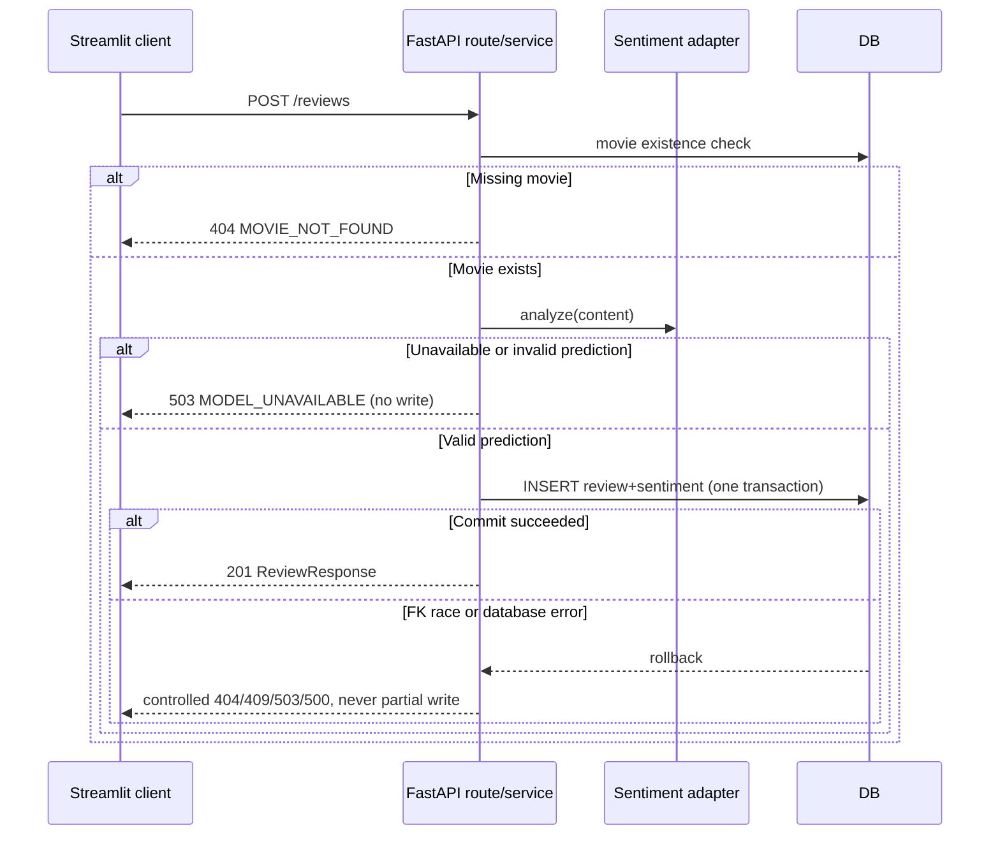

# Mission 18 — API Contract v1.0 (G1)

> Status: **Design locked in G1; all 13 routes implemented and locally verified in G3 (2026-10-10)**. Original contract version 1.0 remains unchanged; see G3 acceptance report.
>
> **Machine-readable single source of truth for endpoint identities, schemas and status codes:** [`../contracts/api_contract.json`](../contracts/api_contract.json). This document explains behavioral invariants; `scripts/check_contracts.py` enforces consistency. Changes require an ADR and contract-version update.

## 1. Scope and compatibility

- Canonical UI: **Streamlit**, HTTP client only. All durable state, transactions and inference belong to **FastAPI**.
- Route prefix: none. Keep course-aligned `/movies`, `/reviews`.
- Local backend `http://127.0.0.1:8000`; Streamlit candidate port `8518`.
- OpenAPI: `/docs`, `/openapi.json`; APIs must include `summary`, Korean `description`, `tags`, `response_model`, documented errors and example bodies.
- JSON input on POST, ISO `YYYY-MM-DD` release date, UTC ISO-8601 datetime with `Z` in responses. IDs are server generated; request body `extra=forbid`.
- Unknown resource is `404`, malformed input `422`, successful create `201`, successful delete `204` **with no body**, empty collection `200 []`.
- Stable ordering: `created_at DESC, id DESC`. Queries never operate on a Streamlit-local DB or persistent session state.
- `X-Request-ID` always in response headers; server-generated if missing or invalid. No raw review content, SQL statements or secret values in error logs.
- Scope excludes PATCH, users/auth, image ingestion, and independently exposing inference API. The admin/write access risk must be resolved before an unrestricted public demonstration.

## 2. Endpoints and contractual side effects

| ID | Method | Path | Request | Success | Error | Side effect |
|---|---|---|---|---|---|---|
| SYS-01 | GET | `/health` | - | `200 HealthResponse` | 500 | none |
| SYS-02 | GET | `/readiness` | - | `200 ReadinessResponse` | 503 | none |
| MOV-01 | POST | `/movies` | MovieCreate | `201 MovieResponse` | 422/503 | insert movie |
| MOV-02 | GET | `/movies` | query/genre/limit/offset | `200 MovieResponse[]` | 422/503 | none |
| MOV-03 | GET | `/movies/{movie_id}` | positive ID | `200 MovieResponse` | 404/422/503 | none |
| MOV-04 | DELETE | `/movies/{movie_id}` | positive ID | `204` empty | 404/422/503 | movie delete + DB cascade reviews |
| REV-01 | POST | `/reviews` | ReviewCreate | `201 ReviewResponse` | 404/422/503 | inference then **atomic** insert review and score |
| REV-02 | GET | `/reviews` | limit/offset | `200 ReviewResponse[]` | 422/503 | none |
| REV-03 | GET | `/reviews/recent` | limit | `200 ReviewResponse[]` | 422/503 | none |
| REV-04 | GET | `/movies/{movie_id}/reviews` | ID/limit/offset | `200 ReviewResponse[]` | 404/422/503 | none |
| REV-05 | GET | `/reviews/{review_id}` | positive ID | `200 ReviewResponse` | 404/422/503 | none |
| REV-06 | DELETE | `/reviews/{review_id}` | positive ID | `204` empty | 404/422/503 | delete review |
| ANA-01 | GET | `/movies/{movie_id}/sentiment-score` | positive ID | `200 MovieSentimentSummary` | 404/422/503 | none |

**No `/api/v1` prefix or `PATCH` routes in this mission.** The operation list above is part of acceptance testing.

## 3. Input/output schemas

### MovieCreate (all required)

| Field | Type/constraints |
|---|---|
| `title` | string, trimmed, 1–200 chars |
| `release_date` | ISO `YYYY-MM-DD` date, valid date, future allowed |
| `director` | string, trimmed, 1–120 |
| `genre` | string, trimmed, 1–80 |
| `poster_url` | http/https URL, at most 2048 chars |

Validate whitespace **after** trimming, including Korean strings. Poster URL is metadata; backend must not fetch arbitrary remote URLs. The frontend should display a safe fallback if poster fails and should avoid proxying untrusted intranet URLs.

### MovieResponse

`id` (positive int), five create fields, `created_at` (UTC), `review_count` (nonnegative int), `average_sentiment_score` (float in [0,1] or null). Aggregates are server-computed with bounded SQL rather than per-movie N+1 calls. No review => count 0, average **null**, never 0.0.

### ReviewCreate (all required)

`movie_id`: positive int and **existing movie**; `author`: trimmed 1–80; `content`: trimmed 1–2000. Any client-supplied `sentiment_label`, `sentiment_score`, `model_revision`, `created_at` or `id` is rejected (422).

### ReviewResponse

`id`, `movie_id`, `author`, `content`, `sentiment_label` (positive|negative), `sentiment_score` ([0,1] and **P(positive)**), `sentiment_confidence` ([0.5,1]), `model_name`, `model_revision`, `inference_latency_ms` (integer >= 0), `inferred_at`, `created_at` (UTC).

### MovieSentimentSummary

`movie_id`, `review_count`, `positive_count`, `negative_count`, `average_sentiment_score`. The counts obey positive+negative=total. Nonexistent movie => 404; existent movie with zero reviews => `0,0,0,null`.

### Health/Readiness

`GET /health`: `{"status":"ok"}` reports process liveness. `GET /readiness` returns `{"status":"ready","database":"ready","model":"ready"}` **only when required DB and configured actual model are ready**; otherwise 503 with safe error code. It is not a public metric endpoint. A fake injected adapter may be used **only in isolated tests**, never disguised as a real model in public deployment.

### Query parameters

- `limit`: 50 default, 1–100 inclusive; `offset`: 0 default, >=0.
- `/reviews/recent`: limit 10 default, 1–10 inclusive.
- `/movies?query=...`: title substring, case-insensitive for ASCII (backend implements SQL LOWER; locale behavior not guaranteed); `genre=...`: exact, case-insensitive by the same convention.
- For absent collections, return `200 []`. `GET /movies/{movie_id}/reviews` first validates parent existence; nonexistent parent returns `404`, not `[]`.
- Specific ID path accepts positive integer; `0`, negative or unparseable => 422.

## 4. Review creation — atomicity and idempotence boundaries



- Perform inference before a write transaction holds SQLite locks. Movie may be deleted between check/inference; FK protects against orphan review, and the service handles the race without a fake success.
- A successful write includes sentiment fields and model provenance **in the same row**. No queued background sentiment task in this mission.
- POST replay after a client timeout can create a duplicate; this is a **known limitation**, to be mitigated in a public deployment with idempotency keys or write controls, not falsely claimed implemented.

## 5. Sentiment score semantics

For calibrated or uncalibrated binary model **softmax** outputs indexed by validated label mapping:

```text
p_pos = softmax(logits)[positive_label_index]
label = "positive" if p_pos >= 0.5 else "negative"
score = p_pos
confidence = max(p_pos, 1 - p_pos)
movie_average = mean(score)  # SQL AVG, null if empty
```

Output is an **AI-estimated positivity index**, **not** an audience star rating, approval probability with guaranteed calibration, or a ground-truth score. Negative high-confidence predictions have **low** positive score. Reject NaN, infinity, malformed logits, unknown class mapping, or incompatible 3-way class outputs (model unavailable). Detailed contract: [SENTIMENT_CONTRACT.md](SENTIMENT_CONTRACT.md).

## 6. Errors and HTTP semantics

Envelope for all application errors (including 422 validation errors):

```json
{"error":{"code":"MOVIE_NOT_FOUND","message":"해당 영화를 찾을 수 없습니다.","request_id":"76bfca91-57d6-4f30-b8f5-6be0c6b2c8a8"}}
```

| Code | HTTP | Trigger |
|---|---:|---|
| `VALIDATION_ERROR` | 422 | body/path/query invalid, missing, too long, bad URL/date |
| `MOVIE_NOT_FOUND` | 404 | specific movie absent, create review for absent movie |
| `REVIEW_NOT_FOUND` | 404 | specific review absent |
| `INVALID_OPERATION` | 400 | semantically invalid operation if implemented |
| `CONCURRENT_MODIFICATION` | 409 | **only** when an actual conflicting race is identified |
| `MODEL_UNAVAILABLE` | 503 | model missing/unknown label mapping/inference failure |
| `DATABASE_UNAVAILABLE` | 503 | DB cannot serve requests |
| `INTERNAL_ERROR` | 500 | unexpected backend defect |
| `RATE_LIMITED` | 429 | only if an actual rate limiter is configured |

Never present a hypothetical 400/409/429 as implemented until tests confirm it. Validation response details may include field path and generalized reason; **never raw input values or secrets**. In OpenAPI, list available errors for each operation and document descriptions/examples.

## 7. Implementation and review acceptance

- FastAPI `response_model` and `responses={...}`, Pydantic v2 `Field(description=..., examples=...)`, `ConfigDict(extra="forbid")`.
- Static route `/reviews/recent` before `/reviews/{review_id}`.
- TestClient tests for each route, 201/204/404/422/503, response shape, consistency of aggregates and stable ordering.
- A contract checker must compare operation IDs, methods, paths and schema invariants with the manifest, then Phase 2 tests inspect the generated `/openapi.json`.
- `/docs` full screenshot evidence belongs to final report, **not** G1; G1 locks the intended descriptions and examples.

## 8. Change control

The JSON manifest is authoritative for machine-readable fields. This Markdown document and the implementation must not silently diverge. An approved change updates manifest, Markdown, test assertions, and the relevant ADR together. If app runtime has not implemented the contract, keep G2 marked **NOT TESTED**.
