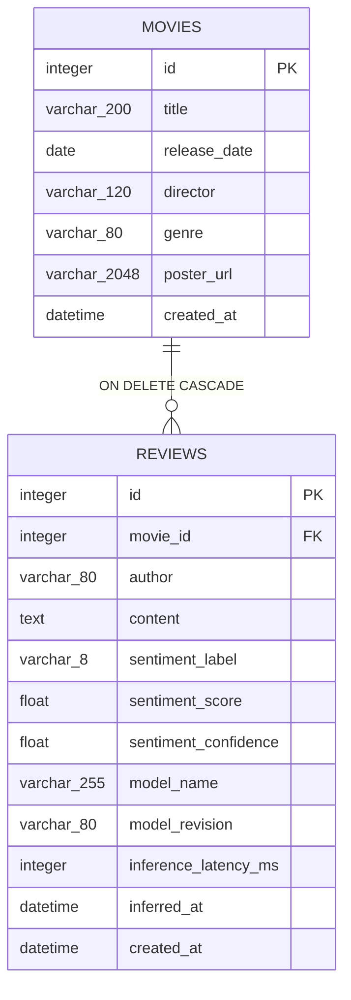

# Mission 18 — Data Design, ERD and Database Invariants v1.0

**Status:** G1 design baseline, not a migrated or tested database. 2026-10-09.

**Persistence is backend-exclusive.** The official submission uses Streamlit as an HTTP client; no SQLite or SQLAlchemy calls in `frontend/`. SQLite for local/grader, persistent PostgreSQL for public demonstration, selected with `DATABASE_URL`. A single pair of SQLAlchemy ORM models and Alembic migrations must support both dialects.

## 1. ERD



## 2. Table DDL conceptual contract

| Table | Column | SQLAlchemy logical type | Constraints | Owner |
|---|---|---|---|---|
| movies | id | Integer | PK, autoincrement | DB |
| movies | title | String(200) | NOT NULL, trimmed 1–200 | client validated |
| movies | release_date | Date | NOT NULL | client validated |
| movies | director | String(120) | NOT NULL, trimmed 1–120 | client validated |
| movies | genre | String(80) | NOT NULL, trimmed 1–80 | client validated |
| movies | poster_url | String(2048) | NOT NULL, http(s), validated before write | client validated |
| movies | created_at | DateTime(timezone=True) | NOT NULL, UTC | server |
| reviews | id | Integer | PK, autoincrement | DB |
| reviews | movie_id | Integer | NOT NULL, FK movies.id ON DELETE CASCADE | client selected |
| reviews | author | String(80) | NOT NULL, trimmed 1–80 | client validated |
| reviews | content | Text | NOT NULL, trimmed 1–2000 | client validated |
| reviews | sentiment_label | String(8) | NOT NULL, positive/negative only | inference adapter |
| reviews | sentiment_score | Float | NOT NULL, finite [0,1], P(positive) | inference adapter |
| reviews | sentiment_confidence | Float | NOT NULL, finite [0.5,1] | inference adapter |
| reviews | model_name | String(255) | NOT NULL, nonempty | inference adapter |
| reviews | model_revision | String(80) | NOT NULL, nonempty / immutable revision or hash | inference adapter |
| reviews | inference_latency_ms | Integer | NOT NULL, >=0 | inference adapter |
| reviews | inferred_at | DateTime(timezone=True) | NOT NULL, UTC | server |
| reviews | created_at | DateTime(timezone=True) | NOT NULL, UTC | server |

*Operational detail:* SQLite may return naive datetimes despite timezone-aware ORM declarations. All service and response serialization paths must normalize to **UTC** and emit `Z` (never assume native SQLite stores timezone metadata). Use a consistent UTC helper across dialects.

## 3. Database constraints

Alembic revision 0001 must create named constraints:

- `fk_reviews_movie_id_movies` with `ON DELETE CASCADE`.
- `ck_reviews_sentiment_label`: `sentiment_label IN ('positive','negative')`.
- `ck_reviews_sentiment_score`: `sentiment_score >= 0 AND sentiment_score <= 1`.
- `ck_reviews_sentiment_confidence`: `sentiment_confidence >= 0.5 AND sentiment_confidence <= 1`.
- `ck_reviews_inference_latency`: `inference_latency_ms >= 0`.
- Optional portable DB length checks for `title`, `director`, `genre`, `author`, `content`, `poster_url` if supported consistently; API must always validate.
- No unique constraint on movie title: real titles can repeat by year/director; uniqueness cannot be inferred from title alone.

**NaN/infinity:** reject at Pydantic/inference boundary using `math.isfinite` before DB. SQL `CHECK` alone is not sufficient to prove floating-point validity across engines.

**Indexes:**

1. `ix_reviews_movie_created_id`: (`movie_id`, `created_at`, `id`) ascending physical index; within a fixed movie_id, backward index scan supports latest-first order.
2. `ix_reviews_created_id`: (`created_at`, `id`) ascending physical index; backward scan supports latest-first order.
3. `movies.id` and `reviews.id` already backed by PK indexes.
4. Add title/genre indexes only if `EXPLAIN` shows value; naive B-tree generally does not accelerate `%substring%` search.

## 4. ORM relationships, cascade and transactions

```python
# design pseudocode, NOT implemented here
movie.reviews = relationship(
    "Review",
    back_populates="movie",
    cascade="all, delete-orphan",
    passive_deletes=True,
)
review.movie_id = mapped_column(
    ForeignKey("movies.id", name="fk_reviews_movie_id_movies", ondelete="CASCADE"),
    nullable=False,
)
```

SQLite must enable `PRAGMA foreign_keys=ON` on **every DB connection** using SQLAlchemy's `connect` event. Assert the pragma with a live DB test, not only a code inspection. A movie deletion must remove all its reviews even if deletion occurs via direct SQL; ORM cascade alone does not establish this.

**Transaction boundary:** request-scoped session; commit once for a successful write; rollback on any failure. Inference happens **before** acquiring a write transaction. Model failure => zero inserted rows; FK race => rollback, no orphan. Avoid global Session instances.

**Movie deletion:** `DELETE /movies/{id}` returns 204 even when it cascades review deletion, but 404 if movie absent. User UI must warn of permanent cascade before allowing deletion.

## 5. Read queries and aggregates

- Movie list response joins a **subquery** aggregating `COUNT(review.id)` and `AVG(review.sentiment_score)` per `movie_id`, using `COALESCE(count, 0)` but not for AVG. Avoid movie-by-movie N+1 SQL.
- Sentiment summary queries `COUNT(*)`, `SUM(CASE WHEN label='positive')`, `SUM(CASE WHEN label='negative')`, `AVG(sentiment_score)`; no reviews => counts `0`, average **NULL**.
- Reviews sorted by `created_at DESC, id DESC`; use matching indexes. Recent 10 is not 10 per movie; it is global latest 10.
- DB is SSOT. Do **not** keep authoritative counts/sentiment aggregates in `st.session_state` or extra mutable local JSON.
- Model versions are stored per review. If users mix versions, aggregate is computed as specified but marked in reports as **mixed revisions**; do not claim model scores are mutually calibrated.

## 6. Migration and lifecycle

1. Use `alembic` SQLAlchemy 2.x revision 0001; no `create_all` in production startup.
2. `DATABASE_URL` points to a writable local SQLite location or PostgreSQL. The default local path must be under an ignored app-data directory; never commit `*.db`, WAL, or production credentials.
3. `alembic upgrade head` on a fresh isolated DB; schema creation succeeds; subsequent upgrade is idempotent.
4. Ensure FK ON in SQLite; deleting parent cascades. Invalid direct `movie_id` raises integrity error.
5. Restart service and confirm movie/review counts and score invariants unchanged.
6. On migration failure, do not continue into an apparently healthy/readied application. Record rollback/runbook procedures and backup strategy before public deployment.
7. PostgreSQL demo must have persistent disk/managed service independent of ephemeral FastAPI web-service local filesystem.

## 7. Verification matrix

| Check | Evidence / assertion | Phase |
|---|---|---|
| Model and expected columns | ORM metadata + Alembic schema comparison | G2/G3 |
| SQLite pragma | `PRAGMA foreign_keys` equals 1 on pooled connections | G2 |
| FK cascade | 1 movie + N reviews → deleting movie removes N rows | G3 |
| Orphan prevention | INSERT review unknown movie_id rejected | G3 |
| Inference exception | No created review and no false 201 | G3 |
| Concurrent delete | no orphaned record or unhandled 500 | G3 |
| Null aggregate | 0 reviews yields null avg and zero counts | G3 |
| Deterministic order | descending created_at,id tie-break | G3 |
| Restart | state and score counts survive new process | G2/G3 |
| PostgreSQL parity | same migration + smoke on separate DB | G7 |

**G1 EXIT:** This schema and its differences from the original learning example are fully specified. No DB or migration exists yet; runtime claims are **NOT TESTED**.
