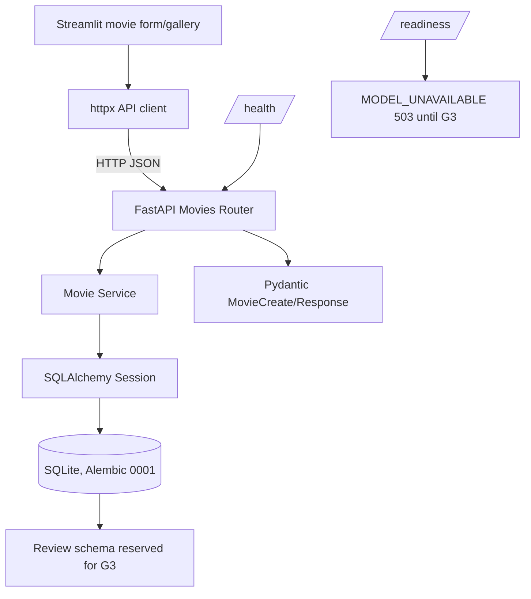

# Mission 18 — Phase 2 / G2 Verified Implementation & Acceptance

- Date: 2026-10-09 (Asia/Seoul)
- Status: **G2 FUNCTIONAL VERIFICATION PASS (LOCAL)**
- Canonical repo: `/Volumes/SSD 4T/z_ai_asset/M18_fastapi_review`
- Scope: initial Movie CRUD vertical slice; reviews/actual inference remain G3

## 1. Implemented architecture



- `backend/app/main.py`: FastAPI composition, liveness/readiness, controlled origins, request ID/error envelope.
- `backend/app/routers/movies.py`: `POST /movies`, `GET /movies`, `GET /movies/{movie_id}`, `DELETE /movies/{movie_id}`.
- `backend/app/schemas.py`: Pydantic v2 validated DTOs and normalized UTC `created_at`.
- `backend/app/services.py`: SQLAlchemy CRUD/aggregates, bounded queries, commit/rollback; no business logic in Streamlit.
- `backend/app/models.py`: `Movie` / `Review` ORM; review table exists for future review support.
- `backend/app/db.py`: one engine, request-scoped session, SQLite FK enforcement at every connection.
- `backend/migrations/versions/0001_movies_reviews.py`: DB creation, NOT NULL/CHECK/FK/CASCADE/indexes.
- `frontend/app.py`: create/list/search/delete Streamlit UI via HTTP only.
- `frontend/api_client.py`: HTTPX client with bounded timeout and safe API error conversion.
- `scripts/smoke_g2.py`: isolated real-path verification; only creates temporary DB/processes and terminates its own child processes.

### Intentional readiness state

`GET /health` returns 200 process liveness. `GET /readiness` checks DB and actual model requirement; G2 has no real model, so returns `503 MODEL_UNAVAILABLE`. This is **correct and intentional**, not a hidden failure.

## 2. Host-verified execution evidence

| Verification | Observed | Verdict |
|---|---|---|
| Python compileall | G2 backend/frontend/tests parsed | PASS |
| Alembic `upgrade head` | on fresh isolated SQLite, creates movies and reviews | PASS |
| Alembic `current` | `0001 (head)` after upgrade | PASS |
| Alembic repeated `upgrade head` | idempotent | PASS |
| Alembic `check` | `No new upgrade operations detected.` | PASS |
| SQLite FK PRAGMA | `foreign_keys=1` (integration test) | PASS |
| FK `ON DELETE CASCADE` | deleting movie removes reviews | PASS |
| API TestClient | 22/22 G2 tests, including parameterized input rejection and fixture review aggregation | PASS |
| Uvicorn real server | /health via actual HTTP | PASS |
| HTTP movie create/detail/list | real server and DB, not mock | PASS |
| HTTP movie delete | 204 empty and following 404 | PASS |
| HTTP OpenAPI Docs | /docs and /openapi.json | PASS |
| Streamlit actual server | GET /_stcore/health | PASS |
| Streamlit AppTest with backend HTTP | persisted movie visible | PASS |
| Streamlit create form AppTest | sends actual HTTP and creates second persisted movie | PASS |
| Restarted Uvicorn | both movies still present on same SQLite DB | PASS |
| Model-unavailable honesty | /readiness 503 MODEL_UNAVAILABLE | PASS |
| Ruff | `ruff check .` and format check on 23 files | PASS |
| GitHub Actions CI | workflow authored; no connected M18 GitHub remote | NOT TESTED |
| Real sentiment inference/reviews API | not implemented at G2 | NOT TESTED |
| Public cloud deployment | no provisioning/deployment at G2 | NOT TESTED |

Notes: installed Starlette emitted an `httpx` TestClient deprecation warning. G2 tests nevertheless passed; monitor dependency compatibility before deployment. Streamlit AppTest produced a `missing ScriptRunContext` warning in bare test harness; no exception affected test assertions.

## 3. Bugs surfaced and corrected before acceptance

1. **SQLite/Alembic revision not persisted:** initial Alembic connection-level `PRAGMA foreign_keys=ON` triggered SQLAlchemy autobegin, and the revision insert did not persist. Moved PRAGMA handling to DBAPI `connect` listener in Alembic; subsequent fresh migration stored revision `0001` and repeat upgrade passed.
2. **String/date serialization mismatch:** SQLAlchemy `Date` column requires Python `date`; `MovieCreate.model_dump(mode="json")` would yield a string. Changed to Python-type dump and explicit HTTP URL `str` conversion; POST integration passes.
3. **Index drift:** ORM DESC expression indexes differed from SQLite's reflected ascending indexes, causing `alembic check` failure. Standardized physical composite indexes to ASC (reverse scan supports descending query ordering), maintained service ordering, and repeated schema check passed. See ADR-0003.
4. **AppTest wrong API environment:** AppTest executes in test interpreter, not child Streamlit server's env. Test now injects isolated live API URL only during AppTest and restores environment afterward.
5. **pytest root import path:** added `pythonpath=["."]` in `pyproject.toml` for uninstalled source package test discovery.

## 4. Final integrated regression result

- `pytest -q`: **29 passed**, 3 additional subtests passed, 1 Starlette deprecation warning (no test failure).
- `ruff check .`: **All checks passed**.
- `ruff format --check backend frontend scripts tests`: **23 files already formatted**.
- `uv lock --check`: **PASS** (62 resolved dependency packages).
- `python scripts/preflight.py`: **12/12 PASS**, no listeners on 8000/8518 at the check snapshot.
- `python scripts/check_contracts.py`: **PASS**.
- Real G2 smoke: **10/10 checkpoints PASS** incl. Streamlit form posting through live HTTP and persistent DB across Uvicorn restart.

## 5. Reproduction commands

```bash
cd "/Volumes/SSD 4T/z_ai_asset/M18_fastapi_review"
uv sync --locked --group dev
.venv/bin/python scripts/check_contracts.py
.venv/bin/pytest -q
.venv/bin/ruff check .
.venv/bin/ruff format --check backend frontend tests scripts
.venv/bin/python scripts/smoke_g2.py
```

Manual movie service (changes only M18-local DB; do not point at existing/user DB):

```bash
# Explicitly create an isolated database (read DB location from .env.example)
mkdir -p .local
DATABASE_URL=sqlite:///./.local/movie.db .venv/bin/alembic upgrade head
DATABASE_URL=sqlite:///./.local/movie.db .venv/bin/uvicorn backend.app.main:app --host 127.0.0.1 --port 8000
# separate terminal
API_BASE_URL=http://127.0.0.1:8000 .venv/bin/streamlit run frontend/app.py --server.port 8518
```

Do not use the public host to run unprotected write endpoints. Local smoke chooses random free localhost ports and disposable ignored M18 test DB to avoid interfering with running M17 services.

## 6. G2 acceptance and next scope

**G2 PASS** means a full real movie vertical slice with persistent local DB, HTTP/Streamlit flow and negative API testing is demonstrated; it does **not** imply finished Mission18 or actual sentiment model readiness.

- G0/G1: PASS (prior gates).
- G2: PASS (local real-path checks).
- G3–G8: NOT TESTED/NOT IMPLEMENTED.

**G3 scope:** ReviewCreate/Response and routes, binary sentiment model selection and immutable weights, startup load-once, review insert with inference atomicity, recent 10 and movie sentiment summary, review/model negative tests, and actual model readiness.
