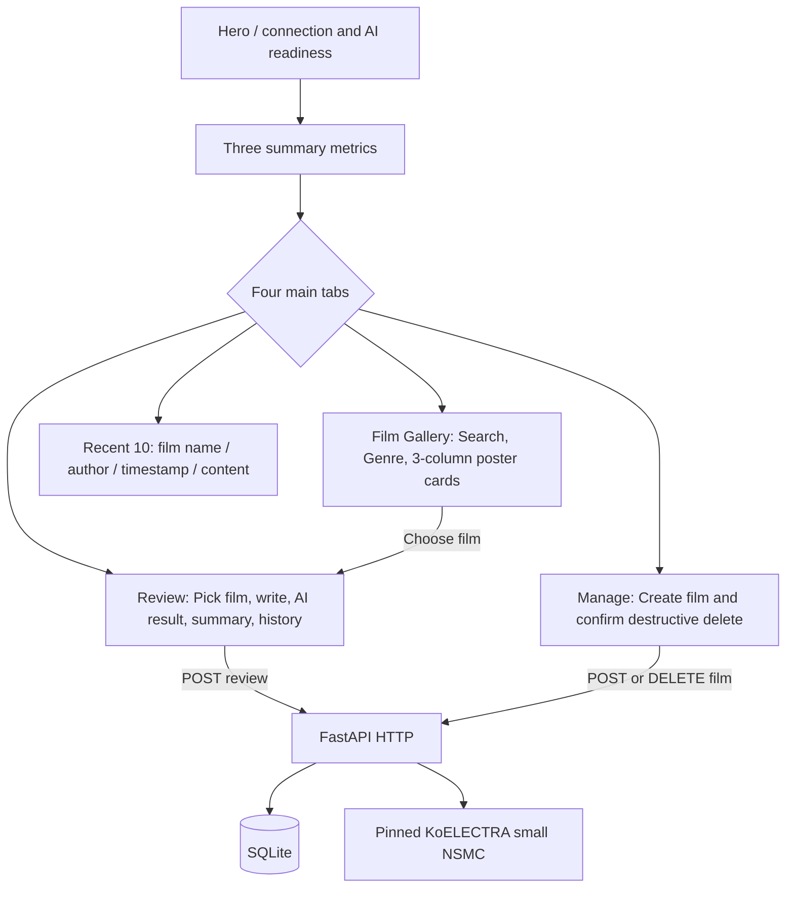

# Mission 18 — G4 Streamlit UX/UI & Visual Evidence Acceptance

- Recorded: 2026-10-10 (Asia/Seoul)
- Verdict: **G4 LOCAL PASS — browser-verified UI, demo dataset and screenshot preparation**
- Scope: Streamlit experience, real HTTP service boundary, deterministic demo seed and desktop/mobile evidence
- Canonical root: `/Volumes/SSD 4T/z_ai_asset/M18_fastapi_review`
- Evidence manifest: `docs/evidence/g4_manifest.json`

## 1. Implemented UX

| G4 requirement | Implementation | Verification |
|---|---|---|
| Gallery / poster treatment | `frontend/app.py`, `frontend/styles.css`, `frontend/ui_helpers.py` | Real Chrome desktop and mobile captures; synthetic placeholder poster art renders without reliance on an external image host |
| Movie register / delete | HTTP-only Streamlit form + confirmation | Prior G2 actual HTTP/AppTest regression PASS; backend validates input and FK deletes |
| Review creation / model analysis | Explicit selected movie, input checks, spinner, success flash, no submission while model unavailable | Prior G3 actual AI HTTP/AppTest + G4 Chrome review tab |
| Per-movie reviews / summary | Review count, positive/negative, model positivity index, stored revision, author and UTC timestamp | Chrome review tab & actual DB summary read |
| Recent 10 | Per-review movie name, author, date, sentiment label, content and model provenance | Chrome recent tab; real backend returns latest 10 |
| Search / genre | Sidebar search/genre filters, no duplicate API writes | Real Chrome title filter 3→1→3 |
| Empty / unavailable API | Actionable empty-result and offline banners, disabled writes when backend unavailable | Offline AppTest and read-only error UI tests |
| Responsive | Streamlit auto sidebar state (prevents mobile overlay), small-screen CSS, compact poster visuals | Chrome headless 1440px and 390px viewports |
| Security boundary | Escape user-supplied text in custom HTML; UI imports no model/ORM/DB libs | Unit tests + AST import inspection |
| Seed demonstration | 3 fictional movies, each 12 distinct synthetic Korean reviews through real model & HTTP API | Idempotent two-run seed, actual SQLite demo DB |

### UX information architecture



**Accuracy of language:** `sentiment_score` is `P(positive)`; do not claim user star rating or calibrated satisfaction. Model confidence is separate. No placeholder/keyword sentiment predictions are used in public app behavior. Poster placeholder is only a UI rendering fallback, not a claim about an authentic movie poster.

## 2. Verified environment

- M18 isolated Python 3.12.14 and optional model extra; no M13/M17 process or file changed.
- Playwright 1.63 installed in **dev** dependencies, using locally installed Chrome in headless browser mode.
- Real model: `daekeun-ml/koelectra-small-v3-nsmc`, immutable revision `d1c0233fc013ae8bd879d7b61f2bec69aa3af4c9`.
- Demo DB (persistent locally, deliberately Git-ignored): `.local/demo/movie_reviews.sqlite3`; `alembic upgrade head` applied. Created first pass 3 movies × 12 reviews; subsequent repeated invocations inserted **zero** records.
- Seed uses `MovieApiClient` exclusively and refuses non-loopback API URLs. It never deletes/truncates/resets data.
- A local real model/backend and Streamlit server were started on random free ports for the capture, then only the script-owned processes were stopped.
- Screenshot verification: actual Chrome browser DOM/text and non-empty pixel checks (not merely generating files).

## 3. Screenshot inventory

| File | Size in pixels | What it demonstrates |
|---|---|---|
| `docs/evidence/g4_gallery_desktop.png` | 1440 × 920 | Responsive desktop hero, healthy AI indicator, 3 movies/review count, cinema gallery |
| `docs/evidence/g4_review_desktop.png` | 1440 × 920 | Film review form, AI positivity meaning, model-backed per-film metrics |
| `docs/evidence/g4_recent_desktop.png` | 1440 × 920 | Recent-review tab with actual seeded authors, timestamps and text |
| `docs/evidence/g4_gallery_mobile.png` | 390 × 844 | Responsive mobile gallery after scrolling to a poster card; sidebar auto-collapses and does not overlay content |

All files are **real screenshots**, not illustrative mockup images. Their cryptographic hashes and sizes are preserved in `docs/evidence/g4_manifest.json`. The screenshots display synthetic fixtures and are suitable as interim UI evidence. **G8 final PDF still requires separate planned screenshots** ensuring the full 13-route FastAPI Docs and a clear 10-reviews-per-movie demonstration across three movies.

## 4. Actual G4 verification (source-of-truth: evidence manifest)

Nine real Chrome/API checks passed:

1. Repeat seed inserts no duplicates
2. Three movies have 12 real-model review records each
3. Actual Streamlit service starts
4. Desktop gallery is visible through Chrome
5. Live search changes gallery 3→1→3
6. Actual review form and per-film summary tab are visible
7. Recent 10 UI shows seeded author entries
8. Mobile browser capture is nonblank with auto-collapsed sidebar
9. Backend readiness remains healthy after browser actions

**G2/G3 regression:** Real G2/G3 smoke scripts and 46 prior pytest tests remained passing after the redesigned UI; additional G4 unit/offline tests were added to the same test suite. See final regression transcript for total count. Prior G3 full smoke demonstrated Streamlit actual HTTP review submission and model-backed persistence; this is not just Chrome static rendering.

## 5. Defects identified and resolved during G4

1. **Mobile obstruction:** initially sidebar was always expanded, covering the 390px film view. Changed to Streamlit `initial_sidebar_state="auto"` and captured a usable mobile screenshot.
2. **Browser search commit:** Streamlit's text input processes the typed query on Enter/blur, not just Playwright `fill`. Browser smoke explicitly commits the query before checking the filtered gallery.
3. **Hidden tab element ambiguity:** Playwright text matches from inactive Streamlit tabs are hidden; browser assertion now scopes to visible author markup. No functional change to storage/API.
4. **Old G2 smoke heading:** existing smoke was tied to the previous page title. Updated it to assert the new real hero text while retaining the same live movie CRUD/HTTP checks.

## 6. Reproduction and safety

```bash
cd "/Volumes/SSD 4T/z_ai_asset/M18_fastapi_review"
uv sync --locked --extra ml --group dev
.venv/bin/python scripts/download_model.py
.venv/bin/pytest -q
.venv/bin/python scripts/smoke_g2.py
.venv/bin/python scripts/smoke_g3.py
.venv/bin/python scripts/prepare_g4_demo.py
```

`prepare_g4_demo.py` preserves and reuses its ignored M18-local demo DB. It may access the network only for already-reviewed application/API URLs at the local browser; model runtime is configured offline. Direct `seed_demo.py` requires an explicit loopback `--api-url` and a running backend/model; it does **not** connect to third-party/public APIs.

Manual demo after script has prepared 3×12 records (each command runs in a separate terminal):

```bash
DATABASE_URL=sqlite:///./.local/demo/movie_reviews.sqlite3 .venv/bin/alembic upgrade head

DATABASE_URL=sqlite:///./.local/demo/movie_reviews.sqlite3 \
MODEL_BACKEND=transformers \
MODEL_ID=daekeun-ml/koelectra-small-v3-nsmc \
MODEL_REVISION=d1c0233fc013ae8bd879d7b61f2bec69aa3af4c9 \
MODEL_PATH=.local/models/koelectra-small-v3-nsmc \
HF_HUB_OFFLINE=1 \
.venv/bin/uvicorn backend.app.main:app --host 127.0.0.1 --port 8000

API_BASE_URL=http://127.0.0.1:8000 \
.venv/bin/streamlit run frontend/app.py --server.port 8518
```

Open UI at `http://127.0.0.1:8518`, API Docs at `http://127.0.0.1:8000/docs`. These are commands for manual use, **not** claims that servers remain running after G4 smoke.

## 7. Remaining boundaries

**G4 PASS does not establish:** 3-movie/10-review-per-movie screenshot layout on one static page, a formal accessibility WCAG audit, cross-browser compatibility, independent sentiment holdout accuracy/F1, security of public writes, cloud deploy or a completed PDF submission. Those remain G5–G8.

**Next work unit: G5 — independent model quality, latency/memory/size benchmark and lightweight/ONNX trial.**


## 8. Final combined regression audit

- `uv.lock` contains **99 resolved packages** after adding Playwright to dev dependencies; `uv lock --check` PASS.
- `pytest -q`: **59 passed, 3 subtests passed, 1 StarletteDeprecationWarning** (no failures). Includes offline `AppTest` recovery guidance and frontend forbidden-import inspection.
- `ruff check .` and `ruff format --check frontend backend scripts tests`: expected PASS at G4 sign-off.
- G2 and G3 actual full-stack smokes PASS after redesigned UI; G4 Chrome smoke **9/9** PASS, with real screenshots and idempotent seed.
- Evidence screenshots prove render/flow at recorded viewports, not a WCAG compliance or pixel-perfect cross-browser audit.
- No GitHub CI remote execution is claimed. M18 remains a local repository until a remote is deliberately created.
