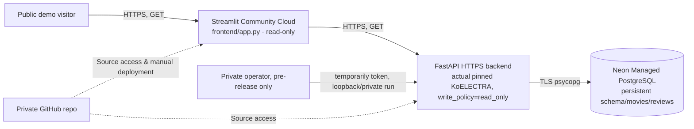

# Mission 18 — G7 배포 사전 검증 및 운영 결정서

**2026-10-11 · 단계: Local G7 PREDEPLOY PASS / Hosted G7 NOT STARTED.**
**External resource creation:** no hosted Postgres, FastAPI service, Streamlit app or paid instance has been provisioned. A private GitHub source repo exists; hosted GitHub Actions remains blocked by account billing (see `G6_GITHUB_ACTIONS_VERIFICATION.md`).

## 1. Architecture and source of truth



- Frontend deployed **from the GitHub private repository** with `frontend/app.py`; `frontend/requirements.txt` takes precedence over the root `uv.lock` because Streamlit resolves entrypoint-local dependencies first. Only Streamlit and httpx direct pins, not torch/SQLAlchemy/PostgreSQL in public frontend.
- Backend real inference uses the **unchanged G3 PyTorch KoELECTRA** with immutable checkpoint revision/weight SHA-256. G5 INT8 is rejected as production candidate.
- Database stores movies, reviews, foreign keys and sentiment results, with migration `alembic upgrade head`; never rely on a hosting service's ephemeral SQLite disk.
- Public site `FRONTEND_READ_ONLY=true`, backend `PUBLIC_DEPLOYMENT=true`, `WRITE_POLICY=read_only`. **Server-to-server secret is not visitor authentication.**

## 2. 실제 실행한 배포 사전 검증 (로컬)

| Verification | Observed result |
|---|---|
| New frontend-only Python 3.12 virtual environment and `frontend/requirements.txt` install | **PASS**, 37 installed packages; torch/transformers/SQLAlchemy/psycopg absent |
| Offline public read-only Streamlit `AppTest` | **PASS**, disabled mutations and explanatory message, no server traceback |
| Dedicated Docker `postgres:16-alpine` on random loopback port | **PASS**, test-only image present locally; no existing container touched |
| Actual PostgreSQL `alembic upgrade head` | **PASS**, table and migration revision verified in system catalog |
| Real pinned model + temporary strong Bearer pre-release seeding | **PASS**, 3 movies × 12 synthetic reviews through actual HTTP, score and recent ten verified |
| Repeated seed | **PASS**, new movies 0, new reviews 0 |
| Stop API, restart on same PostgreSQL with `WRITE_POLICY=read_only` | **PASS**, 3×12 data still present, unauthorized write HTTP 403 |
| Cleanup | **PASS**, solely script-owned Uvicorn processes and uniquely named Docker PostgreSQL fixture stopped and removed |
| Actual Neon/Render/Streamlit live endpoint | **NOT TESTED**, connectors/account/cost approval needed |
| Docker on Linux x86 release-build image | **NOT TESTED**, only PostgreSQL Docker container and Mac-arm64 backend runtime validated |

Evidence: `docs/evidence/g7_frontend_preflight.json` and `docs/evidence/g7_local_postgres_preflight.json`. Actual source script: `scripts/preflight_g7_frontend.py` and `scripts/preflight_g7_postgres.py`.

## 3. October 2026 hosting risk comparison

| Provider | Source-checked capability | Decision |
|---|---|---|
| Streamlit Community Cloud | Supports private GitHub repos with additional GitHub authorization; entrypoint-local requirements; private-repo apps default to private (one private app at a time) | **Preferred frontend.** Public sharing requires explicit visibility change and ownership review |
| Render free web service | 0.1 CPU / 512MB RAM; spins down when idle. G5 PyTorch worker ~494MB peak RSS on Mac, without deployment OS/multiple workers | **High OOM/performance risk; not a verified feasible model host** |
| Render 2GB web tier | 1 CPU / 2GB RAM (`1c-2g`), advertised ~US$25/month at checked pricing date | **Technically safer paid candidate**, but NO service or charge is authorized yet |
| Render free PostgreSQL | Expires after 30 days; no durable storage assumption | **REJECT for persistent grading database** |
| Neon Free PostgreSQL | As of Oct 2 2026, 1GB per project in the published Free plan | **Preferred durable prototype database** subject to account limits, scale-to-zero, secret/TLS management, user connection |
| Hugging Face Docker Space | CPU Basic hardware has no hourly cost, but new Docker/compute Space creation requires PRO/Team or Enterprise | Not a general free fallback |

Official documentation:
- https://docs.streamlit.io/deploy/streamlit-community-cloud/deploy-your-app/app-dependencies
- https://docs.streamlit.io/deploy/streamlit-community-cloud/get-started/connect-your-github-account
- https://docs.streamlit.io/deploy/streamlit-community-cloud/share-your-app
- https://render.com/docs/compute-plans
- https://render.com/pricing
- https://render.com/docs/deploy-fastapi
- https://render.com/changelog/free-postgresql-instances-now-expire-after-30-days-previously-90
- https://neon.com/blog/neon-free-plan-1-gb-per-project
- https://huggingface.co/docs/hub/spaces-overview

**Important:** provider pricing, quotas, eligibility and one-private-app limits are external facts, not guarantees about a particular user's account or an agreement to incur charges.

## 4. Operator instructions — blocked until provider connection/approval

### Step A: Persistent PostgreSQL

Use a dedicated new Neon Free project for M18 (not ChatAgent/other projects). Store the **TLS-enabled** connection string as a provider secret (not Git, docs or chat):

```dotenv
DATABASE_URL=postgresql+psycopg://<user>:<password>@<neon-host>/<database>?sslmode=require
```

Apply the migration from a trusted environment connected to that database, before exposing any demo to anonymous visitors:

```bash
uv run --locked --no-dev --extra ml alembic upgrade head
```

On hosted production, ensure the migration uses a direct suitable Postgres connection; do not assume the transaction-pooler is suitable without tests. Preserve backups, confirm storage limits, and check provider sleep/resume behavior.

### Step B: FastAPI hosting — choose an approved plan

The original `uv.lock` and `pyproject.toml` are the backend dependency contract. A Render Python service (after external account authorization) needs:

```text
Runtime: Python 3.12 (set PYTHON_VERSION exactly to a tested patch)
Build command: uv sync --locked --no-dev --extra ml && uv run --locked --no-dev --extra ml python scripts/download_model.py
Migration command (controlled, once before service exposure): uv run --locked --no-dev --extra ml alembic upgrade head
Start command: uv run --locked --no-dev --extra ml uvicorn backend.app.main:app --host 0.0.0.0 --port $PORT
Health path: /health
Readiness path: /readiness (must return 200 before declaring model+DB ready)
```

Set secret environment values:

```dotenv
PUBLIC_DEPLOYMENT=true
WRITE_POLICY=read_only
DATABASE_URL=<Neon TLS URL, SECRET>
CORS_ALLOW_ORIGINS=https://<final-streamlit-subdomain>.streamlit.app
MODEL_BACKEND=transformers
MODEL_ID=daekeun-ml/koelectra-small-v3-nsmc
MODEL_REVISION=d1c0233fc013ae8bd879d7b61f2bec69aa3af4c9
MODEL_PATH=.local/models/koelectra-small-v3-nsmc
HF_HUB_OFFLINE=1
TOKENIZERS_PARALLELISM=false
```

**Do not paste a fake placeholder host into real settings**; these templates are not deployment-ready URLs. Run a platform-specific dependency/cold start/RSS benchmark before accepting a production memory tier. Private GitHub repo must be explicitly authorized with the hosting provider.

### Step C: First synthetic seed, then public read-only enforcement

A database on the internet must **not** be seeded by temporarily exposing unauthenticated writes. A trusted operator can provision synthetic data with a **private localhost-only API** or an approved one-off administrative task using a temporary strong token, then restart the public backend in read_only mode, exactly as the Docker G7 preflight proves. Do not transmit bearer tokens in browser redirects, public Streamlit secrets, logs, screenshots or Git.

**Submission trade-off:** G8 may require that a grader can create a review on the publicly hosted site. This is **not yet supported securely** by the read-only visitor UI. If live public writes are mandatory, build visitor identity + scoped authorization + anti-abuse isolation, or get approval for an explicitly fenced demo workspace; do **not** make a shared admin token available to anonymous visitors.

### Step D: Streamlit Community Cloud

Use Streamlit dashboard `https://share.streamlit.io`, authorize access to **this private repository** only if that selection is offered by GitHub. Select repository `exobiz7/mission18-movie-review-intelligence`, branch `main`, entrypoint `frontend/app.py`, Python 3.12.

Root-level app secrets (these keys become environment variables in Cloud app):

```toml
API_BASE_URL = "https://<approved-backend-host>"
PUBLIC_DEPLOYMENT = "true"
FRONTEND_READ_ONLY = "true"
```

Once both sides have valid URLs and allowed origins, test real HTTPS `/health`, `/readiness`, `/openapi.json`, read-only gallery, 3 movies with ≥12 reviews each, and recent ten. No public site URL or database has been created at the end of this work unit.

## 5. Owner decisions blocking hosted G7

1. GitHub account billing/settings need attention before Actions can run (not a source failure): `docs/G6_GITHUB_ACTIONS_VERIFICATION.md`.
2. Connect Neon and Render providers if you want their projects and logs administered directly here. Cloud account connection and any paid plan require explicit user action.
3. Decide whether to pay for Render ≥2GB backend or authorize another adequately sized provider. **No paid service is automatically created.**
4. Decide whether the private-repo Streamlit app should become public for grading and whether graders need interactive write access. Until then keep it private/read-only.
