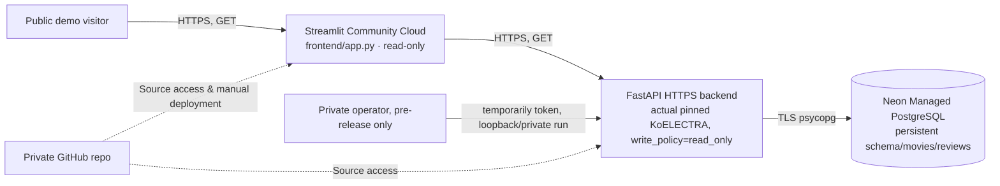

# Mission 18 — G7 배포 사전 검증 및 운영 결정서

**2026-10-13 · G7 HOSTED BACKEND LIVE PASS (Render Free HTTPS + Neon Free READ) / STREAMLIT PUBLIC UI NOT DEPLOYED.**
**Actual cloud resources:** Neon Free PostgreSQL 16 (`mission18`, revision `0001`) + Render **Free** HTTPS backend `https://m18-movie-review-api.onrender.com` are now live. Actual `/health`, `/readiness`, movie/review reads return 200; no application data inserted. Public anonymous writes return 403. Streamlit public UI remains undeployed. No paid instances were created; hosted GitHub Actions remains blocked by billing. Evidence: `docs/evidence/g7_render_neon_live_api.json`.

## 1. Architecture and source of truth



- Frontend deployed **from the GitHub private repository** with `frontend/app.py`; `frontend/requirements.txt` takes precedence over the root `uv.lock` because Streamlit resolves entrypoint-local dependencies first. Only Streamlit and httpx direct pins, not torch/SQLAlchemy/PostgreSQL in public frontend.
- Backend real inference uses the **unchanged G3 PyTorch KoELECTRA** with immutable checkpoint revision/weight SHA-256. G5 INT8 is rejected as production candidate.
- Database stores movies, reviews, foreign keys and sentiment results, with migration `alembic upgrade head`; never rely on a hosting service's ephemeral SQLite disk.
- Public site `FRONTEND_READ_ONLY=true`, backend `PUBLIC_DEPLOYMENT=true`, `WRITE_POLICY=read_only`. **Server-to-server secret is not visitor authentication.**

## 2. 실제 실행한 배포 사전 검증 (로컬)

| Verification | Observed result |
|---|---|
| New frontend-only Python 3.12 virtual environment and `frontend/requirements.txt` install | **PASS**, 37 installed packages; torch/transformers/SQLAlchemy/psycopg absent |
| Offline public read-only Streamlit `AppTest` | **PASS**, disabled mutations and explanatory message, no server traceback |
| Dedicated Docker `postgres:16-alpine` on random loopback port | **PASS**, test-only image present locally; no existing container touched |
| Actual PostgreSQL `alembic upgrade head` | **PASS**, table and migration revision verified in system catalog |
| Real pinned model + temporary strong Bearer pre-release seeding | **PASS**, 3 movies × 12 synthetic reviews through actual HTTP, score and recent ten verified |
| Repeated seed | **PASS**, new movies 0, new reviews 0 |
| Stop API, restart on same PostgreSQL with `WRITE_POLICY=read_only` | **PASS**, 3×12 data still present, unauthorized write HTTP 403 |
| Cleanup | **PASS**, solely script-owned Uvicorn processes and uniquely named Docker PostgreSQL fixture stopped and removed |
| **Neon Free actual hosted PostgreSQL schema** | **PASS (2026-10-12)**: project/db/branch checked via Neon connector, canonical Alembic-generated PostgreSQL `0001` DDL applied atomically, verified tables/indexes/FK/check constraints and zero application rows |\n| Actual Render FastAPI / Streamlit HTTPS endpoints | **NOT DEPLOYED / NOT TESTED**: accounts connected but no services created |
| Docker on Linux x86 release-build image | **NOT TESTED**, only PostgreSQL Docker container and Mac-arm64 backend runtime validated |

Evidence: `docs/evidence/g7_frontend_preflight.json` and `docs/evidence/g7_local_postgres_preflight.json`. Actual source script: `scripts/preflight_g7_frontend.py` and `scripts/preflight_g7_postgres.py`.

## 3. October 2026 hosting risk comparison

| Provider | Source-checked capability | Decision |
|---|---|---|
| Streamlit Community Cloud | Supports private GitHub repos with additional GitHub authorization; entrypoint-local requirements; private-repo apps default to private (one private app at a time) | **Preferred frontend.** Public sharing requires explicit visibility change and ownership review |
| Render Free web service | 0.1 CPU / 512MiB. G3 PyTorch worker ~494MB peak RSS; optional G7 ONNX FP32 self-contained Linux amd64 emulated candidate **210.6MiB** with real HTTP under 512MiB/0.1 CPU | **Free-first candidate technically verified in Linux emulator; actual Render cloud NOT YET TESTED** |
| Render 2GB web tier | 1 CPU / 2GB RAM (`1c-2g`), advertised ~US$25/month at checked pricing date | **Technically safer paid candidate**, but NO service or charge is authorized yet |
| Render free PostgreSQL | Expires after 30 days; no durable storage assumption | **REJECT for persistent grading database** |
| Neon Free PostgreSQL | As of Oct 2 2026, 1GB per project in the published Free plan | **Preferred durable prototype database** subject to account limits, scale-to-zero, secret/TLS management, user connection |
| Hugging Face Docker Space | CPU Basic hardware has no hourly cost, but new Docker/compute Space creation requires PRO/Team or Enterprise | Not a general free fallback |

Official documentation:
- https://docs.streamlit.io/deploy/streamlit-community-cloud/deploy-your-app/app-dependencies
- https://docs.streamlit.io/deploy/streamlit-community-cloud/get-started/connect-your-github-account
- https://docs.streamlit.io/deploy/streamlit-community-cloud/share-your-app
- https://render.com/docs/compute-plans
- https://render.com/pricing
- https://render.com/docs/deploy-fastapi
- https://render.com/changelog/free-postgresql-instances-now-expire-after-30-days-previously-90
- https://neon.com/blog/neon-free-plan-1-gb-per-project
- https://huggingface.co/docs/hub/spaces-overview

**Important:** provider pricing, quotas, eligibility and one-private-app limits are external facts, not guarantees about a particular user's account or an agreement to incur charges.

## 4. Operator instructions — blocked until provider connection/approval

### Step A: Persistent PostgreSQL

**DONE: dedicated Neon Free `mission18-movie-review` project, database `mission18`, branch `production` (`dry-leaf-54440653`).** Apply no further schema initialization: Alembic revision `0001` is already recorded. The SQL was generated by the unchanged local Alembic migration in offline PostgreSQL mode and executed using Neon's single SQL transaction API (not the direct Alembic CLI against Neon). Read-back confirmed all three tables, two secondary review indexes, one CASCADE FK and four review CHECK constraints; all application tables remain empty. Evidence: `docs/evidence/g7_neon_schema_verification.json`. Store the **TLS-enabled** connection string as a provider secret (not Git, docs or chat):

```dotenv
DATABASE_URL=postgresql+psycopg://<user>:<password>@<neon-host>/<database>?sslmode=require
```

For *future schema revisions only*, apply new migrations from a trusted environment connected to the database before exposing a demo. **Do not reset or reinitialize the current schema**, which already records `0001`:

```bash
uv run --locked --no-dev --extra ml alembic upgrade head
```

On hosted production, ensure the migration uses a direct suitable Postgres connection; do not assume the transaction-pooler is suitable without tests. Preserve backups, confirm storage limits, and check provider sleep/resume behavior.

### Step B: FastAPI hosting — choose an approved plan

The original `uv.lock` and `pyproject.toml` remain the canonical **PyTorch** backend dependency contract. For **free-tier** provisioning, the independently tested optional `onnx_fp32` runtime uses **`Dockerfile.g7-onnx`** (two-stage CPU-only export + minimal runtime). This avoids the original PyTorch ~494MB process RSS; does not accept G5's rejected INT8. If the full PyTorch model is used instead, a larger paid memory plan may be necessary. An old PyTorch service template is retained below for reference only:

```text
Runtime: Python 3.12 (set PYTHON_VERSION exactly to a tested patch)
Build command: uv sync --locked --no-dev --extra ml && uv run --locked --no-dev --extra ml python scripts/download_model.py
Migration command (controlled, once before service exposure): uv run --locked --no-dev --extra ml alembic upgrade head
Start command: uv run --locked --no-dev --extra ml uvicorn backend.app.main:app --host 0.0.0.0 --port $PORT
Health path: /health
Readiness path: /readiness (must return 200 before declaring model+DB ready)
```

Set secret environment values:

```dotenv
PUBLIC_DEPLOYMENT=true
WRITE_POLICY=read_only
DATABASE_URL=<Neon TLS URL, SECRET>
CORS_ALLOW_ORIGINS=https://<final-streamlit-subdomain>.streamlit.app
MODEL_BACKEND=transformers
MODEL_ID=daekeun-ml/koelectra-small-v3-nsmc
MODEL_REVISION=d1c0233fc013ae8bd879d7b61f2bec69aa3af4c9
MODEL_PATH=.local/models/koelectra-small-v3-nsmc
HF_HUB_OFFLINE=1
TOKENIZERS_PARALLELISM=false
```

**Free-tier Docker candidate tested:** `Dockerfile.g7-onnx`, `requirements-g7-onnx-runtime.txt`, `scripts/export_g7_fp32.py` and `scripts/probe_g7_selfcontained.py`. The actual self-contained Linux amd64 candidate generated the G5-approved ONNX SHA-256 and recorded 210.6MiB under 512MiB / 0.1 CPU, with real FastAPI review inference. Proof: `docs/evidence/g7_render_free_container_candidate.json`. A Mac/Linux emulator run **is not** Render public-hosted memory/cold-start/HTTPS verification. This is a no-fee deployment candidate, not license to silently upgrade plans.\n\n**Neon database security:** a `mission18_public_reader` role was created directly via explicit SQL with NOLOGIN/no superuser/CREATEDB/CREATEROLE, and was verified to have SELECT on the M18 movies/reviews but no INSERT/DELETE. It is deliberately **NOLOGIN** until a Render Free service is ready for secure secret injection. Neon's convenience role creation gave admin privileges; the temporary privileged role was deleted (verified). Do not use the Neon project owner's admin credential as the public app's DATABASE_URL. Evidence: `docs/evidence/g7_neon_reader_security.json`.\n\n**Do not paste a fake placeholder host into real settings**; these templates are not deployment-ready URLs. Private GitHub repo must be explicitly authorized with the hosting provider. Render `plan=free`, `region=singapore`, Dockerfile `Dockerfile.g7-onnx`, `autoDeploy=no` are the intended configuration. No hosted service has been deployed as of this proof.

### Step C: First synthetic seed, then public read-only enforcement

A database on the internet must **not** be seeded by temporarily exposing unauthenticated writes. A trusted operator can provision synthetic data with a **private localhost-only API** or an approved one-off administrative task using a temporary strong token, then restart the public backend in read_only mode, exactly as the Docker G7 preflight proves. Do not transmit bearer tokens in browser redirects, public Streamlit secrets, logs, screenshots or Git.

**Submission trade-off:** G8 may require that a grader can create a review on the publicly hosted site. This is **not yet supported securely** by the read-only visitor UI. If live public writes are mandatory, build visitor identity + scoped authorization + anti-abuse isolation, or get approval for an explicitly fenced demo workspace; do **not** make a shared admin token available to anonymous visitors.

### Step D: Streamlit Community Cloud

Use Streamlit dashboard `https://share.streamlit.io`, authorize access to **this private repository** only if that selection is offered by GitHub. Select repository `exobiz7/mission18-movie-review-intelligence`, branch `main`, entrypoint `frontend/app.py`, Python 3.12.

Root-level app secrets (these keys become environment variables in Cloud app):

```toml
API_BASE_URL = "https://<approved-backend-host>"
PUBLIC_DEPLOYMENT = "true"
FRONTEND_READ_ONLY = "true"
```

Once both sides have valid URLs and allowed origins, test real HTTPS `/health`, `/readiness`, `/openapi.json`, read-only gallery, 3 movies with ≥12 reviews each, and recent ten. No public site URL or database has been created at the end of this work unit.

## 5. Owner decisions blocking hosted G7

1. GitHub account billing/settings need attention before Actions can run (not a source failure): `docs/G6_GITHUB_ACTIONS_VERIFICATION.md`.
2. Neon and Render connectors are already linked; **Neon Free project and M18 schema are verified**. Render service provisioning/plan choice and any paid plan require explicit user authorization; no new Render service was created.
3. Decide whether to pay for Render ≥2GB backend or authorize another adequately sized provider. **No paid service is automatically created.**
4. Decide whether the private-repo Streamlit app should become public for grading and whether graders need interactive write access. Until then keep it private/read-only.


## 8. Actual Render Free → Neon Free hosted backend LIVE verification (2026-10-13)

- Render service `srv-db6ca72d0e5s73a73sng`, Docker `Dockerfile.g7-onnx`, Singapore, **Free**, manual deploy, Git SHA `de336ab19d8c633459dc8918ddb54c698dc80266`, deploy `dep-db6o1eff3r2c73br264g`, status `live`. The redeploy after the user corrected `DATABASE_URL` to the direct Neon host succeeded in **35.5 seconds**; prior failures are retained as history, not silently overwritten.
- **Actual HTTPS (from Mac Studio, not a mock):** `/health` 200 `{"status":"ok"}`; `/readiness` 200 `{"status":"ready","database":"ready","model":"ready"}`; `/movies`, `/reviews`, `/reviews/recent` all 200 with empty lists; OpenAPI 200 with 9 paths. `/` intentionally returns FastAPI 404 because it is an API service, not the Streamlit web page.
- **Actual read-only safety:** DELETE nonexistent movie/review IDs returns HTTP 403 `WRITE_DISABLED` without any row changes. Unknown Origin CORS preflight returns 400/no allow-origin, configured frontend Origin returns 200. No POST that could write data was issued.
- **Direct Neon DB audit:** `alembic_version=0001`, movies 0, reviews 0; `mission18_public_reader` login and table SELECT allowed, admin membership/superuser/CREATEDB/CREATEROLE and movie/review INSERT denied. Render Live log interval contains **zero `M18_READINESS_DB_FAILED`** warnings.
- **Exactly what is verified:** managed Render Free app boot + hosted readiness model flag + live SQL database read + public API security/CORS. **Not verified:** cloud review inference through an actual persisted POST (intentionally public read-only), Streamlit public frontend/browser E2E, long-term idle cold-start and hosted GitHub Actions.
- Evidence is recorded without credentials in `docs/evidence/g7_render_neon_live_api.json`. **Next independent G7 gate:** provision Streamlit Community Cloud frontend in READ_ONLY mode, secure only the public `API_BASE_URL` (never Neon DSN), and run browser E2E and cold-start checks before full G7 PASS.

## 9. 2026-10-13 — Streamlit Cloud frontend predeploy acceptance

**LOCAL-TO-LIVE-API PASS, STREAMLIT CLOUD NOT DEPLOYED.**

- Executed `scripts/smoke_g7_streamlit_live.py` (real `streamlit.testing.v1.AppTest` against actual `https://m18-movie-review-api.onrender.com`). The UI displays backend + AI readiness, public read-only notice, accurate zero-movie content, and disabled movie registration. No real rows mutated; no secrets used. Evidence: `docs/evidence/g7_streamlit_hosted_api_preflight.json`.
- `frontend/app.py` public read-only empty-state wording now avoids inviting visitors to an unusable registration form. Existing local CRUD and private development mode remain functional.
- Verified Streamlit Community Cloud official prerequisites: GitHub OAuth private repo permission, branch `main`, entrypoint `frontend/app.py`, Python 3.12, entrypoint-local requirements; add root-level Secrets TOML with public `API_BASE_URL`, `FRONTEND_READ_ONLY=true`, `PUBLIC_DEPLOYMENT=true`, no DB URL or write token. Desired URL `https://m18-movie-review.streamlit.app` is not yet allocated. Private source repo remains private; Streamlit app sharing setting requires independent owner authorization.
- **No connected Streamlit Community Cloud administrative tool is available; user must perform the one-time GitHub authorization and Create app action in Streamlit UI.** Exact user screen guide and security gate: `docs/G7_STREAMLIT_COMMUNITY_CLOUD_DEPLOY.md`.
- Hosted browser E2E, Streamlit URL and sharing state, and idle/cold-start long-run acceptance remain OPEN. Render/Neon hosted-backend PASS is unaffected.
